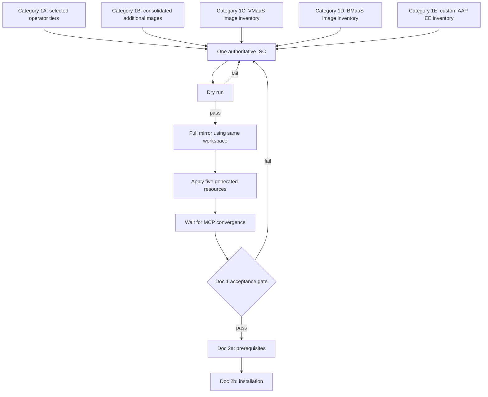

# Disconnected Mirroring Documentation

Category-specific guides for mirroring OSAC images and dependencies into a disconnected (air-gapped) mirror registry.

## Overview

OSAC disconnected installation requires mirroring container images from
multiple upstream registries into a local mirror registry.  All mirroring
uses **`oc-mirror` v2** with an `ImageSetConfiguration` that defines
operators (via catalog mirroring) and additional images (via the
`additionalImages` section).

The current document ends after the mirror registry is populated, all generated
cluster resources are applied, and the handoff checks pass.
Operator and OSAC installation begin in separate documents.

Each category page contains image discovery, inventory
composition, mirror execution, generated mirror-resource application,
and handoff evidence. It must not install operators or operands, mutate
runtime custom resources, create service instances, or post-install acceptance checklist.

## Three-Phase Architecture

Disconnected OSAC installation is a three-stage process: (1) mirror all
required images and catalogs into your private registry (this guide),
(2) install prerequisites and configure the underlying OpenShift cluster
(see [prereqs.md](prereqs.md)), then (3) install OSAC via Helm using the
mirrored content (see [installation.md](installation.md)).

OSAC installation follows a strict three-phase deployment order:

| Phase | Helm Chart | Purpose | Mirroring Categories |
| ----- | ---------- | ------- | -------------------- |
| **Phase 1a** | Unsupported | Install OLM operators, register CRDs | [Category 1A](mirroring-operators.md) |
| **Phase 1b** | Unsupported | Create CRD instances, deploy shared services | [Category 1B](mirroring-core-components.md) |
| **Phase 2** | `osac` | Deploy the OSAC platform | [Category 1B](mirroring-core-components.md) |

Service-specific categories extend the base mirroring:

| Category | Service | Guide |
| -------- | ------- | ----- |
| **1C** | VMaaS (Virtual Machine as a Service) | [mirroring-vmaas.md](mirroring-vmaas.md) |
| **1D** | BMaaS (Bare Metal as a Service) | [mirroring-bmaas.md](mirroring-bmaas.md) |

The files in this directory are read in this order:

1. `README.md` and the five `mirroring-*.md` pages compose and execute
   the mirroring workflow.
2. [`prereqs.md`](prereqs.md) validates cluster access to mirrored
   content and prepares production prerequisites and customer values.
3. [`installation.md`](installation.md) performs state-changing operator,
   operand, and OSAC installation.

This guide covers mirroring only; installation begins in separate documents.

## Category Guides

The category pages contribute inventory to one authoritative
`imageset-config.yaml`; they do not define independent mirror runs.
Use the same ISC and `oc mirror` workspace for the dry run, full mirror,
and incremental updates.

- Category 1A contributes three always-required core operator packages,
  three VMaaS packages when VMaaS is selected, and MCE when BMaaS is
  selected.
- Category 1B owns the single consolidated `additionalImages` list,
  including both required Envoy references and both required AAP
  references. BMF is included only for BMaaS.
- Categories 1C-1E identify VMaaS, BMaaS, and custom AAP images to append
  before the dry run.

Do not create a separate ISC or workspace for a category. Run the
canonical mirror commands once after the selected inventory is complete.

### [Category 1A: Mirroring OLM Operators](mirroring-operators.md)

Mirror OLM-managed operators for the selected OSAC profile
(3 core always; add 3 VMaaS when selected; add `multicluster-engine` for BMaaS):

1. `openshift-cert-manager-operator` — TLS certificate lifecycle
2. `ansible-automation-platform-operator` — AAP controller/hub
3. `amq-streams` — Kafka messaging
4. `kubevirt-hyperconverged` — VM workloads *(VMaaS)*
5. `lvms-operator` — Local volume provisioning *(VMaaS)*
6. `metallb-operator` — Bare-metal load balancing *(VMaaS)*
7. `multicluster-engine` — Cluster lifecycle *(BMaaS only)*

### [Category 1B: Mirroring Core Components](mirroring-core-components.md)

Mirror OSAC dependency and core component images:

- **Dependencies** (6 images): OpenBao, trust-manager,
  trust-pkg-debian-bookworm, Keycloak, origin-cli, PostgreSQL
- **Core components** (6 images): osac-operator, fulfillment-service,
  envoy, osac-aap, osac-ui, bare-metal-fulfillment-operator
- **Conditional metering** (2 images): metering-service, m360-adapter
- **Conditional CSI** (4 images): osac-csi-driver + 3 CSI sidecars
- Bastion laptop workflow for Helm chart deployment
- Disconnected Helm value: `cliImage`; CatalogSource naming
  requirement (all Subscriptions hard-code `redhat-operators`)

### [Category 1C: Mirroring VMaaS Images](mirroring-vmaas.md)

Mirror VM disk images (containerdisks) for VMaaS:

- Containerdisk `additionalImages` entries
- ITMS configuration for tag-based image resolution
- Each mirror-registry repository storing a VM containerdisk must allow anonymous CDI pulls; CDI receives no registry credentials for these imports (this does not apply to the upstream registry or unrelated repositories)

### [Category 1D: Mirroring BMaaS Images](mirroring-bmaas.md)

TODO: Placeholder section for BMaaS / Metal3 OCI images

### [Category 1E: Mirroring AAP Images](mirroring-aap.md)

Mirror AAP controller/hub images:

- Operator-managed Redis and PostgreSQL (via `RELATED_IMAGE_*` env vars,
  not Helm values)
- Execution environment image mirroring

## Dependency Flowchart

## Key Principles

1. **One authoritative ISC and workspace lineage** — All images
   are mirrored via a single unified `ImageSetConfiguration`
   using `oc-mirror` v2.  Category pages contribute entries to
   the ISC and link back to the canonical execution block; they
   never duplicate the mirror command or maintain a separate ISC.

2. **No `global.imageRegistry`** — OSAC does not expose a global image
   registry override.  Disconnected image resolution relies on IDMS
   (ImageDigestMirrorSet) and ITMS (ImageTagMirrorSet) at the
   kubelet/CRI-O level.

3. All operator Subscriptions reference
   `source: redhat-operators`.  The mirrored CatalogSource must
   be named `redhat-operators` in `openshift-marketplace` so that
   Subscriptions resolve correctly.  See
   [mirroring-operators.md § CatalogSource naming requirement](mirroring-operators.md#catalogsource-naming-requirement).

4. **Bastion laptop for OCI Helm charts** — `oc-mirror` v2 supports
   `mirror.helm` for local or repository-index charts, but cannot
   pull OCI-format charts from a registry (RFE-8713) or pass Helm
   values (RFE-8748).  Use an internet-connected workstation to pull
   OSAC's OCI charts from `ghcr.io` and deploy via SSH tunnel.

5. **Three-tier operator model** — Three core operators are always
   required. Add three VMaaS operators when
   `global.services.vmaas.enabled: true`. Add `multicluster-engine`
   only when `global.services.bmaas.enabled: true`.

## Quick Reference

| What to mirror | How | Guide |
| -------------- | --- | ----- |
| OLM operator catalogs | `operators` section in ISC | [Category 1A](mirroring-operators.md) |
| Dependency images (OpenBao, Keycloak, etc.) | `additionalImages` in ISC | [Category 1B](mirroring-core-components.md) |
| OSAC core images | `additionalImages` in ISC | [Category 1B](mirroring-core-components.md) |
| Metering images (conditional) | `additionalImages` in ISC | [Category 1B](mirroring-core-components.md) |
| CSI driver images (conditional) | `additionalImages` in ISC | [Category 1B](mirroring-core-components.md) |
| VM containerdisks | `additionalImages` in ISC | [Category 1C](mirroring-vmaas.md) |
| Metal3 agent images | MCE operator catalog + `additionalImages` | [Category 1D](mirroring-bmaas.md) |
| AAP controller/hub images | AAP operator catalog (via RELATED_IMAGE) | [Category 1E](mirroring-aap.md) |
| Helm charts | Bastion laptop (NOT oc-mirror) | [Category 1B](mirroring-core-components.md) |

## Doc 1 Acceptance Gate

Complete this checklist before linking to Doc 2.  **Any failure
returns ownership to the mirror operator; Doc 2 must not begin.**

- [ ] All three core package manifests are visible
- [ ] If VMaaS is selected, all three VMaaS package manifests are visible
- [ ] If BMaaS is selected, the MCE package manifest is visible
- [ ] Representative image pulls succeed with read-only mirror credentials
- [ ] ISC and workspace metadata are archived for incremental updates

Only after every check passes, continue to
[Disconnected Prerequisites and Configuration](prereqs.md).

See
[mirroring-operators.md § Handoff Verification](mirroring-operators.md#handoff-verification-doc-1-gate)
for the verification commands.
