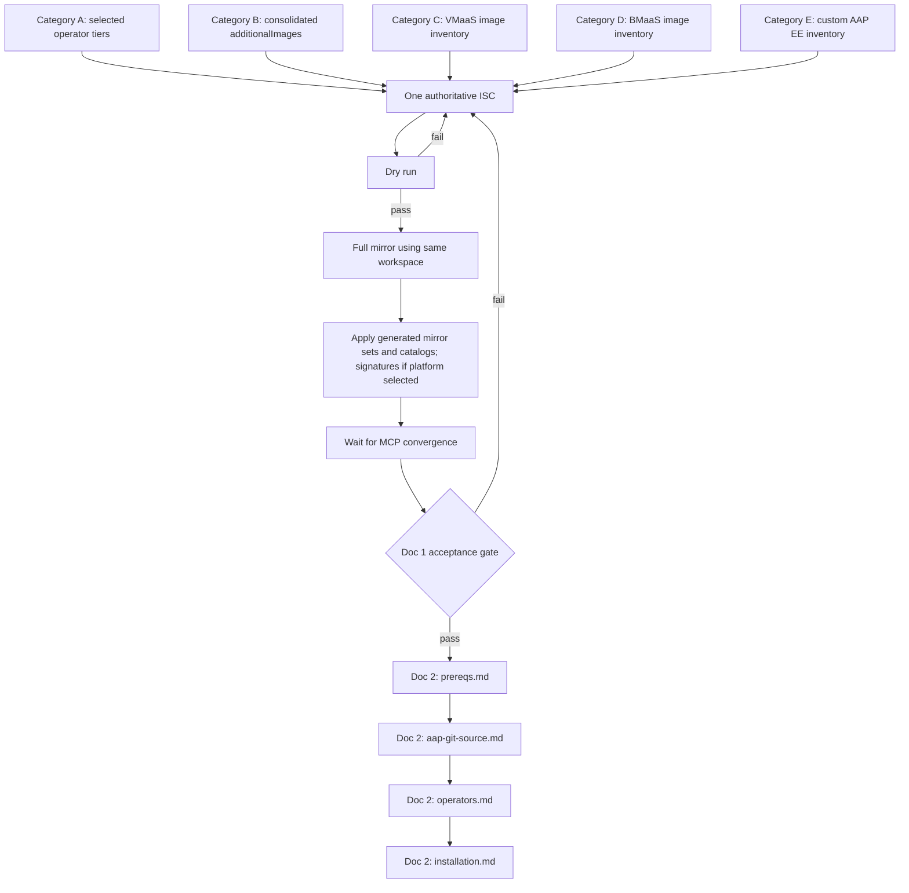

# Disconnected Mirroring Documentation

- [Disconnected Mirroring Documentation](#disconnected-mirroring-documentation)
  - [Three-Phase Architecture](#three-phase-architecture)
  - [Category Guides](#category-guides)
    - [Category A: Mirroring OLM Operators](#category-a-mirroring-olm-operators)
    - [Category B: Mirroring Core Components](#category-b-mirroring-core-components)
    - [Category C: Mirroring VMaaS Images](#category-c-mirroring-vmaas-images)
    - [Category D: Mirroring BMaaS Images](#category-d-mirroring-bmaas-images)
    - [Category E: Mirroring AAP Images](#category-e-mirroring-aap-images)
  - [Dependency Flowchart](#dependency-flowchart)
  - [Key Principles](#key-principles)
  - [Quick Reference](#quick-reference)
  - [Doc 1 Acceptance Gate](#doc-1-acceptance-gate)
    - [Live Core image mirror rules](#live-core-image-mirror-rules)

Category-specific guides for mirroring OSAC images and dependencies into a disconnected (air-gapped) mirror registry.

> **Baseline**: this guide targets OSAC v0.0.62 on OpenShift Container
> Platform 4.22.

OSAC disconnected installation requires mirroring container images from
multiple upstream registries into a local mirror registry.  All mirroring
uses **`oc-mirror` v2** with an `ImageSetConfiguration` that defines
operators (via catalog mirroring) and additional images (via the
`additionalImages` section).

The current document ends after the mirror registry is populated, all generated
cluster resources are applied, and the handoff checks pass.
Operator and OSAC installation begin in separate documents.

Each category page contains image discovery, inventory
composition, mirror execution, generated mirror-resource application,
and handoff evidence. It must not install operators or operands, mutate
runtime custom resources, create service instances, or run a post-install acceptance checklist.

## Three-Phase Architecture

Disconnected OSAC installation is a three-stage process: (1) mirror all
required images and catalogs into your private registry (this guide),
(2) install prerequisites and configure the underlying OpenShift cluster
(see [prereqs.md](prereqs.md)), then (3) install OSAC via Helm using the
mirrored content (see [installation.md](installation.md)).

OSAC installation follows a strict three-phase deployment order:

| Phase | Helm Chart | Purpose | Mirroring Categories |
| ----- | ---------- | ------- | -------------------- |
| **Phase 1a** | Unsupported | Install OLM operators, register CRDs | [Category A](mirroring-operators.md) |
| **Phase 1b** | Unsupported | Create CRD instances, deploy shared services | [Category B](mirroring-core-components.md) |
| **Phase 2** | `osac` | Deploy the OSAC platform | [Category B](mirroring-core-components.md) |

Service-specific categories extend the base mirroring:

| Category | Service | Guide |
| -------- | ------- | ----- |
| **C** | VMaaS (Virtual Machine as a Service) | [mirroring-vmaas.md](mirroring-vmaas.md) |
| **D** | BMaaS (Bare Metal as a Service) | [mirroring-bmaas.md](mirroring-bmaas.md) |
| **E** | AAP | [mirroring-aap.md](mirroring-aap.md) |
| **F** | CaaS | TBF |

The files in this directory are read in this order:

1. `README.md` and the five `mirroring-*.md` pages compose and execute
   the mirroring workflow.
2. [`prereqs.md`](prereqs.md) validates cluster access to mirrored
   content and prepares production prerequisites and customer values.
3. [`aap-git-source.md`](aap-git-source.md) prepares the internal AAP Git
   source handoff.
4. [`operators.md`](operators.md) prepares selected operators and shared
   infrastructure.
5. [`installation.md`](installation.md) installs the OSAC Helm release
   and owns post-install acceptance.

This guide covers mirroring only; installation begins in separate documents. Category A Step 2c may call only the [shared pre-handoff node transport checkpoint](prereqs.md#pre-handoff-node-transport-checkpoint) after full mirror population and owner-prepared node access, before applying catalogs. This limited diagnostic call is not entry into the remaining prerequisite/operator/OSAC installation sequence.

## Category Guides

The category pages contribute inventory to one authoritative
`imageset-config.yaml`; they do not define independent mirror runs.
Use the same ISC and `oc mirror` workspace for the dry run, full mirror,
and incremental updates.

- Category A contributes three always-required core operator packages,
  three VMaaS packages when VMaaS is selected, and MCE when BMaaS is
  selected.
- Category B owns the single consolidated `additionalImages` list,
  including both required Envoy references and both required AAP
  references. BMF is included only for BMaaS.
- Categories C-E identify VMaaS, BMaaS, and custom AAP images to append
  before the dry run.

Do not create a separate ISC or workspace for a category. Run the
canonical mirror commands once after the selected inventory is complete.

### [Category A: Mirroring OLM Operators](mirroring-operators.md)

Mirror OLM-managed operators for the selected OSAC profile
(3 core always; add 3 VMaaS when selected; add `multicluster-engine` for BMaaS):

1. `openshift-cert-manager-operator` — TLS certificate lifecycle
2. `ansible-automation-platform-operator` — AAP controller/hub
3. `amq-streams` — Kafka messaging
4. `kubevirt-hyperconverged` — VM workloads *(VMaaS)*
5. `lvms-operator` — Local volume provisioning *(VMaaS)*
6. `metallb-operator` — Bare-metal load balancing *(VMaaS)*
7. `multicluster-engine` — Cluster lifecycle *(BMaaS only)*

### [Category B: Mirroring Core Components](mirroring-core-components.md)

Mirror OSAC dependency and core component images:

- **Dependencies** (6 images): OpenBao, trust-manager,
  trust-pkg-debian-bookworm, Keycloak, origin-cli, PostgreSQL
- **Core components** (5 images): osac-operator, fulfillment-service,
  envoy, osac-aap, osac-ui
- **Metering service** (1 image, mandatory): metering-service
- **Metering adapter** (1 image, optional): m360-adapter — mirror only if
  enabling M360 integration (disabled by default)
- **BMaaS** (BMaaS-conditional only): bare-metal-fulfillment-operator
- Mirror inventory and handoff; OCI Helm chart artifact delivery
- Disconnected Helm value: `cliImage`; CatalogSource naming
  requirement (all Subscriptions hard-code `redhat-operators`)

<!-- Moved to installation.md §4. Installing OSAC. See docs/guides/installation/disconnected/installation.md -->

### [Category C: Mirroring VMaaS Images](mirroring-vmaas.md)

Mirror VM disk images (containerdisks) for VMaaS:

- Containerdisk `additionalImages` entries
- ITMS configuration for tag-based image resolution
- Qualify the actual CDI pod/node pull path separately; if that path supplies no registry credentials, the selected mirror repository must allow approved anonymous reads (not broad anonymous access)

### [Category D: Mirroring BMaaS Images](mirroring-bmaas.md)

TODO: Placeholder section for BMaaS / Metal3 OCI images

### [Category E: Mirroring AAP Images](mirroring-aap.md)

Mirror AAP controller/hub images:

- Operator-managed Redis and PostgreSQL (via `RELATED_IMAGE_*` env vars,
  not Helm values)
- Execution environment image mirroring

## Dependency Flowchart



## Key Principles

1. **One authoritative ISC and workspace lineage** — All images
   are mirrored via a single unified `ImageSetConfiguration`
   using `oc-mirror` v2.  Category pages contribute entries to
   the ISC and link back to the canonical execution block; they
   never duplicate the mirror command or maintain a separate ISC.

2. **No `global.imageRegistry`** — OSAC does not expose a global image
   registry override.  Disconnected image resolution relies on IDMS
   (ImageDigestMirrorSet) and ITMS (ImageTagMirrorSet) at the
   kubelet/CRI-O level.

3. All operator Subscriptions reference
   `source: redhat-operators`.  The mirrored CatalogSource must
   be named `redhat-operators` in `openshift-marketplace` so that
   Subscriptions resolve correctly.  See
   [mirroring-operators.md § CatalogSource naming requirement](mirroring-operators.md#catalogsource-naming-requirement).

4. **Bastion laptop for OCI Helm charts** — `oc-mirror` v2 supports
   `mirror.helm` for local or repository-index charts, but cannot
   pull OCI-format charts from a registry (RFE-8713) or pass Helm
   values (RFE-8748).  Use an internet-connected workstation to pull
   OSAC's OCI charts from `ghcr.io` for delivery to the disconnected site.

   <!-- Moved to installation.md §4.1 Preparing the cluster. See docs/guides/installation/disconnected/installation.md -->

5. **Three-tier operator model** — Three core operators are always
   required. Add three VMaaS operators when
   `global.services.vmaas.enabled: true`. Add `multicluster-engine`
   only when `global.services.bmaas.enabled: true`.

## Quick Reference

| What to mirror | How | Guide |
| -------------- | --- | ----- |
| OLM operator catalogs | `operators` section in ISC | [Category A](mirroring-operators.md) |
| Dependency images (OpenBao, Keycloak, etc.) | `additionalImages` in ISC | [Category B](mirroring-core-components.md) |
| OSAC core images | `additionalImages` in ISC | [Category B](mirroring-core-components.md) |
| Metering service (mandatory) | `additionalImages` in ISC | [Category B](mirroring-core-components.md) |
| Metering adapter (M360, optional) | `additionalImages` in ISC | [Category B](mirroring-core-components.md) |
| VM containerdisks | `additionalImages` in ISC | [Category C](mirroring-vmaas.md) |
| Metal3 agent images | MCE operator catalog + `additionalImages` | [Category D](mirroring-bmaas.md) |
| AAP controller/hub images | AAP operator catalog (via RELATED_IMAGE) | [Category E](mirroring-aap.md) |
| Helm charts | Bastion laptop (NOT oc-mirror) | [Category B](mirroring-core-components.md) |

## Doc 1 Acceptance Gate

Complete this checklist before entering `prereqs.md` §2 and the remaining Doc 2 preparation. A failed handoff check stops its dependent preparation and returns to the responsible mirror/access/trust owner. Category A's earlier named node-checkpoint call does not waive this checklist.

- [ ] All three core package manifests are visible
- [ ] Every entry in every generated IDMS and ITMS document has `mirrorSourcePolicy: NeverContactSource` before apply and handoff, including Core-only scope; Category A's joint pre-apply check passes for both kinds before either is applied
- [ ] For each selected Core image, applied live rules of the applicable kind (ITMS for tags, IDMS for digests) have a most-specific matching source with nonempty mirrors and `mirrorSourcePolicy: NeverContactSource`; the check below passes, including all rules tied at that specificity
- [ ] If VMaaS is selected, selected upstream containerdisk repositories and exact tags are retained in existing records, and Category C's most-specific source coverage and exact mirror-tag checks pass; CDI import acceptance remains separate
- [ ] If VMaaS is selected, all three VMaaS package manifests are visible
- [ ] If BMaaS is selected, the MCE package manifest is visible
- [ ] Representative selected-image pulls from the populated mirror succeed in the approved administration-host mirror-read client context, using read-only mirror credentials and direct mirror references; these are not the later original-reference node pull or actual CDI import tests
- [ ] ISC and workspace metadata are archived for incremental updates

Only after every check passes, continue to
[Disconnected Prerequisites and Configuration](prereqs.md).

See
[mirroring-operators.md § Handoff Verification](mirroring-operators.md#handoff-verification-doc-1-gate)
for the verification commands.

### Live Core image mirror rules

Run this read-only **Bash** check after Category A apply and before handoff,
using **Mike Farah yq v4** and **jq**. Use the exact ISC from the mirror run.
It checks every selected `mirror.additionalImages` reference, including Core
and any optional images, against live rules of its own kind only. Registry,
namespace and repository sources match at path boundaries; wildcard registry
sources match subdomains. Select the most-specific source **before** checking
mirrors and policy, so an unsafe child cannot be hidden by a safe parent.
All equally specific matching entries must pass (a conservative gate for merged
rules). Empty inventories, missing coverage and failed reads stop the check.
This verifies policy coverage, not mirror content, node convergence or pull success.

```bash
set -euo pipefail
rule_work=$(mktemp -d)
trap 'rm -rf "$rule_work"' EXIT
yq -o=json '.' imageset-config.yaml | jq -e '
  .mirror.additionalImages |
  if type == "array" and length > 0 and
     all(.[]; .name | type == "string" and length > 0)
  then . else error("selected additionalImages inventory is required") end
' > "$rule_work/images.json"
oc get imagetagmirrorset -o json > "$rule_work/tags.json"
oc get imagedigestmirrorset -o json > "$rule_work/digests.json"

jq -er '.[].name' "$rule_work/images.json" > "$rule_work/references"
while IFS= read -r image_ref; do
  if [[ "$image_ref" == *@* ]]; then
    source_repo=${image_ref%@*}
    rule_kind=imageDigestMirrors
    rule_file="$rule_work/digests.json"
  else
    [[ "${image_ref##*/}" == *:* ]] || {
      echo "ERROR: explicit tag or digest required: $image_ref" >&2
      exit 1
    }
    source_repo=${image_ref%:*}
    rule_kind=imageTagMirrors
    rule_file="$rule_work/tags.json"
  fi
  jq -e --arg repository "$source_repo" --arg kind "$rule_kind" '
    def matches_source($source):
      if ($source | startswith("*.")) then
        ($repository | split("/")[0] | endswith($source[1:]))
      else $repository == $source or
        ($repository | startswith($source + "/")) end;
    [.items[].spec[$kind][]? |
      select(.source | type == "string" and length > 0) |
      select(matches_source(.source))] |
    if length == 0 then false
    else (map(.source | ltrimstr("*") | length) | max) as $specificity |
      [.[] | select((.source | ltrimstr("*") | length) == $specificity)] |
      all(.[];
        (.mirrors | type == "array" and length > 0) and
        all(.mirrors[]; type == "string" and length > 0) and
        .mirrorSourcePolicy == "NeverContactSource")
    end
  ' "$rule_file" >/dev/null || {
    echo "ERROR: live $rule_kind coverage/policy failed: $image_ref" >&2
    exit 1
  }
  printf 'OK: %s live mirror policy\n' "$image_ref"
done < "$rule_work/references"
```
