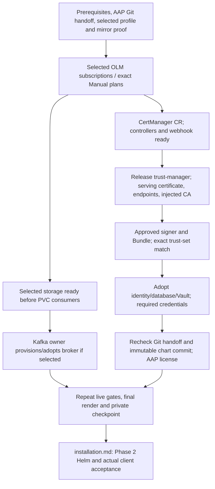

# Prepare OSAC Operators and Shared Infrastructure

- [Prepare OSAC Operators and Shared Infrastructure](#prepare-osac-operators-and-shared-infrastructure)
  - [1. Entry Contract](#1-entry-contract)
    - [Private state and safe records](#private-state-and-safe-records)
    - [Resume](#resume)
  - [2. Install the Selected Operators](#2-install-the-selected-operators)
    - [One OLM pattern](#one-olm-pattern)
  - [3. Shared Certificates, Trust and Credentials](#3-shared-certificates-trust-and-credentials)
    - [Dependency order](#dependency-order)
    - [cert-manager initialization](#cert-manager-initialization)
    - [trust-manager release contract](#trust-manager-release-contract)
    - [Issuer and trust distribution](#issuer-and-trust-distribution)
    - [Runtime Secret and ConfigMap contracts](#runtime-secret-and-configmap-contracts)
  - [4. Production Services and AAP Inputs](#4-production-services-and-aap-inputs)
    - [Identity, PostgreSQL and Vault/OpenBao](#identity-postgresql-and-vaultopenbao)
    - [Kafka](#kafka)
    - [AAP Git source handoff](#aap-git-source-handoff)
    - [AAP instance boundary and production TLS](#aap-instance-boundary-and-production-tls)
  - [5. Optional VMaaS Operands](#5-optional-vmaas-operands)
    - [LVMS](#lvms)
    - [MetalLB](#metallb)
    - [OpenShift Virtualization](#openshift-virtualization)
    - [CDI registry-consumer preparation](#cdi-registry-consumer-preparation)
  - [6. Completion, Troubleshooting and Day 2](#6-completion-troubleshooting-and-day-2)
    - [Seven responsibility outcomes](#seven-responsibility-outcomes)
    - [Worked flow and failure recovery](#worked-flow-and-failure-recovery)
    - [Day-2 boundaries](#day-2-boundaries)
    - [Existing-site DiskImage inventory — post-Phase 2 only](#existing-site-diskimage-inventory--post-phase-2-only)

This is Doc 2b for OSAC **0.0.62**. Complete the [mirroring handoff](README.md), [installation prerequisites](prereqs.md) and [AAP Git source handoff](aap-git-source.md) first, in that order. This guide prepares Phase 1; [installation.md](installation.md) owns the OSAC Helm release and Phase 2 acceptance.

The supported scope here is Core and optional VMaaS. BMaaS and CaaS provisioning are outside this procedure. Mirroring an operator package does not select it for installation.

Use the [customer installation guide](../customer-install-guide.md) for OSAC configuration semantics and the [Helm deployment guide](../helm-deployment-guide.md) for component responsibilities. Their connected-cluster downloads, development fixtures and internal-chart installation commands are not the disconnected deployment procedure.

> Do not install the internal dependency or infrastructure charts. Use their release source only as reference. Production PostgreSQL, Keycloak and Vault/OpenBao remain customer-managed services.
>
> Validation in this guide is manual and evidence-based. The actual **0.0.62** chart, its schema, and the commands below are the validation surface; no companion toolkit is used.

## 1. Entry Contract

Continue in the protected administration context from `prereqs.md`. One change owner coordinates mutations across all administration hosts; local locks alone do not exclude a remote administrator.

Set `NS="$OSAC_NAMESPACE"` from the protected prerequisite value; `$NS` is the same release namespace, not an independent input.

| Input | Required value or contract |
| --- | --- |
| OSAC chart | Actual downloaded `osac` chart, version `0.0.62` |
| Release source | Approved checkout of `osac/v0.0.62`, with Git provenance |
| OSAC namespace | `$OSAC_NAMESPACE`, `osac` in examples; use the namespace bound by prerequisites |
| Values | Existing protected `values-osac.yaml`; never regenerate defaults over it |
| Selection | `profile`, `enable_vmaas`, `with_lvms`, `with_metallb`, `kafka_provider`, `storage_class` |
| Profile | `core` or `core-vmaas`; must agree with `global.services.vmaas.enabled` |
| Kafka | `external` or `in-cluster`; must agree with `kafka.enabled` |
| Other service tiers | `global.services.bmaas.enabled=false`, `global.services.caas.enabled=false`, `global.services.maas.enabled=false` |
| Optional providers | LVMS and MetalLB only when selected for VMaaS |
| `LOADBALANCER_PROVIDER` | Same protected site input as prerequisites: `existing` when `with_metallb=false`, `metallb` when `with_metallb=true`; MetalLB selection requires VMaaS |
| Catalog | `redhat-operators` in `openshift-marketplace`, from Doc 1 |
| CLI images | Both `cliImage` and `aap.bootstrap.cliImage` from protected prerequisite values; exact mirror-resident references and script compatibility validated there |
| AAP EE | Effective `aap.configAsCode.eeImage` from released defaults plus site values |
| AAP Git handoff | Protected `aap-git-handoff.txt` from Doc 2a; same run/chart, returned internal URL, full source commit, auth/trust and egress confirmation |
| Private state | Same run identity, cluster UID, chart tree, selections and approved values checkpoint |
| Evidence record | Protected manual record of exact identities, inputs, observations, and pass/fail results |

The independent `cliImage` and `aap.bootstrap.cliImage` settings both default to `quay.io/openshift/origin-cli:4.20.0`; set and validate both through the prerequisite contract for the target OpenShift minor. Neither changing an image name nor reaching its registry establishes mirror coverage.

The AAP EE must support the selected Git/probe operations. Resolve and verify its exact image before any storage or source probe uses it.

**Entry review** — use the existing prerequisite record and approved post-Git values checkpoint to identify the intended selections, chart, namespace and cluster. Retain the original values digest and record each applicable input comparison separately; these observations do not bind live resources into one consistent snapshot. Consume the same-run Git handoff and recheck endpoint/ref readiness before resource creation. Missing inputs or unreviewed changes stop the dependent operation.

**Catalog gate** — compare exact source identity and image with the archived generated CatalogSource, not a hostname substring.

```bash
oc --request-timeout=30s get catalogsource redhat-operators -n openshift-marketplace -o json | jq -e --arg image "$EXPECTED_CATALOG_IMAGE" '.metadata.name == "redhat-operators" and .metadata.namespace == "openshift-marketplace" and .spec.image == $image and .status.connectionState.lastObservedState == "READY"'
```

Expected: `true`. `$EXPECTED_CATALOG_IMAGE` comes from the approved Doc 1 artifact, including its tag or digest.

Doc 1 owns IDMS/ITMS, ClusterCatalog/signatures and image availability. Prerequisites own DNS, mirror trust, read-only pull credentials and MCP convergence. Return failures to that owning boundary; never enable an online catalog to bypass them.

### Private state and safe records

- Preserve the prerequisite output boundary: no tracing, terminal recording or raw-output collection, including on the source workstation and bastion.

- Keep values, renders, endpoint documents, CA material, credential input files, inventory and checkpoints private. Export only validated allowlisted audit metadata.

- Read expected command results below only in the approved private review context; they are not permission to export command output.

- Record fixed gate/service identifiers, UTC, bounded duration, exit status, and an enumerated failure class without arbitrary messages or private inputs.

- Never save Secret bodies, tokens, credential-derived hashes or third-party Job logs in audit evidence.

### Resume

Resume from the retained run, not a new directory. Review the recorded chart, cluster, namespace, prerequisite inputs and selections separately. Compare the local values bytes with the approved snapshot digest; that comparison restores input context, not a common live-resource snapshot.

A changed values digest requires private full-diff, fresh-render and image/Secret-contract review before an explicitly approved checkpoint update.

Missing/corrupt state is not authorization to initialize over it. A valid checkpoint restores context only: recheck live readiness and ownership before continuing the first unverified stage.

## 2. Install the Selected Operators

### One OLM pattern

Use the [OpenShift operator installation procedure](https://docs.redhat.com/en/documentation/openshift_container_platform/4.22/html/operators/user-tasks). Apply this pattern once per selected OLM row below; do not duplicate it for each product.

1. Inspect existing Namespace, OperatorGroup and Subscription ownership. Adopt only an owner-approved compatible installation; do not create a competing OperatorGroup or use force-conflict takeover.

2. Verify the package, channel and any explicit CSV pin in the approved mirrored catalog. Record the resolved CSV where no fixed pin is specified.

3. Create or adopt the Namespace and correctly scoped OperatorGroup; server-validate the Subscription before applying it.

4. For Manual approval, follow that exact Subscription's `status.installPlanRef`. Review every dependency CSV, bundle and image against the mirrored inventory. Before approval or acceptance of an adopted installation, satisfy the AAP security and selected AMQ compatibility prerequisites below.

5. Approve only the reviewed plan using server-enforced UID/resourceVersion preconditions. Preserve the original reviewed UID through all later reads and waits; a name alone is insufficient.

6. Require that same plan to reach `Complete`, then its intended installed CSV to reach `Succeeded`, followed by the APIs required to be served and operand gates.

7. An already completed adopted Manual plan is recorded and verified, not approved again. A different plan at final acceptance stays unapproved pending a separate lifecycle review.

All OLM rows use `source: redhat-operators` and `sourceNamespace: openshift-marketplace`. `startingCSV` is an initial selection, not a permanent upgrade lock.

| Operator | Namespace | Channel | CSV Pin | Approval Strategy | CatalogSource | Notes |
| --- | --- | --- | --- | --- | --- | --- |
| cert-manager | `cert-manager-operator` | `stable-v1` | None specified; record resolved CSV | Automatic | `redhat-operators` | Package/Subscription `openshift-cert-manager-operator`; AllNamespaces |
| trust-manager | `cert-manager` | Not OLM | Not a CSV: standalone `v0.20.0` | Reviewed release manifest/adoption | Not applicable | Install after cert-manager webhook readiness; do not invent a Subscription |
| MetalLB | `metallb-system` | `stable` | None specified; record resolved CSV | Automatic | `redhat-operators` | Package/Subscription `metallb-operator`; OwnNamespace; only with MetalLB |
| LVMS | `openshift-storage` | `stable-<cluster-major.minor>` | None specified; record resolved CSV | Automatic | `redhat-operators` | Package/Subscription `lvms-operator`; OwnNamespace; only with LVMS |
| AMQ Streams | `osac-kafka` | `stable` | No cross-release fixed pin; review resolved CSV | Manual | `redhat-operators` | Package/Subscription `amq-streams`; OwnNamespace; only in-cluster Kafka |
| AAP | `ansible-aap` | `stable-2.6-cluster-scoped` | `aap-operator.v2.6.0-0.1787258256` | Manual, exact pin | `redhat-operators` | Package `ansible-automation-platform-operator`; Subscription `dev-ansible-automation-platform`; AllNamespaces |
| OpenShift Virtualization / VMaaS | `openshift-cnv` | `stable` | None specified; record resolved CSV | Automatic | `redhat-operators` | Package/Subscription `kubevirt-hyperconverged`; OwnNamespace; VMaaS only |

> **CVE-2026-75884:** This AAP CSV is the last release before the CVE fix; the pin is accepted as source-correct for OSAC 0.0.62.
> Source correctness is not security approval. No automatic pin change is authorized; monitor for a patched CSV.

**AAP security prerequisite** — before approving its Manual plan or accepting an adopted installation, require a recorded security-owner disposition in protected runtime evidence. Continuing with this pin requires an explicit, acknowledged risk-acceptance exception for CVE-2026-75884, bound to the exact CSV, reviewed bundle/image digests and verified CSV-to-image mapping. Missing, denied or deferred authorization blocks approval and acceptance; a patch decision returns to the release/security owners rather than silently changing the pin. Recheck this authorization and mapping at final acceptance; this guide does not grant an exception.

**AMQ compatibility prerequisite** — for in-cluster Kafka, record the resolved AMQ Streams CSV and reviewed bundle, plus the operator/release owner's explicit compatibility decision for that exact release and the chart's `kafka.strimzi.io/v1` consumers, before approving its Manual plan or accepting an adopted installation. A floating `stable` channel is not compatibility evidence. Missing or incompatible decisions block progress; do not invent a compatible CSV. After installation, require the strict served-v1 checks below for all three Kafka CRDs, and recheck the recorded CSV/decision and APIs at final acceptance.

Core with external Kafka requires two OLM installations, plus standalone trust-manager. MCE is not installed by this guide. The VMaaS product identity here is the source's OpenShift Virtualization/CNV, not multicluster engine.

For AllNamespaces, `spec.targetNamespaces` is absent/empty. For OwnNamespace, it contains exactly the installation namespace. Reuse compatible existing groups; never add a second group to make a copied pattern work.

**Package gate** — set `$PACKAGE`, `$CHANNEL` and `$CSV_PIN` from the row; use an empty pin only where the row has none.

```bash
oc --request-timeout=30s get packagemanifest "$PACKAGE" -n openshift-marketplace -o json | jq -e --arg package "$PACKAGE" --arg channel "$CHANNEL" --arg pin "$CSV_PIN" '.metadata.name == $package and .status.catalogSource == "redhat-operators" and .status.catalogSourceNamespace == "openshift-marketplace" and any(.status.channels[]; .name == $channel and ($pin == "" or .currentCSV == $pin))'
```

Expected: `true`. A different AAP channel head blocks this reference procedure; return to the catalog compatibility owner rather than approving another bundle.

**Manual-plan gate** — use the frozen, reviewed plan UID, CSV set, bundle set, and Subscription specification from private inputs, including the AAP security authorization/verified mapping and, when selected, the AMQ resolved-CSV/v1 compatibility decision above. Missing authorization, mapping, or selected compatibility evidence blocks approval and acceptance. This gate performs no approval or mutation.

**CSV gate** — `$CSV` is the recorded installed CSV for `$SUB` in `$OPERATOR_NAMESPACE`.

```bash
oc --request-timeout=30s get csv "$CSV" -n "$OPERATOR_NAMESPACE" -o json | jq -e '.status.phase == "Succeeded"'
```

Expected: `true`. Also require the Subscription to identify this intended CSV; a copied CSV elsewhere is not evidence.

Expected: `true`. Also require the Subscription to identify this intended CSV; a copied CSV elsewhere is not evidence.

**AAP related-image inspection** — use the same recorded `$CSV` and `$OPERATOR_NAMESPACE`, not a namespace-wide grep or a guessed AAP namespace. First satisfy the existing CSV/API and Subscription identity observations; inspect the selected bundle/CSV image selectors in the private context:

```bash
(set -o pipefail; oc --request-timeout=30s get csv "$CSV" -n "$OPERATOR_NAMESPACE" -o json | jq -er --arg csv "$CSV" 'if .metadata.name != $csv or .status.phase != "Succeeded" then error("unexpected CSV identity or phase") else [.spec.install.spec.deployments[]?.spec.template.spec.containers[]?.env[]? | select(.name | startswith("RELATED_IMAGE")) | {name,value}] | if length > 0 and all(.[]; (.value | type) == "string" and (.value | length) > 0) then .[] | "\(.name)=\(.value)" else error("unqualified related-image layout") end end') || exit 1
```

**Why:** these are the intended CSV's declared selectors, not evidence of effective IDMS resolution, registry availability or a successful operand pull. Compare them with the approved bundle/image inventory. Missing or different packaging layout stops for operator-owner review; it is not proof that the registry itself is unsafe. Keep output private. Reuse the existing Succeeded/API checks instead of adding the removed name-grep validation a second time.

**Subscription identity gate** — for every selected operator, verify row-specific scope, source, channel, approval mode, expected CSV, and preserved plan identity. An empty inventory is failure, not success.

**API gate** — run once for each required CRD below.

```bash
oc --request-timeout=30s wait crd/"$CRD" --for=condition=Established --timeout=10m
```

Expected: `<CRD> condition met`.

| Selection | Required CRDs |
| --- | --- |
| cert-manager initialization | `certmanagers.operator.openshift.io` |
| cert-manager consumers | `certificates.cert-manager.io` |
| trust-manager | `bundles.trust.cert-manager.io` |
| AAP | `ansibleautomationplatforms.aap.ansible.com` |
| In-cluster Kafka | `kafkas.kafka.strimzi.io`, `kafkanodepools.kafka.strimzi.io`, `kafkausers.kafka.strimzi.io` |
| LVMS | `lvmclusters.lvm.topolvm.io` |
| MetalLB | `metallbs.metallb.io`, `ipaddresspools.metallb.io`, `l2advertisements.metallb.io` |
| VMaaS | `hyperconvergeds.hco.kubevirt.io` |

In-cluster Kafka additionally requires served `kafka.strimzi.io/v1` APIs for the recorded compatible AMQ CSV; a compatibility decision does not waive this gate or authorize substituting an older API in this procedure.

```bash
oc --request-timeout=30s get crd "$KAFKA_CRD" -o json | jq -e 'any(.spec.versions[]; .name == "v1" and .served == true)'
```

Expected: `true` for each selected Kafka CRD.

## 3. Shared Certificates, Trust and Credentials

### Dependency order



Prepare selected storage before workloads that consume it. A successful apply or a numeric hook weight does not establish dependency readiness.

### cert-manager initialization

After its API exists, create/adopt only this OSAC-relevant initialization CR:

```yaml
apiVersion: operator.openshift.io/v1alpha1
kind: CertManager
metadata:
  name: cluster
spec:
  managementState: Managed
```

**Controller gate** — repeat the single command for `cert-manager`, `cert-manager-webhook` and `cert-manager-cainjector`.

```bash
oc --request-timeout=30s rollout status deployment/"$CERT_MANAGER_DEPLOYMENT" -n cert-manager --timeout=10m
```

Expected: the selected Deployment successfully rolled out.

**Webhook endpoint gate**:

```bash
oc --request-timeout=30s get endpoints cert-manager-webhook -n cert-manager -o json | jq -e 'any(.subsets[]?; (.addresses // [] | length) > 0)'
```

Expected: `true`. Do not create dependent Certificates while this fails.

### trust-manager release contract

Use the approved `osac/v0.0.62` blob `osac-installer/prerequisites/trust-manager.yaml`, not current main or an unverified working-tree copy. A compatible existing controller may be adopted with its owner's approval.

| Component | Release reference |
| --- | --- |
| Controller | `quay.io/jetstack/trust-manager:v0.20.0` |
| Trust package | `quay.io/jetstack/trust-pkg-debian-bookworm:20230311-deb12u1.1` |
| Trust namespace | `cert-manager` |
| Serving Certificate | `cert-manager/trust-manager` |
| Serving Secret | `cert-manager/trust-manager-tls`, `tls.crt`, `tls.key` |
| Deployment / Service | `cert-manager/trust-manager` |
| Admission configuration | `ValidatingWebhookConfiguration/trust-manager` |

Both exact images require Doc 1 proof. The generic static-manifest installation remains the administrator's normal procedure: CRD, foundation, serving certificate, controller/endpoints, webhook with injected CA, then Bundle. Do not install a second trust-manager to repair an adopted instance.

**Release-manifest gate**:

Record the owner-approved Git blob identity and the separate image observations in the existing protected inputs; neither observation alone certifies complete release provenance or image coverage.

**Serving-certificate gate**:

```bash
oc --request-timeout=30s wait certificate/trust-manager -n cert-manager --for=condition=Ready --timeout=10m
```

Expected: `certificate.cert-manager.io/trust-manager condition met`.

**Controller gate**:

```bash
oc --request-timeout=30s rollout status deployment/trust-manager -n cert-manager --timeout=10m
```

Expected: Deployment successfully rolled out.

**Webhook endpoint gate**:

```bash
oc --request-timeout=30s get endpoints trust-manager -n cert-manager -o json | jq -e 'any(.subsets[]?; (.addresses // [] | length) > 0)'
```

Expected: `true`.

**Webhook CA structural preflight**:

```bash
oc --request-timeout=30s get validatingwebhookconfiguration trust-manager -o json | jq -e '(.webhooks | length > 0) and all(.webhooks[]; (.clientConfig.caBundle // "" | length) > 0)'
```

Expected: `true`. This proves only that CA data is present, not that the webhook's serving certificate is trusted.

**Manual webhook certificate gate** — use approved certificate clients and the existing protected service inputs and owner evidence. Complete this gate before the first Bundle, when adopting an existing installation, and after serving-certificate or injected-CA rotation; final acceptance requires current evidence.

1. Bind the live `trust.cert-manager.io` entry in `ValidatingWebhookConfiguration/trust-manager` to the approved release or owner-approved adopted configuration. The release Service is `cert-manager/trust-manager`, port `443` to `6443`, with path `/validate-trust-cert-manager-io-v1alpha1-bundle`; its expected certificate DNS SAN is `trust-manager.cert-manager.svc`. Retain the approved matching rules and fail-closed admission configuration; never switch to `Ignore`, exclude requests, or bypass admission to pass this gate.
2. Privately decode that entry's exact current `clientConfig.caBundle` and parse its PEM certificates. Bind its trust anchors and issuing chain to the approved service CA references and owner evidence, not merely matching issuer names. The [pinned release](https://github.com/cert-manager/trust-manager/blob/v0.20.0/deploy/charts/trust-manager/templates/certificate.yaml) uses the self-signed `Issuer/cert-manager/trust-manager` for `Certificate/cert-manager/trust-manager`; its approved self-signed serving anchor is distinct from the OSAC distribution CA below. Do not substitute `default-ca` or an unrelated system trust store.
3. Through approved service access, obtain the certificate chain currently served by **each** ready backend selected by the Service; require a nonempty ready-backend set. Bind each to the approved Certificate, Secret `cert-manager/trust-manager-tls` and Deployment `/tls` mount. Inspect only public certificates, never `tls.key`. A Secret's `tls.crt`, Certificate `Ready`, or rollout alone does not prove which certificate is currently served. Using **only the exact live webhook CA bundle** as trust anchors, verify signatures/chain, current validity, TLS server-authentication purpose and the actual Service DNS SAN above (not CN-only fallback or SNI alone). Disable default trust-path/store fallback and require verification errors to produce nonzero failure; for example, OpenSSL `s_client` requires `-verify_return_error`, not just printed verification warnings. Follow the approved client's [certificate verification semantics](https://docs.openssl.org/3.5/man1/openssl-verification-options/).
4. Keep the owner-reviewed identity, exact bundle/served-chain binding and successful verification evidence in existing protected service evidence; export only already-allowlisted outcomes. Record the named certificate-check results separately against the current approved material; do not convert them into a whole-stage pass or an unchanged cross-resource snapshot. Missing, malformed, stale, unapproved, mismatched or unverifiable evidence blocks Bundle creation/adoption and final acceptance. After rotation, repeat the applicable verification rather than reusing old observations. Do not regenerate a CA or weaken validation to repair a failure.

This read-only certificate verification is not an admission probe or proof of API-server network reachability. A successful dry-run that skips a webhook or ignores its failure is not substitute evidence; retain [Kubernetes webhook matching and TLS requirements](https://kubernetes.io/docs/reference/access-authn-authz/extensible-admission-controllers/).

### Issuer and trust distribution

Adopt the approved enterprise CA-backed issuer where available. A new OSAC-local CA requires explicit CA-owner approval; never regenerate an existing `default-ca` to clear a readiness failure.

The local reference's unique fields are below. Each fragment belongs to the named resource; these are field references, not a multi-document apply file.

```yaml
# Issuer cert-manager/selfsigned-issuer
spec:
  selfSigned: {}

# Certificate cert-manager/default-ca-cert
spec:
  isCA: true
  commonName: default-ca
  secretName: default-ca
  privateKey:
    algorithm: RSA
    size: 4096
  issuerRef:
    name: selfsigned-issuer
    kind: Issuer

# ClusterIssuer default-ca
spec:
  ca:
    secretName: default-ca
```

Bind `service.certs.issuerRef` to the selected issuer's exact kind/name. This reference procedure supports CA-Secret-backed issuers only; other providers need a separately reviewed public-signer adapter and issuance gate.

The signer Secret namespace for a ClusterIssuer must match the controller's configured cluster-resource namespace; the reference uses `cert-manager`. A namespaced Issuer uses the release namespace.

**Selected issuer gate** — run only the branch matching the exact `service.certs.issuerRef.kind` and name in the reviewed values; do not infer scope from the current kubeconfig namespace.

For a **namespaced Issuer**, set `ISSUER_RESOURCE=issuer/<selected-name>` and use the prerequisite-bound `$OSAC_NAMESPACE`:

```bash
oc --request-timeout=30s wait "$ISSUER_RESOURCE" -n "$OSAC_NAMESPACE" --for=condition=Ready --timeout=10m
```

For a **ClusterIssuer**, set `ISSUER_RESOURCE=clusterissuer/<selected-name>`; do not add a namespace flag:

```bash
oc --request-timeout=30s wait "$ISSUER_RESOURCE" --for=condition=Ready --timeout=10m
```

Expected: the selected issuer condition is met in its bound namespace or cluster scope. Missing, mismatched or unsupported kind/name blocks progress; do not retry against a same-name issuer in another scope.

The source ConfigMap `cert-manager/osac-source-ca` contains approved **public** CA chains under `bundle.pem`. Include the selected signer and production database, identity, Kafka, Vault/OpenBao and AAP trust anchors; never include a private key.

Only approved consumer namespaces receive label `osac.openshift.io/phase1-trust=true`. Existing Bundles/selectors/targets require ownership review before enabling this selector.

```yaml
apiVersion: trust.cert-manager.io/v1alpha1
kind: Bundle
metadata:
  name: ca-bundle
spec:
  sources:
    - configMap:
        name: osac-source-ca
        key: bundle.pem
  target:
    configMap:
      key: bundle.pem
    namespaceSelector:
      matchLabels:
        osac.openshift.io/phase1-trust: "true"
```

**Trust ownership gate** — reject a foreign source/target or another Bundle whose selector would compete after labeling.

Evidence result: `trust-ownership: pass`. Namespace label changes retain their reviewed resourceVersion precondition.

**Bundle gate** — current generation, not a stale `Synced` condition:

```bash
oc --request-timeout=30s get bundle ca-bundle -o json | jq -e '.metadata.generation as $g | any(.status.conditions[]?; .type == "Synced" and .status == "True" and .observedGeneration == $g)'
```

Expected: `true`.

**Trust-set observations** — use the approved owner procedure to check exact equality of the approved/distributed certificate-fingerprint sets and selected-signer membership. Record each result with the issuer/Secret/target identities actually observed; separate reads do not prove those resources remained unchanged throughout verification.

A failed set-equality or signer-membership check, or missing or unapproved certificates, blocks the affected consumers. PEM presence alone is not acceptance; retain the separate comparison and signer observations rather than a compound `signer-bundle: pass`.

### Runtime Secret and ConfigMap contracts

Examples below use release name/namespace `osac`. The actual chart plus approved values render is authoritative, including name overrides and independent credential roles.

| Resource | Keys / value contract | Owner / phase |
| --- | --- | --- |
| `cert-manager/default-ca` | Signer `tls.crt` and private `tls.key`; approved local-CA path only | CA owner / cert-manager; never export key |
| `cert-manager/osac-source-ca` ConfigMap | `bundle.pem`, approved combined public CA chain | Trust owner, Phase 1 |
| `$NS/ca-bundle` ConfigMap | `bundle.pem`, synchronized approved trust set | Bundle controller, Phase 1 |
| `$NS/fulfillment-controller-credentials` | `client-id=osac-controller`, `client-secret` from identity owner | Required when selected by `service.auth.controllerCredentials[]` |
| Identity-administration credential source | Actual `service.idp.credentials[]` names/keys; example may share controller credentials | Identity owner; distinct role even if keys match |
| `$NS/osac-ui-backend-credentials` | `client-secret` for governed `osac-ui-backend`; reference creation also supplies `client-id` | `ui.auth.serviceAccount.credentialsSecret`, Phase 1 |
| `$NS/config-as-code-manifest-ig` | Only `license.zip`, exact approved ZIP; label `osac.openshift.io/project=osac-aap` | External license input, Phase 1; override via `aap.configAsCode.manifestSecret` |
| `$NS/osac-vault-credentials` | `client-secret`, dedicated canonical Vault client | Canonical secrets guide example; site may override |
| `$NS/vault-ca-bundle` ConfigMap | `bundle.pem`, approved Vault serving CA | Canonical secrets guide example; site may use shared trusted pool |
| `$NS/external-kafka` ConfigMap | Explicit `service.kafka.connection[].configMap`: `name=external-kafka`, `brokers`→`brokers`, `user`→`user` (`key`→`param`) | External Kafka example; `kafka.enabled=false`; no automatic wiring |
| `$NS/external-kafka-credentials` Secret | Explicit `service.kafka.connection[].secret`: `name=external-kafka-credentials`, `password`→`password` (`key`→`param`) | External Kafka example; no automatic wiring |
| `$NS/fulfillment-service-kafka` | `brokers`, `user`, `password` | In-cluster default destination; Phase 2 chart-owned |
| `$NS/osac-db-config` | `url` with rendered host/database and verify-full connection | Phase 2 Helm-owned; do not pre-create |
| `$NS/osac-db-client-cert` | Rendered client-certificate output, including required `tls.crt`/`tls.key` and configured projected keys | Phase 2 Certificate-owned; do not pre-create |
| `$NS/osac-db-init-cert` | Bootstrap Certificate output; `tls.crt`, `tls.key`, `ca.crt` consumed by db-init | Phase 2 hook Certificate-owned |
| Conditional `osac-db-metering-*` | Rendered URL/client-certificate contracts when metering enabled | Phase 2 writers; not Phase 1 probe inputs |

The operator's Fulfillment connection uses `operator.fulfillment.tokenFile`, `serverAddress` and its configured CA, not an invented operator OIDC credential-array key.

**Consumer review** — use the current render and the table above to review each required external name/key, optional reference and potential Phase 2 writer collision separately. Stop the dependent operation on a missing required input or unresolved ownership conflict; this review is not an exhaustive certificate of the complete consumer graph.

Record the individual input observations and leave chart-generated outputs explicitly `deferred-phase2`. Do not create an unused standard Secret to satisfy a guessed name.

Existing credentials require owner-approved adoption/rotation; do not overwrite a newer live credential from an old local file. Verify protected bytes without printing them. Do not change global Certificate garbage-collection policy merely to satisfy a verifier.

## 4. Production Services and AAP Inputs

### Identity, PostgreSQL and Vault/OpenBao

Use the canonical guides rather than duplicating service provisioning:

- Identity: the [customer installation guide](../customer-install-guide.md) and the prerequisite realm/client handoff. Adopt production Keycloak; do not import demo users or reset their passwords.

- PostgreSQL: the actual released chart's database render and prerequisite database-owner approval. Phase 2 still creates its URL Secrets and client/bootstrap Certificates for external PostgreSQL.

- Vault/OpenBao: [Secrets Management Configuration](../secrets-management-configuration.md) owns namespace, JWT claims, roles/policies, credentials, trust, verification and rotation. No initialization/unseal/backup procedure is reproduced here.

**Identity gate** — exact HTTPS issuer and approved endpoint hostnames, discovery/JWKS, governed client authentication, role mapping and namespace-workload connectivity.

Record each applicable canonical identity observation separately; cleanup of temporary token inputs is required on failure as well as success. A token alone does not prove authorization.

**Database gate** — confirm rendered `dbInit.host`, database names, subjects and signer, including bootstrap `postgres` authorization and verify-full TLS.

Record the rendered database-field observations separately from the database owner's compatibility and bootstrap-authorization decision; a field check is not functional database acceptance. If the provider disallows the unconditional bootstrap, stop with chart/database owners; pre-provisioning an application database does not remove the hook.

**Vault handoff gate**:

Record the canonical service-owner handoff and each rendered credential/CA-reference observation separately. A nonempty evidence file is not owner verification, and these records do not prove the future OSAC client's successful Vault connection.

### Kafka

[Kafka Configuration](../kafka-configuration.md) owns broker requirements, listeners, TLS/SASL, advertised addresses, ACLs, connection values, verification, rotation and troubleshooting. Do not copy its listener or ACL schema here.

- External: consume the prerequisite canonical-service handoff; skip AMQ installation, broker creation and probe-user creation.

- In-cluster: after storage readiness, the Kafka owner supplies approved complete broker/NodePool operands and verifies every broker/operator/helper image against Doc 1. The canonical listener example assumes an existing broker; it is not a complete new-cluster manifest.

- Reference coordinates are `osac-kafka/osac-kafka`; retain any approved override in `kafka.clusterNamespace` and `kafka.clusterName`.

- For in-cluster Kafka, the Phase 1 identity is unique `phase1-kafka-$RUN_ID`, with its recorded UID and canonical permission contract. Final fulfillment KafkaUser/password/destination Secret remain Phase 2-owned.

**Broker gate** — in-cluster only:

```bash
oc --request-timeout=30s get kafka "$KAFKA_CLUSTER_NAME" -n "$KAFKA_CLUSTER_NAMESPACE" -o json | jq -e '(.status.observedGeneration == .metadata.generation) and any(.status.conditions[]?; .type == "Ready" and .status == "True")'
```

Expected: `true`.

**Kafka functional gate** — selected-provider DNS, bootstrap and advertised-broker TLS, SCRAM authentication, canonical topic/group authorization and reviewed execution context.

Record each applicable canonical Kafka check separately, including its selected provider and execution context; do not combine them into a whole-stage Kafka-readiness certificate. Operator CSV readiness alone is not broker or client readiness. For in-cluster Kafka, retire only the recorded temporary probe identity through owner-approved UID-preconditioned cleanup.

### AAP Git source handoff

Complete [aap-git-source.md](aap-git-source.md) before this guide. Insert the returned Git URL into the values below, retaining the full chart-derived commit. Consume the protected Git handoff at entry and recheck endpoint/ref readiness at final acceptance; server publication and repair remain with the Git administrator. Actual AAP project synchronization remains Phase 2 acceptance.

### AAP instance boundary and production TLS

Do not create `AnsibleAutomationPlatform/osac-aap` here. With instance creation enabled, the OSAC chart creates it in `$NS`, not the operator namespace `ansible-aap`.

Use the URL returned by the Git administrator and the unchanged full chart-derived commit from [aap-git-source.md](aap-git-source.md). Retain those reviewed values; merge the remaining AAP deltas below without replacing other existing values:

```yaml
aap:
  configAsCode:
    projectGitUri: <approved-internal-git-url>
    projectGitBranch: <full-40-character-chart-derived-commit>
    manifestSecret: config-as-code-manifest-ig
    manifest:
      create: false
operator:
  aap:
    url: <https://approved-aap-controller-host/api/controller>
    insecureSkipVerify: "false"
```

The string `"false"` is deliberate for the 0.0.62 template. The shipped default is `"true"`; Bundle readiness does not by itself configure AAP HTTP-client trust. Do not invent an unconsumed AAP CA values key or use Fulfillment gRPC trust as proof of AAP HTTP trust.

**AAP input gate** — exact approved ZIP, Secret ownership/label, pinned operator/API, Git source and rendered explicit HTTPS/verification settings.

Record the listed AAP input observations separately; they are not an aggregate delivery or runtime-readiness result. Phase 2 must additionally prove the actual operator-to-AAP HTTPS request validates hostname and serving chain, plus bootstrap/project-sync revision. An unavailable trust mechanism blocks that acceptance; do not restore skip-verification.

## 5. Optional VMaaS Operands

Skip all new provider installation when the approved existing provider is selected. MetalLB installation is VMaaS-only; the LoadBalancer gate below also rechecks the prerequisite-selected `existing` provider for Core. Use the product procedures for standard setup, not a second OSAC-specific installation recipe.

### LVMS

The storage owner approves unused devices and any per-node selection. Never consume all available disks or change the cluster default StorageClass implicitly.

```yaml
# LVMCluster openshift-storage/lvms-cluster: selected reference fields
spec:
  storage:
    deviceClasses:
      - name: vg1
        default: true
        deviceSelector:
          paths:
            - <approved-unused-block-device-path>
        thinPoolConfig:
          name: thin-pool-1
          sizePercent: 90
          overprovisionRatio: 10
```

These reference sizing values are not production capacity approval. The storage owner must accept device layout, usable capacity and oversubscription for the site's workload.

**Storage gate** — selected StorageClass, current provider rollout, disposable 1Gi RWO PVC plus actual write-test consumer; handles `WaitForFirstConsumer`.

Evidence result: `storage: pass`; PVC `Bound` and write-test Pod `Succeeded`. A Pending claim alone is not evidence of failure or success. Retain the agreed class in values; the reference class is `lvms-vg1`.

### MetalLB

The network owner approves a non-overlapping address range and L2 suitability. BGP sites use their reviewed peer/advertisement design instead of this L2 field reference.

```yaml
# MetalLB metallb-system/metallb: no OSAC-specific spec fields
# IPAddressPool metallb-system/osac-address-pool
spec:
  addresses:
    - <approved-first-address-last-address>
  autoAssign: true
  avoidBuggyIPs: true

# L2Advertisement metallb-system/osac-l2-advertisement
spec:
  ipAddressPools:
    - osac-address-pool
```

**LoadBalancer gate** — use the same protected `$LOADBALANCER_PROVIDER` input and `with_metallb` relationship as `prereqs.md`; an unset, unknown or inconsistent value blocks progress.

| `$LOADBALANCER_PROVIDER` | Required branch before the gate |
| --- | --- |
| `existing` | Requires `with_metallb=false`; adopt the approved existing provider and create no MetalLB resources. Recheck allocation and client traffic for both Core and Core + VMaaS. |
| `metallb` | Requires `with_metallb=true` and VMaaS enabled; first verify the selected MetalLB operator and owner-approved operands, then test allocation and client traffic. |

Both branches require current provider readiness, disposable Service address allocation and successful traffic from the administration and intended consumer networks, using a site-approved protocol/fixture. Installing MetalLB is not a substitute for a failed existing-provider test.

Evidence result: `loadbalancer: pass`; allocation without client traffic is insufficient. Keep actual endpoint addresses private. Record the selected provider's proof in `configure-metallb` even when no MetalLB is installed; do not use a profile-disabled skip for a declared `existing` provider.

For example, `with_metallb=false` selects `LOADBALANCER_PROVIDER=existing`: the administrator checks the existing provider, not a new MetalLB installation. If client traffic fails, stop and return to the network/provider owner, then repeat this gate; do not silently switch providers.

### OpenShift Virtualization

```yaml
apiVersion: hco.kubevirt.io/v1beta1
kind: HyperConverged
metadata:
  name: kubevirt-hyperconverged
  namespace: openshift-cnv
spec:
  enableCommonBootImageImport: false
```

**HyperConverged gate**:

```bash
oc --request-timeout=30s get hyperconverged kubevirt-hyperconverged \
  -n openshift-cnv -o json |
jq -e '
  .metadata.generation as $generation |
  .status.conditions as $conditions |
  if ($generation | type) != "number" or ($conditions | type) != "array" then
    false
  else
    ($generation >= 1 and $generation == ($generation | floor)) and
    ([
      {type: "Available", status: "True"},
      {type: "Degraded", status: "False"},
      {type: "Progressing", status: "False"},
      {type: "ReconcileComplete", status: "True"}
    ] |
    all(.[];
      . as $required |
      any($conditions[]?;
        .type == $required.type and
        .status == $required.status and
        .observedGeneration == $generation
      )
    ))
  end
'
```

Expected: `true`. For target OpenShift 4.22, require all four expected statuses, including `ReconcileComplete=True`, with each condition's `observedGeneration` equal to the present, positive integer `.metadata.generation`. Missing conditions, missing/invalid generation evidence, stale generations or unexpected statuses block progress. The [4.22 installation verification](https://docs.redhat.com/en/documentation/openshift_container_platform/4.22/html/virtualization/installing) describes the status checks; generation matching is scoped to the target 4.22 controller.

### CDI registry-consumer preparation

Use the selected Virtualization product's approved namespace, exact CDI object name/UID and owner-reviewed controller selector. Do not select `.items[0]`, assume a resource called `cdi`, or substitute a similarly named object. Keep the HCO preparation above and common-boot-image selection unchanged. Before any diagnostic, record the intended identities privately; an observed Pod list is not ownership or continuing readiness proof.

```bash
(set -o pipefail; oc --request-timeout=30s get pods -n "${VIRT_NAMESPACE:?Set the approved namespace}" -l "${CDI_OPERATOR_SELECTOR:?Set the reviewed selector}" -o json | jq -e '(.items | length > 0) and all(.items[]; .metadata.deletionTimestamp == null and any(.status.conditions[]?; .type == "Ready" and .status == "True"))') || exit 1
oc --request-timeout=30s get cdi "${CDI_NAME:?Set the reviewed CDI name}" -o jsonpath='{.metadata.uid}{"\n"}{.metadata.resourceVersion}{"\n"}' || exit 1
```

**Why:** this observes the owner-bound controller set and resource identity only. It does not prove importer trust, selected image access, tenant authorization, effective image redirection, or a VM lifecycle. A missing/ambiguous set stops for the Virtualization owner. For controller image-pull errors use §6's selected-operator failure route; per-VM virt-launcher/importer failures and actual DataVolume/VMI/service acceptance belong to `installation.md`, after the platform exists.

> [!WARNING]
> **Q-0003 remains unresolved:** do not execute the removed direct CDI insecureRegistries patch or select proxy/image-config CA wiring from this subsection. A site/product owner must establish the supported HCO/CDI configuration surface and actual consumer CA/authentication contract. TLS-disable settings are not a temporary or default answer. This receiving text intentionally does not offer an executable mutation path until that decision is qualified.

If the approved future procedure modifies a shared registry array, preserve the removed CAS safety contract: read the exact object's UID, opaque resourceVersion and existing list together; build the owner-reviewed merge preserving unrelated entries; submit the captured resourceVersion as a server-enforced write precondition; stop on any error. On conflict, re-read, re-merge and re-review the entire intended change. Never attach a freshly fetched version to a stale list, force ownership, or treat a post-write UID check as an atomic precondition. Q-0003 must also determine whether a direct CDI write is permitted or the change belongs in HCO-managed desired state; no alternative is selected here.

The prerequisite diagnostic methods are in `prereqs.md` §3. Actual importer/VM acceptance is a Phase 2 responsibility in `installation.md`, not a condition requiring live OSAC/DiskImages during first mirroring or Phase 1 preparation. Remove the old back-reference to a deleted Doc 1 runtime recipe and do not restore its unpublished compound `PASS cdi` claim. No new companion validator is introduced.

## 6. Completion, Troubleshooting and Day 2

### Seven responsibility outcomes

These are manual responsibilities, not Jobs to install from the reference charts. Equal hook weights do not imply dependencies may be skipped.

| Weight | Responsibility | Required outcome |
| --- | --- | --- |
| 10 | `configure-kafka` | Canonical selected-provider client proof; external provider records no broker installation |
| 10 | `configure-metallb` | `$LOADBALANCER_PROVIDER=existing`: existing-provider allocation/client proof without MetalLB installation; `metallb`: selected VMaaS MetalLB readiness plus allocation/client proof |
| 12 | `apply-ca-bundle` | Current Bundle and exact signer/trust-set acceptance |
| 15 | `wait-keycloak` | Adopted issuer/endpoints, namespace connectivity and owner-approved roles |
| 16 | `keycloak-set-passwords` | `skipped-production-fixture`; no demo password reset |
| 17 | `create-creds` | Governed controller credential identity, keys and authentication |
| 19 | `create-ui-backend-creds` | Governed backend credential identity/keys and identity-owner approval |

Classify each inventory entry as `guide-created`, `adopted` or `temporary`. Record the exact UID for each Kubernetes object entry; for direct administrator actions, use the existing run identity or protected owner-evidence reference instead. Record any missing or failed active responsibility and stop its dependent work, including Phase 2 when that responsibility is a prerequisite; do not treat the ledger as an all-or-nothing completion certificate. Do not fabricate Job identities or UIDs for direct administrator actions.

**End-of-preparation review** — review the selected-resource observations, owned-workload rollouts, original Manual-plan identities, trust/source observations, latest values/render/image/Secret reviews and responsibility entries separately. Recheck the live object needed by the next dependent operation; these checks do not establish a common snapshot or one combined final result. Require the recorded security-owner acknowledged exception for the pinned AAP CSV and its verified CSV-to-image mapping, and, for in-cluster Kafka, the recorded AMQ resolved-CSV/v1 compatibility decision plus all three served-v1 API checks. Missing or no-longer-applicable evidence stops the dependent operation, including for adopted installations.

Do not infer readiness from file existence, namespace-wide counts or old replicas alone, and do not issue a whole-stage `final: pass`.

**Handoff** — after change-owner review, retain the existing private inputs and responsibility records; keep allowlisted check metadata separate. Their retention/publication is not an atomic unit and has no new generation-marker requirement.

Record failed reads, missing inputs, unresolved placeholders and failed active checks without relabeling them as success. An interruption may leave completed operations alongside incomplete records; review the retained context and recheck the next dependency before resuming. Checkpoint, inventories and sensitive runtime inputs stay private through Phase 2 and the approved retry window.

### Worked flow and failure recovery

A Core site selects external Kafka and existing storage. The administrator verifies entry/catalog, installs or adopts cert-manager and pinned Manual AAP, then verifies standalone trust-manager. AMQ, CNV, LVMS and MetalLB installation are skipped for this selection, not marked successful.

If Bundle creation is rejected because trust-manager has no webhook endpoints, the administrator stops before credential consumers. In the private review context, they check the serving Certificate, Deployment rollout, endpoint addresses and injected CA using the gates above. The owner repairs only that failed dependency, rechecks it, then reapplies only the reviewed Bundle. They do not delete the CA, disable admission or replay credential creation.

If AAP resolves a different InstallPlan or CSV, leave it unapproved. Compare the exact live Subscription and plan with the reviewed snapshot. A missing intended bundle returns to Doc 1; a wrong Subscription remains with this phase. A UID/resourceVersion conflict requires a fresh review, never removal of the precondition.

| Symptom | First boundary / next action |
| --- | --- |
| Catalog/package/image missing | Doc 1 owner; repair authoritative inventory and repeat handoff |
| DNS, CA, mirror authentication, MCP convergence | Prerequisite owner; do not proceed to operator repair |
| Pending Manual plan | Change owner reviews exact referenced UID, CSVs, bundles and images |
| CSV/API failure | Selected operator owner; inspect private Subscription/plan/CSV conditions and controller state |
| Subscription `UpgradePending` | Review the exact Subscription conditions and referenced InstallPlan against the frozen UID/CSV/bundle review; do not automatically approve a replacement plan or rewrite every Subscription |
| Selected operator Pod `ImagePullBackOff` | Bind the failed container and exact image to the intended CSV/deployment; missing content returns to Doc 1, while DNS/TLS/read-credential failure returns to prereqs.md §3; never use a public-image fallback |
| Required CRD missing before operand creation | Stop that dependent step; repeat the selected API observation in §2 and dependency order in §3, then resume only the reviewed operation; do not install internal charts or treat a namespace-wide Succeeded count as readiness |
| Admission/webhook failure | Certificate, controller rollout, endpoint and CA-injection gates |
| PVC/probe Pending | Storage owner; distinguish missing consumer from scheduling/provisioning failure |
| Allocated LB address but no traffic | Network owner; provider/client-path evidence, not a second provider |
| Git timeout / different SHA | Return to [aap-git-source.md](aap-git-source.md): network/egress owner or Git publisher respectively |
| Database bootstrap denied | Database/chart owners reconcile host, subject, signer and authorization |
| AAP TLS/client failure after Helm | Phase 2 actual-client trust owner; do not bypass verification |

Raw logs/events and third-party Job output remain private under their owners' diagnostic policy. Retained safe stage records must distinguish timeout, authentication, certificate, source-absence, stale-identity and readiness failures without exposing raw messages.

### Day-2 boundaries

- Follow [aap-git-source.md](aap-git-source.md) for source publication and release updates. Preserve the server and immutable refs for later fulfillment; OSAC uninstall does not authorize deleting this source, external services, CA roots or storage.

- Recheck trust-set equality after CA rotation and verify each actual consumer; a synchronized ConfigMap alone does not establish client adoption.

- Treat changed values as reviewed checkpoints, not edits to the original prerequisite digest. Repeat final render, image coverage and Secret-consumer review.

- Later Manual InstallPlans remain unapproved until a separate supported lifecycle review. Automatic rows can resolve newer catalog content; record the installed version and review catalog updates accordingly.

- Changing `startingCSV` or reapplying old YAML is not an operator downgrade/rollback procedure. Do not prescribe unvalidated differential mirroring, operand downgrade, data migration or database rollback here.

- Remove only successfully verified disposable probes by recorded identity under approved cleanup. Never delete a shared namespace, adopted workload or final Phase 2 credential as cleanup.

- Phase 2 must prove chart-generated Secrets/Certificates, database initialization, actual OSAC-to-Kafka/Vault integration, AAP bootstrap, synchronized project commit and operator-to-AAP authenticated TLS before acceptance.

### Existing-site DiskImage inventory — post-Phase 2 only

This optional discovery procedure runs only after an existing OSAC deployment, the matching authenticated CLI and the approved tenant/API access are available. It is not a first-install mirror-inventory producer or a requirement for this guide's Phase 1 completion. For a first installation, Doc 1 consumes an independently approved selected-source inventory before any OSAC instance exists. Runtime DiskImage replacement and VM acceptance remain in `installation.md`.

Use the reviewed tenant rather than assuming every resource in `shared` is selected for a mirror run. Confirm the target release's CLI/JSON shape before using the removed reference fields `spec.source_type` and `spec.source_ref`; the following reference expects a JSON array. Missing/changed shape stops for the API/product owner, not a guessed schema conversion.

```bash
(
  umask 077
  set -o noclobber
  osac get diskimages --tenant "${DISCOVERY_TENANT:?Set the approved tenant}" -o json > "${DISKIMAGE_DISCOVERY_JSON:?Set a fresh private output path}"
) || exit 1
```

Review individual resources with the matching CLI (`osac describe diskimage ID|NAME` is the removed reference syntax; replace `ID|NAME` with one approved identifier, not a shell pipeline). Keep the original returned identities, resource selection and complete source references in the protected record. The optional candidate export below is not the approved selected-source handoff:

```bash
(
  umask 077
  set -o noclobber
  jq -e 'type == "array" and length > 0' "${DISKIMAGE_DISCOVERY_JSON:?}" >/dev/null &&
  jq '[.[] | select(.spec.source_type == "SOURCE_TYPE_REGISTRY") | .spec.source_ref] | if length > 0 and all(.[]; type == "string" and length > 0) then . else error("no qualified registry-source candidates") end' "$DISKIMAGE_DISCOVERY_JSON" > "${DISKIMAGE_SOURCE_CANDIDATES_JSON:?Set a fresh private candidate output path}"
) || exit 1
```

**Why:** full references retain explicit tag/digest lineage. Do not silently strip transport/tag/digest into a file that a downstream consumer expects to contain original selected references. The normalized original-upstream tag-repository set for an ITMS observation is a separate derived contract, not this discovery export. The source API shape/tenant selection and both producer/consumer file contracts must be reconciled before any handoff.

A failed command may leave a partial new output: mark it invalid and do not reuse it as success or overwrite a previous approved record. The mirror owner reviews the selected exact references and any requested inventory change against the same authoritative ISC/workspace lineage. This discovery does not update the ISC, policies, values or live DiskImages, and does not authorize concurrent mirror runs or a public-image fallback.
