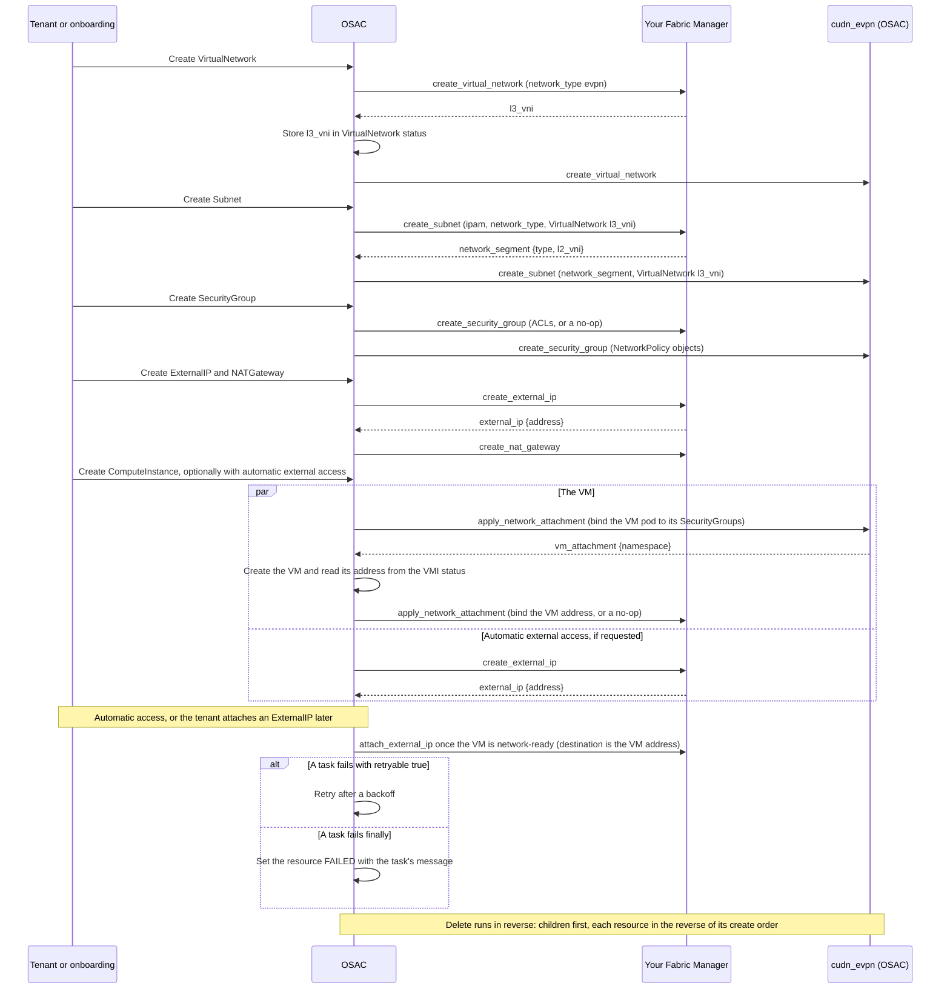

# OSAC Fabric Manager Guide

**Audience:** a provider whose deployment enables VMaaS only, with its own Fabric Manager and OSAC's `cudn_evpn` Kubernetes Manager over the `evpn` network type.

This guide shows how to build, test, deploy, and run an OSAC **Fabric Manager**. A Fabric Manager is the one network manager a provider writes.

The examples call your company **Acme**. Replace `acme` and `ACME` with your own names. Replace every Acme fabric API call (marked `PLACEHOLDER`) with your backend's API.

The guide has every rule a VMaaS-only Fabric Manager acts on, so you can build the manager from this guide alone.

**Contents**

- [Start here](#start-here)
- [1. How OSAC works](#1-how-osac-works)
  - [Terms](#terms)
  - [The two managers](#the-two-managers)
  - [What happens when a tenant creates a VM](#what-happens-when-a-tenant-creates-a-vm)
  - [How OSAC runs a task](#how-osac-runs-a-task)
  - [What OSAC guarantees](#what-osac-guarantees)
- [2. Plan your manager](#2-plan-your-manager)
  - [What you prepare, and when](#what-you-prepare-and-when)
  - [What your fabric must provide](#what-your-fabric-must-provide)
  - [The task files you write](#the-task-files-you-write)
  - [Names](#names)
  - [Your manager design](#your-manager-design)
- [3. Build your manager](#3-build-your-manager)
  - [Create the collection and role](#create-the-collection-and-role)
  - [Write a task file](#write-a-task-file)
  - [Run your first task](#run-your-first-task)
  - [Rules every task follows](#rules-every-task-follows)
  - [Use the Subnet address layout](#use-the-subnet-address-layout)
  - [Implement the tasks in order](#implement-the-tasks-in-order)
- [4. Test your tasks](#4-test-your-tasks)
  - [Run a task with Ansible](#run-a-task-with-ansible)
  - [What to check](#what-to-check)
- [5. Hand over your manager](#5-hand-over-your-manager)
  - [Agree on the shared values and prepare your fabric](#agree-on-the-shared-values-and-prepare-your-fabric)
  - [Build the execution environment image](#build-the-execution-environment-image)
  - [Settings and secrets](#settings-and-secrets)
  - [Registration manifest](#registration-manifest)
- [6. Verify in a lab and go live](#6-verify-in-a-lab-and-go-live)
  - [Verify in a lab](#verify-in-a-lab)
  - [Go-live checklist](#go-live-checklist)
- [7. Operate and change a manager](#7-operate-and-change-a-manager)
  - [Read the status](#read-the-status)
  - [Handle failures and deletes](#handle-failures-and-deletes)
  - [Change a manager](#change-a-manager)
- [Reference](#reference)
  - [Task details](#task-details)
  - [Retry and job behavior](#retry-and-job-behavior)
  - [Stored input](#stored-input)
  - [SecurityGroup rules](#securitygroup-rules)
  - [`nat_gateway_context`](#nat_gateway_context)
  - [Hub objects](#hub-objects)
  - [`cudn_evpn` behavior on the hub](#cudn_evpn-behavior-on-the-hub)
- [Appendix A: Complete task inputs](#appendix-a-complete-task-inputs)
- [Appendix B: OSAC's result checks](#appendix-b-osacs-result-checks)
- [Related documents](#related-documents)

## Start here

### What OSAC is

Open Sovereign AI Cloud (OSAC) is an open-source platform that organizations use to run their own clouds. Tenants use it to create VMs and networks through self-service. OSAC calls your Fabric Manager to configure your fabric for those networks.

### What you deliver

| Deliverable | What it is | Details |
|---|---|---|
| Collection and role | One Ansible collection with one role. | [Create the collection and role](#create-the-collection-and-role) |
| 16 task files | One Ansible task file per named operation, such as `create_subnet`. | [The task files you write](#the-task-files-you-write) |
| Image | OSAC's base image with your collection. | [Build the image](#build-the-execution-environment-image) |
| Settings and secrets | Each key and its value, for the Cloud Infrastructure Admin. | [Settings and secrets](#settings-and-secrets) |
| Registration manifest | One ConfigMap that registers your manager. | [Registration manifest](#registration-manifest) |
| Manager design | A short document you publish. | [Your manager design](#your-manager-design) |

### Your path

Read part 1 first. It explains how OSAC uses your manager. Then follow parts 2 to 6 in order. You reach these milestones:

1. **Plan done.** You know what your fabric must provide ([2. Plan your manager](#2-plan-your-manager)).
2. **First task runs.** `create_virtual_network` runs without OSAC and returns `l3_vni` ([Run your first task](#run-your-first-task)).
3. **All tasks built.** All 16 task files exist ([3. Build your manager](#3-build-your-manager)).
4. **All tasks tested.** Every task passes without OSAC ([4. Test your tasks](#4-test-your-tasks)).
5. **Handed over.** The Cloud Infrastructure Admin has what the install needs ([5. Hand over your manager](#5-hand-over-your-manager)).
6. **Live.** Your manager passes in an OSAC lab and you go live ([6. Verify in a lab and go live](#6-verify-in-a-lab-and-go-live)).

Part 7 is for running the manager.

### Where the reference is

Parts 1 to 7 are the main path. The [Reference](#reference) and the appendices follow. The appendices hold the complete input of every task and every check OSAC applies to a result.

## 1. How OSAC works

This part explains what OSAC does and what your manager does. You write no code here.

### Terms

**OSAC and your manager**

| Term | Meaning |
|---|---|
| CR | A Kubernetes custom resource. |
| AAP | Ansible Automation Platform, which runs OSAC's Ansible jobs. |
| Hub | The management cluster, and the only cluster your tasks reach. The OSAC operator, the OSAC CRs, AAP, and the VMs run there. |
| Hub nodes | The hub's nodes that run VMs. The OSAC installer connects each of them to your fabric over EVPN. |
| Hub network | The network `cudn_evpn` builds on the hub for a VirtualNetwork. VMs use it as their primary network. |
| Fabric | Your physical network. |
| Backend | The system your tasks call, such as your Fabric API. |
| Manager | An Ansible role with one task file per task. Yours is in your own collection. |
| Fabric Manager | The manager that configures your fabric. You write it. |
| Kubernetes Manager | The manager that configures the hub. In this deployment it is `cudn_evpn`, which OSAC ships. |
| Netris | A Fabric Manager that OSAC ships. Some rules here mention it as an example. |
| Registration | The ConfigMap that tells OSAC about a manager ([Registration manifest](#registration-manifest)). |
| Manager design | The document you publish with your role ([Your manager design](#your-manager-design)). OSAC never reads it. |
| Task | One named operation, such as `create_subnet`. OSAC runs it as one AAP job. |
| Fabric delete | The delete task of your Fabric Manager. |
| Result | The keys a task publishes under `osac_result`. |
| Retryable failure | A failure that OSAC retries ([Retry and job behavior](#retry-and-job-behavior)). |
| Final failure | A failure that OSAC does not retry ([Retry and job behavior](#retry-and-job-behavior)). |
| No-op | A task, or part of one, that changes nothing, returns a valid result, and is described as a no-op in your manager design. |
| Implementation limit | Something a manager cannot build. |
| API ID | The stable ID the fulfillment service gives a resource. It is never the CR name or `metadata.uid`. |
| Network type | The technology this deployment's NetworkClass uses to isolate VirtualNetworks and Subnets. This release has only `evpn`. |
| NetworkClass | The deployment's one networking configuration: the selected managers, the tenant defaults, and the address plan. |
| Provider networking | Whether OSAC runs networking jobs in this deployment, set by `global.networking.provisioningEnabled`. |
| API states | PENDING, READY, FAILED, and DELETING ([Read the status](#read-the-status)). |
| ALLOCATED | The ExternalIP state once OSAC accepted its address. |
| Network-ready | A VM state: `cudn_evpn`'s apply and your apply both succeeded. |

API IDs are lowercase UUIDs (36 characters). They are never reused, so you can derive backend names from them.

**People and services**

| Term | Meaning |
|---|---|
| Tenant | An isolation boundary in OSAC. The `tenant` input key identifies it, for example `tenant-a`. |
| Tenant onboarding | The step that creates a tenant's default VirtualNetwork, Subnet, SecurityGroup, ExternalIP `default-nat`, and NATGateway. |
| Default VirtualNetwork | The VirtualNetwork that tenant onboarding creates. Default Subnet and default SecurityGroup work the same way. |
| Cloud Infrastructure Admin | The provider person who manages core infrastructure and installs OSAC. |
| Owner | Who deletes a FAILED resource: the tenant, or the Cloud Infrastructure Admin for an ExternalIPPool. |
| VMaaS, CaaS, BMaaS | Virtual machine, cluster, and bare-metal host as a service. This guide covers VMaaS only. |
| Fulfillment service | OSAC's API service, with its database. |
| OSAC operator | The Kubernetes controllers of OSAC. They act on OSAC CRs and run AAP jobs. |
| OSAC installer | The Helm charts that deploy OSAC. |

**Resource kinds**

The networking resource kinds are VirtualNetwork, Subnet, SecurityGroup, ExternalIPPool, ExternalIP, and NATGateway, plus the kinds below. [Implement the tasks in order](#implement-the-tasks-in-order) says what each gives the tenant.

| Kind | Meaning |
|---|---|
| ComputeInstance | The API resource for a VM. |
| NetworkAttachment | OSAC's internal hub CR for a VM's attachment to its Subnet and SecurityGroups ([VM attachment tasks](#vm-attachment-tasks)). |
| VM attachment | A NetworkAttachment, or the tasks that run for one. |
| ExternalIPAttachment, or ExternalIP attachment | Inbound access to a VM through a public address. It is unrelated to a VM attachment. |

**Kubernetes and AAP**

| Term | Meaning |
|---|---|
| Instance group | An AAP group that runs jobs. Job pods of OSAC's networking group read the ConfigMap and Secret `network-fulfillment-ig` as environment variables. |
| Job pod | The pod that runs one AAP job. |
| Execution environment (EE) | The container image that AAP jobs run in. |
| Base image | The `osac-aap` image of the OSAC release. |
| Finalizer | A marker on a CR that keeps Kubernetes from removing the CR. |
| Admission policy | A rule the Kubernetes API server applies to a write. OSAC's is a ValidatingAdmissionPolicy. |
| NetworkPolicy | The Kubernetes object that `cudn_evpn` uses to enforce SecurityGroups. |
| OVN-Kubernetes | The hub's Kubernetes network plugin. |
| ClusterUserDefinedNetwork (CUDN) | The OVN-Kubernetes CR that `cudn_evpn` uses to build a hub network. |
| VMI | KubeVirt's VirtualMachineInstance object, which reports a running VM's address. |

**Network terms**

| Term | Meaning |
|---|---|
| IP-VRF | The VRF of a VirtualNetwork. Its VNI is `l3_vni`. |
| MAC-VRF | The VRF of a Subnet. Its VNI is `l2_vni`. |
| Extend to the hub nodes | Import and export a VRF's route target over your EVPN peering with the hub nodes ([Route targets](#route-targets)). |
| Symmetric IRB | Symmetric integrated routing and bridging: both ends route through the IP-VRF. |
| Hairpin | Traffic from a VM to an ExternalIP address in its own VirtualNetwork, through a NATGateway. |

### The two managers

| Type | Written by | Configures | Selected by the Helm value |
|---|---|---|---|
| Fabric Manager | You | The fabric | `global.networking.fabricManager` |
| Kubernetes Manager | OSAC (`cudn_evpn`) | The hub | `global.networking.k8sManager` |

Your Fabric Manager configures, on the fabric:

- routing domains
- Subnet segments
- EVPN extension to the hub nodes
- NAT
- external addresses
- SecurityGroup ACLs, if your fabric enforces them

`cudn_evpn` configures, on the hub:

- the hub network VMs use as their primary network
- VM addresses
- SecurityGroup policy objects bound to VMs

`cudn_evpn` ships in OSAC's base image ([Build the image](#build-the-execution-environment-image)), and the OSAC installer registers it. It builds a Layer2 OVN-Kubernetes ClusterUserDefinedNetwork with `transport: EVPN`. That network uses the Subnet's `l2_vni` and its VirtualNetwork's `l3_vni`.

`cudn_evpn` hands out VM addresses and enforces VM SecurityGroups with NetworkPolicy. Your fabric may also enforce them. See [SecurityGroup tasks](#securitygroup-tasks).

OVN-Kubernetes serves the VMs' default gateway on every hub node. Your fabric need not serve it, but may ([Gateway](#gateway)). You write no hub or VM networking.

**What OSAC does:**

- validates tenant requests
- computes each Subnet's address layout
- stores task inputs
- runs jobs in AAP
- validates results
- orders your tasks and `cudn_evpn`'s
- retries or cancels jobs
- keeps finalizers until cleanup succeeds

**How VNIs flow.** `create_virtual_network` returns the VirtualNetwork's `l3_vni`. OSAC stores it in VirtualNetwork status and passes it to both managers' Subnet tasks. `create_subnet` returns the Subnet's `l2_vni`, which OSAC passes to `cudn_evpn`.

**What OSAC records at create.** OSAC records the managers in the CR's `status.networkManagers`. For a VirtualNetwork, Subnet, SecurityGroup, and NetworkAttachment, it also records the network type in `status.networkType`. Every later task of that resource, deletes included, uses these values.

An ExternalIPPool, ExternalIP, ExternalIPAttachment, or NATGateway records only your Fabric Manager, because only Fabric tasks run on them. Every other resource records both managers, copied from its parent.

**A manager never:**

- writes OSAC CRs. OSAC writes all status, addresses, and results. Your job's service account could write them, so this is a rule you follow, not one OSAC enforces.
- reads or modifies VMs or the hub's VM networks.
- calls the Kubernetes Manager.
- writes static addresses into guests.
- puts secrets in `osac_job_vars`, `osac_result`, `osac_error`, or task logs.
- keys backend state by a name, CIDR, IP, MAC, AAP job ID, or Kubernetes UID.
- uses `tenant` to authorize anything.

### What happens when a tenant creates a VM

Your tasks run at the points below. Deletes run in reverse.



### How OSAC runs a task

OSAC runs every task through one generic playbook in the networking AAP instance group. You add no job templates or playbooks.

```yaml
- name: Run the selected network manager task
  ansible.builtin.include_role:
    name: "{{ osac_job_vars.manager.ansible_role }}"
    tasks_from: "{{ osac_job_vars.task }}"
```

Your task gets all its input in one variable, `osac_job_vars` ([Read the input](#read-the-input)). It reports back with `ansible.builtin.set_stats`, as one of:

- its result, as `osac_result`
- an error, as `osac_error` with `retryable` true or false ([Results and errors](#return-a-result-or-an-error))

OSAC then acts on the outcome:

- **Success.** OSAC checks the result ([Appendix B](#appendix-b-osacs-result-checks)).
- **Retryable failure of a create, apply, or attach.** OSAC retries after a backoff, with no attempt limit.
- **Final failure of a create, apply, or attach.** The resource is FAILED, and OSAC does not retry.
- **Failure of a delete or detach.** OSAC retries it until it succeeds.

[Retry and job behavior](#retry-and-job-behavior) has the complete rules, including what counts as final.

### What OSAC guarantees

Your tasks can rely on these rules.

**Order**

- For a VirtualNetwork, Subnet, or SecurityGroup, create (and a SecurityGroup rule update) runs your task, then `cudn_evpn`'s. Delete runs in reverse.
- For a VM, `cudn_evpn`'s `apply_network_attachment` runs first. OSAC then creates the VM. Your apply then runs with its address. After the VM is gone, your delete runs, then `cudn_evpn`'s.
- A child is created after its parent and deleted before it:
  - Subnet, SecurityGroup, and NATGateway under their VirtualNetwork
  - ExternalIP under its pool
  - ExternalIPAttachment under its ExternalIP
- A VM's NetworkAttachment belongs to its ComputeInstance and references its Subnet. It is created after the Subnet and deleted before it.

**Concurrency**

- OSAC runs at most one job at a time per resource, task, and manager.
- OSAC runs at most one Subnet task at a time per VirtualNetwork.
- Jobs of distinct resources may run in parallel.
- Different tasks on one resource may run in parallel, unless the order above applies.
- Managers take no locks.

**Cancel on delete**

- Deleting a resource cancels any create, apply or attach job still running for it, and any pending retry.
- OSAC ignores the result of a cancelled job.
- As soon as AAP reports that job ended, OSAC runs your delete task, even if the cancelled job had already started backend work.
- Your delete must therefore find and remove everything by the resource's API ID, including anything the cancelled job created.

**Retries** start only after the previous job has ended.

**Timeout.** Every networking job has an AAP timeout of 60 minutes. Keep each task, including its backend waits, well below it.

## 2. Plan your manager

### What you prepare, and when

You build and test without OSAC. You hand your manager over before OSAC is installed, and you verify it once OSAC runs.

- **While you build.** Write and test the tasks ([3. Build your manager](#3-build-your-manager), [4. Test your tasks](#4-test-your-tasks)) and your manager design.
- **Before the OSAC install.** Agree on the shared values with the Cloud Infrastructure Admin, and prepare your fabric. Hand over your image, settings, secrets, and registration manifest ([5. Hand over your manager](#5-hand-over-your-manager)).
- **During the install.** The Cloud Infrastructure Admin installs OSAC with your manager, following the [OSAC installation guide](../installation/customer-install-guide.md#44-installing-with-provider-networking).
- **After the install.** Verify your manager in a lab, then go live ([6. Verify in a lab and go live](#6-verify-in-a-lab-and-go-live)).

The shared values are fixed once OSAC is installed ([Shared values](#agree-on-the-shared-values-and-prepare-your-fabric)). Choose them with care, and size the VNI range with headroom. The Acme tasks read that range as `ACME_FABRIC_VNI_RANGE`, so agree on it now, unless your fabric allocates VNIs itself.

### What your fabric must provide

**The network type.** The NetworkClass records one network type for the deployment. Each VirtualNetwork records it in status, and its Subnets inherit that type.

This release has one, `evpn`: an EVPN control plane with a VXLAN data plane, served on the hub by `cudn_evpn`. Declare it in `network_types` of your registration ([Registration manifest](#registration-manifest)). Without it, the NetworkClass is FAILED and no networking resource can be created.

For `evpn`, your fabric must provide:

| Requirement | What is needed | Details |
|---|---|---|
| VirtualNetwork | An IP-VRF with an `l3_vni`, extended to the hub nodes. | [VirtualNetwork tasks](#virtualnetwork-tasks) |
| Subnet | A MAC-VRF with its own `l2_vni`, extended to the hub nodes. | [Subnet tasks](#subnet-tasks) |
| Route targets | Route target `0:<VNI>` on each VRF. | [Route targets](#route-targets) |
| Gateway | Routing for the IP-VRF. Serving the gateway yourself is optional. | [Gateway](#gateway) |
| VTEP addresses | Each VTEP, on a hub node or leaf, has its own underlay address. | |
| Unique VNIs | No two resources share a VNI, and no `l2_vni` equals an `l3_vni`. | [Unique VNIs](#unique-vnis) |
| Persistent VNIs | Each VNI stays the same for its resource's whole life. | [Unique VNIs](#unique-vnis) |
| Data plane | VXLAN on UDP port 4789. Flood broadcast, unknown-unicast, and multicast traffic by ingress replication (type-3 routes), with no multicast underlay. | |
| MTU | Workloads use MTU 1500 (`cudn_evpn` sets it on its network). The fabric underlay and the hub node NICs carry frames of at least 1550 bytes (jumbo frames recommended). | |

Plan for one `cudn_evpn` limit: it runs VMs on only one Subnet of each VirtualNetwork ([`cudn_evpn` behavior on the hub](#cudn_evpn-behavior-on-the-hub)).

#### Route targets

Extend each VRF to the hub nodes by importing and exporting its route target `0:<VNI>` over your EVPN peering with them:

- `0:<l3_vni>` for the IP-VRF
- `0:<l2_vni>` for the MAC-VRF

Advertise the required EVPN routes.

`cudn_evpn` sets exactly these route targets on the hub, whatever the hub nodes' BGP AS. OSAC passes no route target to your tasks.

With any other route target, the hub and your fabric exchange no routes. VMs then get no connectivity while every task succeeds.

#### Gateway

**The required model.**

- The CUDN template sets `defaultGatewayIPs: [gateway_ip]` from the Subnet's `gateway_ipv4`.
- OVN-Kubernetes serves this gateway on every hub node. It routes VM traffic into the IP-VRF (symmetric IRB).
- Your fabric extends the MAC-VRF (`l2_vni`) and IP-VRF (`l3_vni`) to the hub nodes and routes the IP-VRF.
- Your fabric need not serve the VMs' gateway.
- Your fabric does not answer ARP for the VM gateway, unless it serves `gateway_ipv4` itself.
- The template also sets `infrastructureSubnets: [<gateway>/32, <network + 2>/32]`. The gateway and the address two above the Subnet's network address are infrastructure addresses of OVN-Kubernetes on the overlay range. They are never handed to VMs.

**Optional: serve the gateway on your fabric.** Your fabric may also serve `gateway_ipv4` on its own devices. If it does, it must not conflict with the OVN-Kubernetes gateway on the same segment. Do one of these:

- Use the same MAC address (recommended).
- Accept that routed traffic can see two gateway MAC addresses.

OVN-Kubernetes derives its gateway MAC from the gateway address, and you cannot configure it. The MAC is `0a:58` followed by the four bytes of `gateway_ipv4` (`0a:58:0a:00:01:01` for `10.0.1.1`). Verify it in your lab.

State in your manager design which choice you made.

#### Unique VNIs

- Allocate both VNI types atomically from the range kept for OSAC in your settings.
- When your fabric allocates VNIs itself (the Netris Fabric Manager does), return the VNI that it allocated. No OSAC range then applies.
- When the range has no free VNI, fail with `retryable: false` and a message naming the range.
- Reuse a VNI only after the Fabric delete that held it succeeded.
- Free a VNI as the last step of that delete, so a failed delete never frees it.
- OSAC handles a freed VNI that a parallel create gets at once ([VNI conflicts](#vni-conflicts)).

**Persistent.** A VirtualNetwork's `l3_vni` and a Subnet's `l2_vni` stay the same for each resource's whole life, across controller restarts and backend upgrades. Each task returns the same value on reruns.

#### Example

Example, with VirtualNetwork `l3_vni` `20001`, and Subnet `10.0.1.0/24` with `l2_vni` `10100`:

```text
create_virtual_network:  IP-VRF   VNI 20001  route target 0:20001
create_subnet:           MAC-VRF  VNI 10100  route target 0:10100
                         carried to hub nodes and routed in IP-VRF 20001
OVN-Kubernetes:           gateway 10.0.1.1/24 on every hub node; routes into
                         IP-VRF 20001 (symmetric IRB)
```

Your lab verification checks that VMs reach their gateway, each other, and the outside ([Verify in a lab](#verify-in-a-lab)).

### The task files you write

You write 16 task files:

| Tasks | What to do |
|---|---|
| `create_virtual_network`, `delete_virtual_network`, `create_external_ip_pool`, `delete_external_ip_pool`, `create_external_ip`, `delete_external_ip`, `attach_external_ip`, `detach_external_ip`, `create_nat_gateway`, `delete_nat_gateway` | Implement. `create_virtual_network` allocates and returns `l3_vni`. |
| `create_subnet`, `delete_subnet` | Implement the segment and EVPN duties. Serve no DHCP ([Address layout](#use-the-subnet-address-layout)). |
| `create_security_group`, `delete_security_group`, `apply_network_attachment`, `delete_network_attachment` | Enforce SecurityGroups with your fabric's ACLs, or make all four documented no-ops ([SecurityGroup tasks](#securitygroup-tasks)). |

The segment and EVPN duties of `create_subnet` and `delete_subnet` are never a no-op. Neither are those of `create_virtual_network`.

The contract also defines Fabric tasks for BMaaS and CaaS. OSAC never calls them in a VMaaS-only deployment, so you write no files for them.

### Names

Choose the role name and network types once. OSAC reads them only until the NetworkClass is READY ([Change a manager](#change-a-manager)).

| Item | Rule | Example |
|---|---|---|
| Manager name (`name` in the registration) | Lowercase letters, digits, underscores; starts with a letter. | `acme_fabric` |
| Collection | Your own namespace, never `osac.*`. OSAC's collections shadow one of the same name. | `acme.network` |
| Ansible role | One role. | `acme.network.fabric` |
| Environment variables | Start with the registration `name` in upper case. | `ACME_FABRIC_API_URL` |

### Your manager design

Write a short document for your manager. It lists:

- the environment variables your manager reads, and which are secrets
- its network types
- its no-ops (the SecurityGroup and VM attachment tasks, if your fabric does not enforce SecurityGroups)
- its implementation limits ([Implementation limits](#implementation-limits))
- the hub permissions its tasks need ([Settings and secrets](#settings-and-secrets))
- its installation prerequisites ([Shared values](#agree-on-the-shared-values-and-prepare-your-fabric))

Publish it anywhere. OSAC never reads it.

## 3. Build your manager

Build in this order:

1. Create the collection and role.
2. Write a task file: read the input and use the task file pattern.
3. Run your first task.
4. Learn the rules every task follows and the Subnet address layout.
5. Implement the remaining tasks, one resource at a time.

Test each task as soon as it works ([4. Test your tasks](#4-test-your-tasks)).

### Create the collection and role

Create one Ansible collection with one role that holds the 16 task files ([The task files you write](#the-task-files-you-write)). Each task is the file `roles/<role>/tasks/<task>.yaml` (or `.yml`). OSAC runs only the fixed task names.

The role may also hold:

- helper task files (for example `tasks/_report_error.yaml`, included with `ansible.builtin.include_tasks`). OSAC never calls a helper directly.
- `defaults/`
- `vars/`
- `templates/`
- `files/`

```text
acme_collections/ansible_collections/acme/network/
├── README.md
├── galaxy.yml
├── meta/runtime.yml
└── roles/fabric/tasks/                # role acme.network.fabric
    ├── create_virtual_network.yaml
    ├── delete_virtual_network.yaml
    ├── create_subnet.yaml
    ├── delete_subnet.yaml
    ├── create_security_group.yaml
    ├── delete_security_group.yaml
    ├── apply_network_attachment.yaml
    ├── delete_network_attachment.yaml
    ├── create_external_ip_pool.yaml
    ├── delete_external_ip_pool.yaml
    ├── create_external_ip.yaml
    ├── delete_external_ip.yaml
    ├── attach_external_ip.yaml
    ├── detach_external_ip.yaml
    ├── create_nat_gateway.yaml
    └── delete_nat_gateway.yaml
```

`galaxy.yml` (and `meta/runtime.yml` with `requires_ansible: ">=2.19.0"`):

```yaml
namespace: acme
name: network
version: 1.0.0
readme: README.md
authors: [Acme Networking <networking@acme.example>]
description: Acme Fabric Manager for OSAC networking.
license: [Apache-2.0]
dependencies: {}    # leave out collections OSAC's base image already ships
build_ignore: ["*.tar.gz"]
```

Follow these rules for modules and facts:

- Call modules by fully qualified name.
- OSAC's base image already has OSAC's collections and their dependencies (including `ansible.utils` and `community.general`). Add only what your collection needs.
- Check their versions before you use a newer module or filter (`ansible-galaxy collection list` in the base image).
- `ansible.utils` network filters need the Python package `netaddr`, which OSAC's base image ships.
- Do not rely on facts. The generic playbook may not gather them.

### Write a task file

#### Read the input

Your task receives one variable, `osac_job_vars`. Here is a complete `create_subnet` input ([Appendix A](#appendix-a-complete-task-inputs) has every task's):

```yaml
osac_job_vars:
  manager: {name: acme_fabric, type: fabric, ansible_role: acme.network.fabric}
  task: create_subnet
  tenant: tenant-a     # absent for ExternalIPPool tasks
  resource:                                         # snapshot of the resource the task acts on
    apiVersion: osac.openshift.io/v1alpha1
    kind: Subnet
    id: 8a2b4c6d-1e3f-4a5b-9c7d-2e4f6a8b0c12          # the API ID: your ownership key
    metadata: {name: subnet-8a2b4c6d, namespace: osac-networking, uid: 4f0e1d2c-aaaa-4bbb-8ccc-123456789abc, generation: 1}
    spec: {ipv4Cidr: 10.0.1.0/24}                   # only the fields the task lists
  virtual_network:                                  # parent snapshot
    apiVersion: osac.openshift.io/v1alpha1
    kind: VirtualNetwork
    id: 3f1c9a2e-7b4d-4e8a-9c6f-0d2e4b6a8c10
    metadata: {name: vn-3f1c9a2e, namespace: osac-networking, uid: 0e9d8c7b-6a5f-4e3d-8c2b-1a0f9e8d7c6b, generation: 1}
    spec: {ipv4Cidr: 10.0.0.0/16}
    status: {l3Vni: 20001}
  ipam:                                             # the Subnet address layout
    gateway_ipv4: 10.0.1.1
    overlay_ipv4_cidrs: [10.0.1.0/25, 10.0.1.128/26]
    physical_ipv4_cidrs: [10.0.1.192/26]
    lb_vip_ipv4_cidrs: []
  network_type: evpn                                # added at launch (Subnet tasks)
```

- `resource.id` is the ownership key. `metadata.uid` and `metadata.generation` only identify the CR version the input came from.
- A parent's API ID (`virtual_network.id` here) is enough to find your backend objects for that parent.
- OSAC passes the whole parent snapshot so that a task never reads OSAC CRs. Retries and the delete then also see the same parent values, taken from the stored input. Beyond the ID, a Subnet task needs only the VirtualNetwork's accepted `l3Vni`.
- A snapshot `spec` holds only the fields its task section lists ([Task details](#task-details)), in camelCase (`spec: {}` when none). A key the task does not list is absent.
- Parent snapshots carry only `spec.ipv4Cidr` (a pool: `spec.cidrs`). The exception is the VirtualNetwork snapshot on a Subnet or NetworkAttachment task, which also carries its accepted `status.l3Vni`.
- Keys and results use snake_case.
- IPv4 addresses are dotted decimal without leading zeros or a prefix length. CIDRs have zero host bits. Return values in the same formats.
- OSAC stores the input once. Retries and the matching delete or detach reuse it ([Stored input](#stored-input)).
- The hub networking namespace (`osac-networking` in the examples) is `resource.metadata.namespace`. Always read it from the input.

**Settings and secrets** reach your task as environment variables from the ConfigMap and Secret `network-fulfillment-ig` ([Settings and secrets](#settings-and-secrets)). Follow these rules:

- Read them with `lookup('ansible.builtin.env', ...)` in the task that needs them.
- Mark every task that handles a secret `no_log: true`.
- A CA bundle can come through the ConfigMap. When a client needs a file, write it to a job-unique file only when it is set. Remove the file at the end (the pattern below).
- The CA certificate needs the `keyUsage` extension (`keyCertSign`). Python 3.13 and later reject a CA without it.
- Write private keys with mode `0600`, and delete them after use.
- Check every setting a task reads, and its format where that is cheap, in the task's first step. A bad value then never reaches your backend.
- A missing or malformed setting fails the task with `retryable: true` and a message naming the setting. A Cloud Infrastructure Admin can fix it, and job pods read settings when they start.

#### Return a result or an error

Every task file follows this pattern. This complete `create_external_ip` reads its settings, calls the backend (the Acme API is a **placeholder**), and returns the result or an error.

The other examples in this guide show only the steps inside the `block:` and leave out `ca_path` and `timeout`. The one exception is the complete file in [Run your first task](#run-your-first-task). It also sets `return_content: true` on each call whose response it reads.

```yaml
---
# roles/fabric/tasks/create_external_ip.yaml
- name: Reserve an ExternalIP address
  vars:
    acme_api: "{{ lookup('ansible.builtin.env', 'ACME_FABRIC_API_URL') }}"
    acme_token: "{{ lookup('ansible.builtin.env', 'ACME_FABRIC_API_TOKEN') }}"
    acme_ca_bundle: "{{ lookup('ansible.builtin.env', 'ACME_FABRIC_CA_BUNDLE') }}"
    acme_final_statuses: [400, 410, 422]    # PLACEHOLDER: backend HTTP statuses that a retry cannot fix
  block:
    - name: Fail when a setting is missing or malformed    # retryable: an administrator can fix it
      vars:
        acme_checks:                    # each setting this task reads: true when its value is well formed
          ACME_FABRIC_API_URL: "{{ acme_api is match('https://[^ ]+$') }}"
          ACME_FABRIC_API_TOKEN: "{{ acme_token | length > 0 }}"
          ACME_FABRIC_CA_BUNDLE: "{{ acme_ca_bundle | length == 0 or ('-----BEGIN CERTIFICATE-----' in acme_ca_bundle and '-----END CERTIFICATE-----' in acme_ca_bundle) }}"
        acme_bad: "{{ acme_checks | dict2items | rejectattr('value') | map(attribute='key') | list }}"
      when: acme_bad | length > 0
      ansible.builtin.fail:
        msg: "Missing or malformed setting in network-fulfillment-ig: {{ acme_bad | join(', ') }}."

    - name: Create a job-unique file for the CA bundle    # only when the setting is set
      when: acme_ca_bundle | length > 0
      ansible.builtin.tempfile:
        suffix: .pem
      register: acme_ca_file

    - name: Write the CA bundle
      when: acme_ca_bundle | length > 0
      ansible.builtin.copy:
        content: "{{ acme_ca_bundle }}"
        dest: "{{ acme_ca_file.path }}"

    - name: Reserve a free address under the ExternalIP API ID    # PLACEHOLDER: Acme IPAM API
      ansible.builtin.uri:
        url: "{{ acme_api }}/v1/pools/osac-{{ osac_job_vars.external_ip_pool.id }}/reservations/{{ osac_job_vars.resource.id }}"
        method: PUT
        headers: {Authorization: "Bearer {{ acme_token }}"}
        ca_path: "{{ acme_ca_file.path | default(omit) }}"
        timeout: 30
        status_code: [200, 201, 507]    # 200: the same reservation on a retry; 507: pool full
        return_content: true
      register: acme_reservation
      no_log: true

    - name: Stop with a final error when the pool has no free address
      when: acme_reservation.status == 507
      block:
        - name: Mark the error as final
          ansible.builtin.set_fact:
            acme_final_error: >-
              ExternalIPPool {{ osac_job_vars.external_ip_pool.id }} is full.
              Delete unused ExternalIPs or add a pool.
        - name: Fail
          ansible.builtin.fail:
            msg: "{{ acme_final_error }}"

    - name: Return the typed output to OSAC
      ansible.builtin.set_stats:
        aggregate: false
        per_host: false
        data:
          osac_result:
            external_ip:
              address: "{{ acme_reservation.json.address }}"    # PLACEHOLDER response field

  rescue:
    - name: Build an error message without secrets    # read only status, msg, and json.message
      ansible.builtin.set_fact:
        acme_error_message: >-
          {{ acme_final_error | default(
               ('The Acme Fabric API did not answer in time, cannot be reached, or its certificate is not trusted (check ACME_FABRIC_API_URL and ACME_FABRIC_CA_BUNDLE): ' ~ ansible_failed_result.msg)
               if ansible_failed_result.status | default(0) == -1 else
               ('Step "' ~ ansible_failed_task.name ~ '" failed'
                ~ ((' with backend HTTP status ' ~ ansible_failed_result.status) if ansible_failed_result.status is defined else '')
                ~ ': ' ~ (ansible_failed_result.json.message | default(ansible_failed_result.msg) | default('no details', true))),
               true) }}

    - name: Report the error to OSAC
      ansible.builtin.set_stats:
        aggregate: false
        per_host: false
        data:
          osac_error:
            message: "{{ acme_error_message }}"
            retryable: "{{ acme_final_error is undefined and ansible_failed_result.status | default(0) not in acme_final_statuses }}"

    - name: Fail the play
      ansible.builtin.fail:
        msg: "{{ acme_error_message }}"

  always:
    - name: Remove the CA file
      when: acme_ca_file.path is defined
      ansible.builtin.file:
        path: "{{ acme_ca_file.path }}"
        state: absent
```

The Acme IPAM API reserves atomically and returns the existing reservation for the same API ID. So a retry returns the same address, and parallel calls on one pool never get the same one ([Parallel jobs](#parallel-jobs)).

**Keep secrets out of errors.**

- `no_log: true` hides a task's result from the log, not from `ansible_failed_result`.
- In the rescue, `ansible_failed_result` is the complete result, including `invocation.module_args` with your Authorization header.
- Never put `ansible_failed_result`, or its `invocation`, into `osac_error`, a `debug`, or a `fail` message.
- Read only the fields the pattern reads:
  - `status`: the backend HTTP status, `-1` when the backend was unreachable or did not answer within `timeout`
  - `msg`
  - your backend's own error field (here the placeholder `json.message`), and only if your backend never echoes a secret in it

**Final and retryable errors.** The pattern raises a final failure in two cases:

- It sets `acme_final_error` before it fails.
- The backend answers with a status in `acme_final_statuses`.

It reports every other error as retryable. List in `acme_final_statuses` your backend's answers that mean "never possible", for example:

- 400 for a malformed request
- 410 for a write to a deleted API ID ([Ownership](#ownership-idempotency-and-updates))
- 422 for an implementation limit

The settings check keeps a bad setting from reaching the backend as one of them.

Retrying every other error is the pattern's default, not OSAC's. A failure without `osac_error` is final.

Because the pattern retries every unclassified error, a bug is retried forever (at most every 30 minutes). Mark every error a retry cannot fix as final.

Result rules:

- A task with a result publishes it under `osac_result` with `ansible.builtin.set_stats` before it ends.
- A task without a result publishes nothing. A successful play is its result.
- OSAC rejects a result with a missing required key, an extra key, or a malformed value.
- OSAC also rejects a `create_nat_gateway` result whose dependencies changed during the job ([NATGateway tasks](#natgateway-tasks)).
- A rejected result is a final failure, and OSAC changes nothing.
- When the play fails, OSAC ignores any `osac_result`.
- OSAC reads only `osac_result` and `osac_error`, and only from the job it launched, so a result needs no identity fields.
- `osac_error` has exactly `message` and `retryable`.
- `message` says in plain words what failed and what to fix. Tenants see it, so never put secrets in it.
- [Appendix B](#appendix-b-osacs-result-checks) lists every check OSAC applies.

Use `retryable: false` when retrying cannot help:

- Your fabric cannot build the Subnet or hold a SecurityGroup's rules.
- The pool or the VNI range is full.

Use `retryable: true` for anything that can pass later:

- backend timeouts
- an unreachable backend
- API errors
- a conflict with a parallel job
- a missing or malformed setting (job pods load settings when they start)

A Fabric Manager normally creates no hub objects. If yours does, follow [Hub objects](#hub-objects).

### Run your first task

Start with `create_virtual_network`. It is the first row of [Implement the tasks in order](#implement-the-tasks-in-order). This section gives the complete file and runs it outside AAP. You need no OSAC and no image yet.

**Step 1: save the task file.** This file follows the pattern. It adds the VNI range setting, and two backend calls replace the pattern's one call. The Acme API is a placeholder. Replace both `ansible.builtin.uri` steps with your backend's API before you run it.

```yaml
---
# roles/fabric/tasks/create_virtual_network.yaml
- name: Create the VRF of a VirtualNetwork and return its VNI
  vars:
    acme_api: "{{ lookup('ansible.builtin.env', 'ACME_FABRIC_API_URL') }}"
    acme_token: "{{ lookup('ansible.builtin.env', 'ACME_FABRIC_API_TOKEN') }}"
    acme_ca_bundle: "{{ lookup('ansible.builtin.env', 'ACME_FABRIC_CA_BUNDLE') }}"
    acme_vni_range: "{{ lookup('ansible.builtin.env', 'ACME_FABRIC_VNI_RANGE') }}"
    acme_final_statuses: [400, 410, 422]    # PLACEHOLDER: backend HTTP statuses that a retry cannot fix
  block:
    - name: Fail when a setting is missing or malformed    # retryable: an administrator can fix it
      vars:
        acme_checks:                    # each setting this task reads: true when its value is well formed
          ACME_FABRIC_API_URL: "{{ acme_api is match('https://[^ ]+$') }}"
          ACME_FABRIC_API_TOKEN: "{{ acme_token | length > 0 }}"
          ACME_FABRIC_CA_BUNDLE: "{{ acme_ca_bundle | length == 0 or ('-----BEGIN CERTIFICATE-----' in acme_ca_bundle and '-----END CERTIFICATE-----' in acme_ca_bundle) }}"
          ACME_FABRIC_VNI_RANGE: >-     # <first>-<last> within 1-16777215
            {{ acme_vni_range is match('[0-9]+-[0-9]+$')
               and 1 <= acme_vni_range.split('-')[0] | int <= acme_vni_range.split('-')[1] | int <= 16777215 }}
        acme_bad: "{{ acme_checks | dict2items | rejectattr('value') | map(attribute='key') | list }}"
      when: acme_bad | length > 0
      ansible.builtin.fail:
        msg: "Missing or malformed setting in network-fulfillment-ig: {{ acme_bad | join(', ') }}."

    - name: Create a job-unique file for the CA bundle    # only when the setting is set
      when: acme_ca_bundle | length > 0
      ansible.builtin.tempfile:
        suffix: .pem
      register: acme_ca_file

    - name: Write the CA bundle
      when: acme_ca_bundle | length > 0
      ansible.builtin.copy:
        content: "{{ acme_ca_bundle }}"
        dest: "{{ acme_ca_file.path }}"

    - name: Create or read the VRF of this VirtualNetwork    # PLACEHOLDER: Acme Fabric API
      ansible.builtin.uri:
        url: "{{ acme_api }}/v1/vrfs/osac-vn-{{ osac_job_vars.resource.id }}"
        method: PUT                         # creates the VRF, or updates the existing one to match this body
        body_format: json
        body: {external_id: "{{ osac_job_vars.resource.id }}", tenant_label: "{{ osac_job_vars.tenant }}"}
        headers: {Authorization: "Bearer {{ acme_token }}"}
        ca_path: "{{ acme_ca_file.path | default(omit) }}"
        timeout: 30
        status_code: [200, 201]
        return_content: true
      register: acme_vrf
      no_log: true

    - name: Give the VRF its IP-VRF from the OSAC VNI range and extend it to the hub    # PLACEHOLDER
      ansible.builtin.uri:
        url: "{{ acme_api }}/v1/vrfs/osac-vn-{{ osac_job_vars.resource.id }}/evpn"
        method: PUT
        body_format: json
        body:
          vni_range: "{{ acme_vni_range }}"
          route_target_admin: 0                 # route target 0:<VNI>
        headers: {Authorization: "Bearer {{ acme_token }}"}
        ca_path: "{{ acme_ca_file.path | default(omit) }}"
        timeout: 30
        status_code: [200, 201, 507]        # 200: a rerun keeps the same VNI; 507: no free VNI
        return_content: true
      register: acme_evpn
      no_log: true

    - name: Stop with a final error when the VNI range has no free VNI
      when: acme_evpn.status == 507
      block:
        - name: Mark the error as final
          ansible.builtin.set_fact:
            acme_final_error: >-
              The VNI range kept for OSAC ({{ acme_vni_range }})
              has no free VNI. Delete unused Subnets or VirtualNetworks, or contact the provider.
        - name: Fail
          ansible.builtin.fail:
            msg: "{{ acme_final_error }}"

    - name: Return the backend network ID and IP-VRF VNI
      ansible.builtin.set_stats:
        aggregate: false
        per_host: false
        data:
          osac_result:
            backend_id: "{{ acme_vrf.json.uuid | string }}"
            l3_vni: "{{ acme_evpn.json.vni | int }}"

  rescue:
    - name: Build an error message without secrets    # read only status, msg, and json.message
      ansible.builtin.set_fact:
        acme_error_message: >-
          {{ acme_final_error | default(
               ('The Acme Fabric API did not answer in time, cannot be reached, or its certificate is not trusted (check ACME_FABRIC_API_URL and ACME_FABRIC_CA_BUNDLE): ' ~ ansible_failed_result.msg)
               if ansible_failed_result.status | default(0) == -1 else
               ('Step "' ~ ansible_failed_task.name ~ '" failed'
                ~ ((' with backend HTTP status ' ~ ansible_failed_result.status) if ansible_failed_result.status is defined else '')
                ~ ': ' ~ (ansible_failed_result.json.message | default(ansible_failed_result.msg) | default('no details', true))),
               true) }}

    - name: Report the error to OSAC
      ansible.builtin.set_stats:
        aggregate: false
        per_host: false
        data:
          osac_error:
            message: "{{ acme_error_message }}"
            retryable: "{{ acme_final_error is undefined and ansible_failed_result.status | default(0) not in acme_final_statuses }}"

    - name: Fail the play
      ansible.builtin.fail:
        msg: "{{ acme_error_message }}"

  always:
    - name: Remove the CA file
      when: acme_ca_file.path is defined
      ansible.builtin.file:
        path: "{{ acme_ca_file.path }}"
        state: absent
```

`backend_id` must be a YAML string, and `l3_vni` must be an integer ([VirtualNetwork tasks](#virtualnetwork-tasks)).

**Step 2: save the playbook.** Run any task file outside AAP with the same `include_role` call. Save `test-task.yml`:

```yaml
- name: Run one network manager task like the OSAC generic playbook
  hosts: localhost
  connection: local
  gather_facts: false
  tasks:
    - name: Run the selected network manager task
      ansible.builtin.include_role:
        name: "{{ osac_job_vars.manager.ansible_role }}"
        tasks_from: "{{ osac_job_vars.task }}"
```

**Step 3: save the input.** Save the `fixtures/create_virtual_network.yaml` block of [Appendix A](#appendix-a-complete-task-inputs) under that file name.

**Step 4: run the task.** Use a local `ansible` package (ansible-core 2.19 or later). The package includes `ansible.utils`, `community.general`, and `ansible.posix`. `acme-test.env` holds `KEY=value` lines for `ACME_FABRIC_API_URL`, `ACME_FABRIC_API_TOKEN`, and `ACME_FABRIC_VNI_RANGE`. `ANSIBLE_SHOW_CUSTOM_STATS` prints what `set_stats` published.

```sh
set -a; . ./acme-test.env; set +a; export ACME_FABRIC_CA_BUNDLE="$(cat ca.pem)"
ANSIBLE_COLLECTIONS_PATH="$PWD/acme_collections" ANSIBLE_SHOW_CUSTOM_STATS=true \
  ansible-playbook test-task.yml -e @fixtures/create_virtual_network.yaml
```

Leave out the `ACME_FABRIC_CA_BUNDLE` export when your API needs no extra CA.

**Step 5: check the output.** The output must show `osac_result` with exactly `l3_vni`, and `backend_id` if you return it. Run the task again. A rerun with the same input must return the same result.

Now read the rules below before you write the next task.

### Rules every task follows

#### Ownership, idempotency, and updates

- Key every backend object by `resource.id`. Use names derived from it.
- Record `resource.id` on the object. Use a field (`external_id` in the examples) or the object's key (the reservation URL in [Results and errors](#return-a-result-or-an-error)).
- A repeated create or apply leaves the same backend state (no duplicate objects, addresses, or policy) and returns the same result.
- A task can be stopped at any point, for example when a delete cancels it. The next run, or the delete, handles the partial state.
- A missing hub CR is no reason to delete or reallocate backend state. Tolerate state left by API IDs that no longer exist.

**Create also updates.** OSAC updates a resource by running its create or apply task again, with the same `resource.id` and a new input. In this release, the only case is a SecurityGroup rule update ([Rule updates](#rule-updates)).

So a create or apply makes the backend match its input:

- It creates what is missing and changes what differs.
- It never stops just because the object exists.
- It keeps what it allocated for the API ID (VNIs, addresses), so the result stays the same.

**Deletes.**

- A delete removes what it finds for the API ID, and reports success only when cleanup is complete.
- Wait for an asynchronous backend.
- A delete succeeds when the state is already gone, including when nothing was ever created.
- OSAC runs no delete or detach on a manager whose create, apply, or attach never started (it has no `status.jobs` entry).
- When OSAC rejects a result, cleanup runs only for managers whose task started.

**A delete wins over in-flight writes.** Cancelling a job kills its pod. It does not stop a request your backend already accepted. OSAC runs your delete at once, so a create, apply, or attach of the same API ID may still land after your delete succeeded. That late write must leave no state.

Handle this in your backend, for every kind of object (pool reservations, ACL bindings, NAT rules, VRFs, segments). Use one of two ways:

1. **Ordered requests.** The backend applies the requests of one API ID in order, so a DELETE takes effect after an earlier PUT.
2. **Tombstone.** The delete records a **tombstone** for the API ID. Any later write for that API ID then changes nothing. The backend answers that write with an error (for example 410 Gone), never with a success that has no object.

Your task reports that error as final (`acme_final_statuses` in [Results and errors](#return-a-result-or-an-error)). OSAC ignores a cancelled job's result and never writes a deleted API ID again.

API IDs are never reused, so a tombstone never blocks a new resource.

Test this before you hand over ([What to check](#what-to-check)).

**Example create.** The simplest idempotent create is one backend call keyed by the API ID. The call creates the object, or updates the existing one to match the request (an upsert). For `create_virtual_network`, that call also allocates or reads the VirtualNetwork's stable `l3_vni`. This step runs inside the pattern's `block`:

```yaml
- name: Create or read the VRF of this VirtualNetwork    # PLACEHOLDER: Acme Fabric API
  ansible.builtin.uri:
    url: "{{ acme_api }}/v1/vrfs/osac-vn-{{ osac_job_vars.resource.id }}"
    method: PUT                         # creates the VRF, or updates the existing one to match this body
    body_format: json
    body: {external_id: "{{ osac_job_vars.resource.id }}", tenant_label: "{{ osac_job_vars.tenant }}"}
    headers: {Authorization: "Bearer {{ acme_token }}"}
    status_code: [200, 201]
    return_content: true
  register: acme_vrf
  no_log: true
```

**Example delete.** This is the idempotent delete in `delete_virtual_network`, with a poll (`until:`) that waits for 404 when your backend deletes asynchronously. The Acme API answers a GET for a deleted API ID with 404, also while it keeps a tombstone. If yours answers 410, accept it in the poll. These steps run inside the pattern's `block`:

```yaml
- name: Delete the VRF of this VirtualNetwork    # PLACEHOLDER: Acme Fabric API, which records a tombstone for the API ID
  ansible.builtin.uri:
    url: "{{ acme_api }}/v1/vrfs/osac-vn-{{ osac_job_vars.resource.id }}"
    method: DELETE
    headers: {Authorization: "Bearer {{ acme_token }}"}
    status_code: [200, 202, 204, 404]   # 404: already gone, or never created
  no_log: true

- name: Wait until the VRF is gone    # PLACEHOLDER: an asynchronous backend
  ansible.builtin.uri:
    url: "{{ acme_api }}/v1/vrfs/osac-vn-{{ osac_job_vars.resource.id }}"
    headers: {Authorization: "Bearer {{ acme_token }}"}
    status_code: [200, 404]
  register: acme_vrf_gone
  until: acme_vrf_gone.status == 404
  retries: 60
  delay: 10
  no_log: true
```

#### Parallel jobs

OSAC runs jobs of different resources in parallel ([What OSAC guarantees](#what-osac-guarantees)), and you take no locks. So two jobs can change one backend object at the same time. For every shared object, do one of these:

- Allocate or write atomically in your backend, as in the pattern.
- Fail with `retryable: true` on a conflict, and OSAC retries with backoff.

Never read the object, change it, and write it back whole. That can lose a parallel job's change. A backend that can do neither is not supported in this release.

With VMaaS only, tasks of different resources share at least these objects, in creates and deletes alike:

- **One pool's free addresses:** `create_external_ip` and `delete_external_ip` of different ExternalIPs in one pool.
- **One VRF's NAT and DNAT rule set:** `attach_external_ip`, `detach_external_ip`, `create_nat_gateway`, and `delete_nat_gateway` on one VirtualNetwork.
- **The VNI range:** `create_virtual_network`, `create_subnet`, and their deletes in different VirtualNetworks. A VNI that a delete frees may go at once to a parallel create. OSAC handles that ([VNI conflicts](#vni-conflicts)), so you need no quarantine or cyclic allocation.
- **One SecurityGroup's ACLs, if you enforce SecurityGroups:** `apply_network_attachment` and `delete_network_attachment` of different VMs bound to the group, and the group's rule update (`create_security_group`). Bind each VM address to the group's one policy object, which every `create_security_group` run replaces atomically. A bind during a rule update then still ends with the newest rules.
- **Anything else your backend shares across VirtualNetworks:** for example the EVPN peering configuration with the hub nodes. Each `create_virtual_network` and `create_subnet` adds a VRF or VNI to it ([VirtualNetwork tasks](#virtualnetwork-tasks)).

#### Isolation with overlapping CIDRs

- Separate VirtualNetworks may use identical or overlapping CIDRs, even two of one tenant.
- Key routing, policy, NAT, address lookup, and cleanup by VirtualNetwork and Subnet API ID, so deleting one resource's state never removes another's.
- Never rely on a namespace or a separate backend API instance for isolation.
- Subnets of one VirtualNetwork have non-overlapping CIDRs and route to each other. Workloads on one Subnet share its L2 domain.
- No VirtualNetwork CIDR overlaps `global.networking.excludedIpv4Cidrs` or an ExternalIPPool CIDR. Give your infrastructure ranges to the Cloud Infrastructure Admin for that list ([Shared values](#agree-on-the-shared-values-and-prepare-your-fabric)).

#### Implementation limits

If your fabric cannot build some Subnet, do both of these:

- Fail its `create_subnet` with `retryable: false` and a message that names the limit.
- List the limit in your manager design.

The Subnet stays FAILED, and the tenant deletes it.

`cudn_evpn` has its own limit and a reachability you should expect. See [`cudn_evpn` behavior on the hub](#cudn_evpn-behavior-on-the-hub).

### Use the Subnet address layout

OSAC computes each Subnet's layout once, at Subnet create, from the address plan stored with the Subnet. It records the layout in `Subnet.status.ipam` and passes it to both managers as `osac_job_vars.ipam`. Every later task gets the recorded layout.

The plan gives the shares `overlay`, `fabric`, and `lbVip` of the Subnet's addresses. With VMaaS only, the default is 0.75/0.25/0.

From the network address, OSAC places the ranges in the order overlay, fabric, lbVip. Each range is the fewest aligned CIDRs in ascending order. A share of 0 gives `[]`.

```yaml
ipam:                                    # Subnet 10.0.1.0/24, plan 0.75/0.25/0
  gateway_ipv4: 10.0.1.1
  overlay_ipv4_cidrs: [10.0.1.0/25, 10.0.1.128/26]
  physical_ipv4_cidrs: [10.0.1.192/26]
  lb_vip_ipv4_cidrs: []
```

| Key | Rule | Who uses it |
|---|---|---|
| `gateway_ipv4` | Network address plus one, in every plan. | OVN-Kubernetes, as the VM gateway on every hub node. Your fabric routes VM traffic into the IP-VRF and may also serve it ([Gateway rule](#gateway)). |
| `overlay_ipv4_cidrs` | The `overlay` share; never empty with `cudn_evpn`. | `cudn_evpn`, for VM addresses. |
| `physical_ipv4_cidrs` | The `fabric` share. | Your range: your own devices on the Subnet (for example appliances or router ports). |
| `lb_vip_ipv4_cidrs` | The `lbVip` share. | No one: `[]` with the default plan. |

Accept any `lb_vip_ipv4_cidrs` list (a set `addressPlan` may fill it), and never use an address from it.

Rules:

- Read the lists. Never compute ranges from the Subnet CIDR or the plan.
- The plan never changes after installation, and a recorded layout never changes, so no address moves.
- Any list may be `[]`, and every task accepts it. With an empty `physical_ipv4_cidrs`, use no Subnet address for a fabric device.
- **DHCP.** Serve no DHCP on a VMaaS Subnet. OVN-Kubernetes assigns the VM addresses, and a second server on the shared segment could answer a VM.
- VMs get their address, the Subnet's prefix, `gateway_ipv4` as router (for example `10.0.1.17/24` via `10.0.1.1`), and the cluster DNS, from `cudn_evpn`'s DHCP. Your manager has no DNS task.
- Allocate only from your own range. Never use the network address or broadcast address for a fabric device.
- Use `gateway_ipv4` only to serve the Subnet's gateway under the [Gateway rule](#gateway). Every other address for your own Subnet devices comes from `physical_ipv4_cidrs`.
- Every CIDR of a layout has at least 16 addresses. OSAC rejects a Subnet whose prefix is too long for the plan (/26 for 0.75/0.25/0).

### Implement the tasks in order

Implement and test the tasks in the order of this table. Each resource needs the ones above it:

- A Subnet lives in a VirtualNetwork.
- A VM attaches to a Subnet and its SecurityGroups.
- An ExternalIP comes from a pool.

| Task pair | What it gives the tenant | Extra input keys | Result | Ready when |
|---|---|---|---|---|
| `create_virtual_network` / `delete_virtual_network` | A private network with its own routing, kept apart from every other network. | `network_type` | `l3_vni`; optional `backend_id` | Your create and `cudn_evpn`'s succeed |
| `create_subnet` / `delete_subnet` | An address range and L2 segment in that network, extended to the hub. OVN-Kubernetes serves the VM gateway there. | `virtual_network`, `ipam`, `network_type` | `network_segment: {type, l2_vni}` | Your create and `cudn_evpn`'s succeed |
| `create_security_group` / `delete_security_group` | Firewall rules for VMs. `cudn_evpn` always enforces them; your fabric may enforce them too. | `virtual_network` | none | Your create and `cudn_evpn`'s succeed |
| `apply_network_attachment` / `delete_network_attachment` | The VM's address bound to its SecurityGroups in your fabric (or a no-op). | `target`, `network_attachment`, `virtual_network`, `subnet`, `ipam` | none | `cudn_evpn`'s apply and yours succeed (the VM is network-ready) |
| `create_external_ip_pool` / `delete_external_ip_pool` | Public addresses that a Cloud Infrastructure Admin hands to OSAC. | none | none | Your create succeeds |
| `create_external_ip` / `delete_external_ip` | One public address reserved for a tenant. | `external_ip_pool` | `external_ip` | Address accepted (ALLOCATED) |
| `attach_external_ip` / `detach_external_ip` | Inbound access to a VM through a public address. | `external_ip`, `destination` | none | Your attach succeeds |
| `create_nat_gateway` / `delete_nat_gateway` | Outbound access to the outside for a whole VirtualNetwork. | `virtual_network`, `external_ip`, `nat_gateway_context` | none | Your create succeeds |

[Task details](#task-details) has what each task pair must do. Read its section before you write the pair.

## 4. Test your tasks

Test every task before OSAC is installed, in a lab with the real APIs your environment uses (for example Arista CloudVision or Netris). Run each task with `ansible-playbook`. You need no AAP and no OSAC.

Give each task a complete input, check its output, and check the configuration it made in your backend.

### Run a task with Ansible

Use the `test-task.yml` of [Run your first task](#run-your-first-task).

**Prepare the fixtures.**

Save each input of [Appendix A](#appendix-a-complete-task-inputs) under the file name in its first line, for example `fixtures/create_virtual_network.yaml` and `fixtures/create_subnet.yaml`.

First run the fixtures through `create_external_ip`. Then set `external_ip.address` in the `attach_external_ip` and `create_nat_gateway` fixtures to the address it returned for that ExternalIP. Only then make the detach and delete fixtures.

A delete or detach gets the same input with only `task` changed, and `-e` cannot change one key inside `osac_job_vars`. So make the delete and detach fixtures from the create, apply, and attach fixtures:

```sh
for f in fixtures/create_*.yaml fixtures/apply_*.yaml fixtures/attach_*.yaml; do
  sed -E 's/^  task: (create|apply)_/  task: delete_/; s/^  task: attach_/  task: detach_/' "$f" \
    > "$(echo "$f" | sed -E 's#/(create|apply)_#/delete_#; s#/attach_#/detach_#')"
done
```

**Run the fixtures.** Run them in the order OSAC runs them: a parent before its child. For example, run `create_virtual_network` before `create_subnet`, and `delete_subnet` before `delete_virtual_network`.

Before your image exists, run each fixture with a local `ansible` package, using the commands in [Run your first task](#run-your-first-task) with that fixture's file name.

Once your image exists ([Build the image](#build-the-execution-environment-image) explains `<base tag>`), run the fixtures in it. `acme-test.env` holds the single-line settings and secrets. `ANSIBLE_SHOW_CUSTOM_STATS` prints what `set_stats` published.

```sh
for task in create_virtual_network create_subnet; do
  podman run --rm -v "$PWD:/work:Z" -w /work -e ANSIBLE_SHOW_CUSTOM_STATS=true \
    --env-file acme-test.env -e ACME_FABRIC_CA_BUNDLE="$(cat ca.pem)" \
    registry.acme.example/osac/osac-aap-acme:<base tag>-1 \
    ansible-playbook test-task.yml -e @fixtures/$task.yaml
done
```

Leave out `-e ACME_FABRIC_CA_BUNDLE=...` when your API needs no extra CA.

**Check results in a script.** Also set `ANSIBLE_STDOUT_CALLBACK=ansible.posix.json`. The JSON output holds what `set_stats` published under `global_custom_stats` (`osac_result` or `osac_error`).

**Create a resource again.** After you delete a resource, do both of these before you create it again:

- Give its fixtures new API IDs (lowercase UUIDs, for example from `uuidgen | tr A-Z a-z`).
- Update every fixture that refers to it (for example `virtual_network.id`, `external_ip_pool.id`, `external_ip.id`, `security_group_ids`).

OSAC never reuses an API ID, and with a tombstone a create with a deleted ID fails with a final failure.

### What to check

- Each create, apply, and attach returns exactly its result ([Appendix B](#appendix-b-osacs-result-checks)), and your backend shows the expected configuration.
- A rerun with the same input changes nothing and returns the same result.
- A rerun with a new input updates the configuration. For example, `create_security_group` with other rules leaves exactly the new rules.
- Each delete and detach removes everything for the API ID.
- Each delete and detach also succeeds when run twice, or for an API ID that was never created.
- A create stopped halfway (Ctrl-C) is cleaned up by its delete.
- A missing or malformed setting, an unreachable API, and a transient backend error fail with `retryable: true` and a message that says what to fix.
- An answer a retry cannot fix fails with `retryable: false`. For example:
  - a full pool (`create_external_ip` on a /31 pool with a third API ID)
  - a full VNI range
  - a SecurityGroup rule set your fabric cannot hold
- No value of a secret appears in any result, error, or output, also with `-vvv`.
- A delete wins over a late create. Start a create, stop it after your backend accepted the request, run the delete, then let the create's request land. Nothing remains for the API ID. With a tombstone, a later create with that ID also fails with a final failure ([Ownership](#ownership-idempotency-and-updates)).
- `create_virtual_network` returns the same integer `l3_vni` on a rerun.
- `create_subnet` receives that `l3_vni` and returns the same integer `l2_vni` on a rerun.
- Both VNIs are unique across resources.
- Tasks run at the same time get different values. Two `create_external_ip` on one pool get different addresses, and two `create_subnet` in different VirtualNetworks get different VNIs.

## 5. Hand over your manager

The Cloud Infrastructure Admin installs OSAC with your manager by following the [OSAC installation guide](../installation/customer-install-guide.md#44-installing-with-provider-networking). Before that install, agree on the shared values and prepare your fabric. Then give the Cloud Infrastructure Admin four things: your image, your settings, your secrets, and your registration manifest.

### Agree on the shared values and prepare your fabric

Agree with the Cloud Infrastructure Admin on:

- **The EVPN connection of the hub nodes.** These are the values of the installer's EVPN host networking ([installation guide, Section 2.6](../installation/customer-install-guide.md#26-evpn-host-networking-for-vmaas)):
  - the VTEP CIDR and each hub node's VTEP address inside it
  - the hub nodes' BGP AS (one default, optionally one per node)
  - for each node uplink: the node interface, its address, and your leaf's BGP address and AS
  - the loopback ranges of your leaves, which the hub nodes accept as /32 VTEP routes
- **The OSAC networking values.**
  - the VNI range for OSAC (none for Netris, which allocates VNIs)
  - the ExternalIPPool CIDRs
  - your infrastructure ranges

The Cloud Infrastructure Admin lists these in OSAC's excluded ranges (`excludedIpv4Cidrs`), so no VirtualNetwork or ExternalIPPool overlaps them:

- the VTEP CIDR
- the fabric loopback ranges
- the uplink ranges
- your infrastructure ranges

The VTEP CIDR and the VNI range are fixed once OSAC is installed. Changing them means reinstalling. Hub nodes can be added and removed later.

Your fabric's gateway duties are in [Gateway](#gateway).

Prepare your fabric before the install, because tasks do not install infrastructure.

**Peering with the hub nodes.** The OSAC installer configures the hub side. It then waits until every session is established. You configure your side, for every hub node:

| The OSAC installer configures | You configure |
|---|---|
| Each node's uplink and VTEP addresses | The switch port and the leaf end of each uplink |
| A BGP session from each uplink to your leaf, with the EVPN address family | A BGP neighbor for each uplink with the node's AS and the EVPN address family |
| | Acceptance of the node's VTEP address (a /32 inside the VTEP CIDR) |
| | Advertisement of your leaf VTEP loopbacks as /32 routes inside the agreed loopback ranges |
| | Route targets `0:<VNI>` ([Fabric requirements](#what-your-fabric-must-provide)) |

- The underlay and the node NICs carry frames of at least 1550 bytes.
- You can configure this before OpenShift is installed. The sessions stay down and retry until the hub side exists.
- This peering is not a task of your manager. Configure it again as hub nodes are added or removed.

**External routing.** The upstream path that brings ExternalIPPool CIDRs to your fabric edge is installation work. `create_external_ip_pool` routes each pool CIDR into the fabric.

**Connected deployment.** OSAC networking supports connected deployments only, not air-gapped ones. The hub, AAP job pods, and your fabric API reach each other.

### Build the execution environment image

OSAC runs every job in one execution environment (EE) image built on **OSAC's base image**. The base image is the `osac-aap` image of the OSAC release. Your image adds your collection in `/usr/share/ansible/collections`.

1. Build the collection archive (`acme-network-1.0.0.tar.gz`):

   ```sh
   cd acme_collections/ansible_collections/acme/network && ansible-galaxy collection build
   ```

2. Find the base image of the OSAC release you deploy. It is the chart value `aap.bootstrap.image`, and its tag can differ from the release number:

   ```sh
   helm show values oci://ghcr.io/osac-project/charts/osac --version <OSAC release> \
     | yq '.aap.bootstrap.image'
   ```

3. In a build directory outside the collection directory, put the archive, a `Containerfile`, and a `requirements.txt` for Python packages. Create an empty `requirements.txt` if you need none.

   ```dockerfile
   FROM ghcr.io/osac-project/osac-aap:<base tag>
   USER root
   COPY acme-network-1.0.0.tar.gz requirements.txt /tmp/
   RUN ansible-galaxy collection install --no-deps \
         -p /usr/share/ansible/collections /tmp/acme-network-1.0.0.tar.gz \
    && <image Python> -m pip install --no-cache-dir -r /tmp/requirements.txt \
    && rm /tmp/acme-network-1.0.0.tar.gz /tmp/requirements.txt
   USER 1000
   ```

   Follow these rules for the `Containerfile`:

   - Install as root, then run as user 1000.
   - For `<image Python>`, use the interpreter that the `python version` line of `podman run --rm ghcr.io/osac-project/osac-aap:<base tag> ansible --version` names, for example `/usr/bin/python3.12`.
   - `--no-deps` keeps the collections OSAC ships unchanged. Never replace or upgrade one.
   - List in `requirements.txt` only packages the image lacks. Never upgrade a Python package the image ships.

   The base image already holds `cudn_evpn`.

4. Build, check, and push:

   ```sh
   podman build -t registry.acme.example/osac/osac-aap-acme:<base tag>-1 .
   podman run --rm registry.acme.example/osac/osac-aap-acme:<base tag>-1 \
     ansible-galaxy collection list acme.network
   podman push registry.acme.example/osac/osac-aap-acme:<base tag>-1
   ```

5. Make sure the hub can pull it. Job pods pull it on every job. If your registry needs credentials, give them to the Cloud Infrastructure Admin, who adds them to the cluster pull secret.

6. Give the image reference to the Cloud Infrastructure Admin, who sets it at install (`aap.configAsCode.eeImage`).

AAP runs OSAC's generic playbook in this image for every OSAC instance group. `ANSIBLE_COLLECTIONS_PATH` always includes `/usr/share/ansible/collections`, after the collections next to OSAC's playbooks. So `include_role` finds your role, and OSAC's collections win a name clash. Jobs need no Galaxy server or network access.

Rebuild the image for every OSAC release.

### Settings and secrets

Your tasks read their settings and secrets as environment variables ([Read the input](#read-the-input)). Give the Cloud Infrastructure Admin each key and its value:

- Settings (endpoints, CA bundles, the shared values) go into the ConfigMap `network-fulfillment-ig`.
- Tokens and private keys go into the Secret `network-fulfillment-ig`.

The installer writes both, and the installation guide shows how. Acme's keys:

| Key | Kind | Value | Example |
|---|---|---|---|
| `ACME_FABRIC_API_URL` | Setting | The Acme Fabric API endpoint. | `https://fabric-api.acme.example` |
| `ACME_FABRIC_CA_BUNDLE` | Setting, optional | The CA that signed the API certificate (PEM, with the `keyCertSign` key usage). Leave it out when the certificate needs no extra CA. | `-----BEGIN CERTIFICATE-----…` |
| `ACME_FABRIC_API_TOKEN` | Secret | The API token. | From your secret store |
| `ACME_FABRIC_VNI_RANGE` | Setting | The VNI range kept for OSAC, with headroom (shared value). | `"10000-29999"` |

- Every role in OSAC's networking jobs can read these values.
- Job pods read the values when they start, so a change applies to the next job.
- Networking jobs run as OSAC's job service account, which has `cluster-admin` on the hub. List in your manager design the hub permissions your tasks need.

### Registration manifest

Your manager registers with one ConfigMap in the OSAC operator's namespace, the namespace of the OSAC Helm release.

You ship the manifest without a namespace. A Cloud Infrastructure Admin applies it in that namespace (`oc apply -n <OSAC namespace> -f acme-registration.yaml`) once that namespace exists, before or after the install.

Until then, the NetworkClass is FAILED with a message that no registration has that name. OSAC resolves it again as soon as the registration exists.

The installer creates only `cudn_evpn`'s registration, and Netris's when it is selected, never yours.

```yaml
# acme-registration.yaml
apiVersion: v1
kind: ConfigMap
metadata:
  name: network-manager-acme-fabric      # any name
  labels:
    osac.openshift.io/network-fabric-manager: "true"
immutable: true
data:
  name: acme_fabric
  ansible_role: acme.network.fabric
  network_types: evpn
  capabilities: security_group_icmp
  description: Acme Fabric Manager (VXLAN EVPN fabric)
```

| Field | Rule |
|---|---|
| Label | `osac.openshift.io/network-fabric-manager: "true"`. |
| `immutable: true` | Required. To change a registration, delete it and create a new one. |
| `data.name` | Your manager name. The Cloud Infrastructure Admin sets it as OSAC's Fabric Manager (`global.networking.fabricManager`). Lowercase letters, digits, underscores; starts with a letter. |
| `data.ansible_role` | `<namespace>.<collection>.<role>`, never `osac.*`. |
| `data.network_types` | Comma-separated, no spaces. Only `evpn` in this release. |
| `data.capabilities` | Optional. See the list below. |
| `data.description` | Optional free text. |

`data.capabilities`:

- The value is comma-separated, with no spaces.
- For a Fabric Manager in this deployment, the capability is `security_group_icmp`. A token that OSAC does not define for Fabric Managers fails the NetworkClass.
- `security_group_icmp` means your `create_security_group` handles `icmp` rules. A documented no-op counts.
- Acme declares it because its policy object enforces `icmp`. With `cudn_evpn` in the same NetworkClass, the derived result is still false ([ICMP](#icmp)).
- Leave the key out otherwise.

Other rules:

- A key with an empty value counts as absent.
- Any other `data` key, such as the typo `networkTypes`, fails the NetworkClass.
- Resolution checks only the format of `ansible_role`. So first run a task in your image with that exact name ([4. Test your tasks](#4-test-your-tasks)).
- A role or task file missing from the image fails every task with `retryable: true` until the image has it.

## 6. Verify in a lab and go live

Do this part once OSAC is installed with your manager in a lab that runs this OSAC release. Verify end to end, through OSAC's API, that OSAC works with your manager and your fabric. Then check every item of the go-live checklist.

### Verify in a lab

Use a lab with only VMaaS enabled, provider networking enabled, and the NetworkClass READY with your manager and `cudn_evpn` ([installation guide, Section 4.4.6](../installation/customer-install-guide.md#446-checking-the-networkclass)). The [networking guide](../developer/networking-guide.md) shows how a tenant creates each resource.

Check, in order:

1. **VirtualNetwork and Subnet.** A new VirtualNetwork and a Subnet in it become READY. Your fabric shows the VRF with its `l3_vni` and the segment with its `l2_vni`. Both have route targets `0:<VNI>` and are extended to every hub node.
2. **VMs on one Subnet.** Two VMs on the Subnet become ready, with addresses in the Subnet's overlay range. They reach their gateway and each other.
3. **A second Subnet.** `cudn_evpn` runs VMs only on the Subnet that owns the VirtualNetwork's hub network ([which Subnet that is](#cudn_evpn-behavior-on-the-hub)). A VM attachment on another Subnet fails as final and names this implementation limit. So you cannot test routing between Subnets with VMs. Check instead:
   - A second Subnet in the VirtualNetwork becomes READY.
   - Your fabric routes its `l2_vni` in the IP-VRF with the `l3_vni`, with route targets `0:<VNI>`.
4. **Egress.** A VM reaches an outside address through the VirtualNetwork's NATGateway. It resolves names through the cluster DNS that `cudn_evpn`'s DHCP gives it.
5. **Ingress.** An ExternalIP from an ExternalIPPool, attached to a VM, accepts SSH from outside the tenant networks, and the VM sees the client's address. A VM in the same VirtualNetwork reaches that ExternalIP too (hairpin).
6. **SecurityGroups.** A rule allows traffic, its absence denies it, and a rule update takes effect on running VMs. If your fabric enforces SecurityGroups, also test traffic that crosses your switches.
7. **Failures.** With your backend unreachable, a create stays PENDING with your message and the next retry time, and becomes READY once the backend is back. The API rejects a create on a full ExternalIPPool, so no job runs. To exercise the final failure of `create_external_ip`, make your backend run out before OSAC's counter does.
8. **Deletes.** Deleting every resource, in any order the API accepts, leaves nothing in your backend for their API IDs.

After a fix, build a new image and have the Cloud Infrastructure Admin roll it out (`aap.configAsCode.eeImage`) before you verify again.

Record the release, your collection version, your image digest, and the results with your manager design.

### Go-live checklist

**Files and design**

- [ ] Manager design published ([Your manager design](#your-manager-design)).
- [ ] The 16 task files exist ([The task files you write](#the-task-files-you-write)).
- [ ] `create_virtual_network` and `create_subnet` always do their IP-VRF and MAC-VRF EVPN duties.
- [ ] `create_subnet` serves no DHCP.

**Errors and results** ([Results and errors](#return-a-result-or-an-error))

- [ ] Every task that calls the backend uses `block`/`rescue`.
- [ ] Every such task publishes `osac_error` on failure, built only from `status`, `msg`, and the backend's error field (never `ansible_failed_result` or its `invocation`).
- [ ] Every such task publishes only its defined results on success.
- [ ] Every setting a task reads is checked first, and a missing or malformed one is retryable and named.
- [ ] Backend answers a retry cannot fix are final.
- [ ] `backend_id` is a string.

**Ownership and deletes** ([Ownership](#ownership-idempotency-and-updates))

- [ ] Backend objects keyed by API ID.
- [ ] Creates and deletes are idempotent.
- [ ] A create rerun with a new input updates the object.
- [ ] A delete succeeds when nothing was created.
- [ ] A delete wins over a cancelled job's late writes (per-ID order, or a tombstone whose write answer is a final failure).

**Parallel jobs** ([Parallel jobs](#parallel-jobs))

- [ ] No locks.
- [ ] Allocation or a write is atomic, or a conflict fails with `retryable: true`, on a backend object shared by distinct resources:
  - one pool's free addresses
  - one VRF's NAT and DNAT rule set
  - the VNI range
  - one SecurityGroup's ACLs
  - the EVPN peering configuration
- [ ] Every task ends well within 60 minutes.

**Fabric duties** ([Fabric requirements](#what-your-fabric-must-provide))

- [ ] VRFs are extended to the hub nodes.
- [ ] VNIs are stable and unique, from an OSAC range with headroom, or the VNIs your fabric allocates itself.
- [ ] VNIs are freed last.
- [ ] OVN-Kubernetes serves the VM gateway.
- [ ] A gateway on your fabric uses the same MAC, or the risk is stated in your manager design.

**Addresses** ([Address layout](#use-the-subnet-address-layout))

- [ ] Every task accepts `[]` lists.
- [ ] `gateway_ipv4` stays reserved for the gateways.
- [ ] Fabric devices use your own range.

**SecurityGroups and NAT** ([SecurityGroup tasks](#securitygroup-tasks), [ExternalIPAttachment tasks](#externalipattachment-tasks))

- [ ] SecurityGroups use stateful ACLs that enforce exactly the rules (or fail final, also on capacity), bound per VM address, or are documented no-ops.
- [ ] DNAT is inbound only.
- [ ] DNAT keeps the client's source address.
- [ ] DNAT works with hairpin.
- [ ] A full pool or VNI range is a final failure.

**Handover and lab**

- [ ] No secrets in input, results, or logs.
- [ ] Shared values agreed, and your fabric prepared, before the install.
- [ ] Image, settings, secrets, and registration manifest handed over.
- [ ] OSAC installed with your manager.
- [ ] The lab verification ([Verify in a lab](#verify-in-a-lab)) passed with this OSAC release.
- [ ] The lab results are recorded with your manager design.

## 7. Operate and change a manager

### Read the status

Each hub CR has one `Ready` condition. It maps to the API `state` and `message`:

| `Ready` reason | API `state` | `message` |
|---|---|---|
| `Progressing` | PENDING | The running task and AAP job ID. After a retryable failure, your message and the next retry time. |
| `Succeeded` | READY (ALLOCATED for an ExternalIP) | |
| `Updating` (a SecurityGroup rule update) | READY | `Updating`, then the running task. |
| `Failed` | FAILED | Your message, the AAP failure text, or why OSAC rejected the result. |

After a delete is accepted, the resource is DELETING.

The CR keeps its stored input in `status.taskInput` and its jobs in `status.jobs`, one entry per task and manager:

  ```yaml
  status:
    jobs:
      - {task: create_subnet, manager: fabric, attempt: 2, state: Succeeded, jobID: "1234", message: ""}
      - {task: create_subnet, manager: kubernetes, attempt: 1, state: Running, jobID: "1240", message: ""}
  ```

`state` is `Running`, `Retrying`, `Succeeded`, `Failed` (final), or `Cancelled` (for a delete; not a failure). In AAP, the job has the label `osac-<task>-<manager>-<API ID>-<attempt>`.

A VirtualNetwork shows its accepted `l3_vni` in `status.l3Vni`. A Subnet shows its accepted segment in `status.networkSegment` (`{type, l2Vni}`).

### Handle failures and deletes

**Final failures** are never retried, also not after you repair the backend. The owner deletes the resource, and your delete cleans up what the failed create left. A FAILED SecurityGroup can also be fixed with a rule update.

**Stuck deletes** retry until they succeed, and the finalizer stays, so a failing delete blocks its parent's delete. Repair the backend. The admission policy rejects removing an OSAC finalizer by hand.

**Hub CRs.** Change them only through the fulfillment API.

An admission policy that the installer creates applies to a networking CR or NetworkAttachment in the OSAC namespace. It rejects creating, updating (also `status` and finalizers), or deleting one, from any identity other than OSAC's controllers and OSAC's AAP jobs. The error is "OSAC manages this resource; change it through the fulfillment API".

Hub objects your manager creates are not affected. A lost CR (for example after an etcd restore) is not supported.

### Change a manager

**New OSAC release.**

1. Rebuild your image on the release's base image.
2. Have the Cloud Infrastructure Admin roll it out.
3. Repeat the lab verification ([Verify in a lab](#verify-in-a-lab)).

The [installation guide](../installation/customer-install-guide.md#table-42-settings-fixed-at-installation) says which upgrades OSAC supports in place.

**New collection version.**

1. Build a new image.
2. Have the Cloud Infrastructure Admin roll it out.
3. Repeat the lab verification.

New code handles state that older versions created for the same API IDs.

Keep the role name and the registration unchanged. A new role name or new network types need a new NetworkClass, which means deleting every networking resource first ([installation guide](../installation/customer-install-guide.md#448-replacing-the-networkclass)).

## Reference

### Task details

Each section lists when OSAC calls the task, its input, what it must do, its result, and what the paired delete does.

- Both tasks of a pair get the same stored input, and only `task` differs. The exceptions are in [Stored input](#stored-input).
- Unless a section says otherwise, the task has no result.
- The input excerpts show only the task-specific keys, without `apiVersion` and `metadata`. [Appendix A](#appendix-a-complete-task-inputs) has the complete input of every task.

#### VirtualNetwork tasks

**Called.** When a VirtualNetwork is created. Delete: after all its children are gone.

**Input.** `resource`: VirtualNetwork snapshot (`spec.ipv4Cidr`); `network_type`.

```yaml
resource: {kind: VirtualNetwork, id: 3f1c9a2e-7b4d-4e8a-9c6f-0d2e4b6a8c10, spec: {ipv4Cidr: 10.0.0.0/16}}
network_type: evpn
```

**Must do.**

- Create a routing domain (for example a VRF) keyed by the VirtualNetwork API ID. It keeps its traffic apart from every other VirtualNetwork, even with overlapping CIDRs.
- Allocate its `l3_vni`, give it an IP-VRF, and extend it to the hub nodes ([Fabric requirements](#what-your-fabric-must-provide)).

**Result.** Required `l3_vni`; optional `backend_id` (string), your network ID shown in `status.backendNetworkId`. OSAC stores `l3_vni` in `VirtualNetwork.status.l3Vni` and passes it to Subnet tasks.

**Delete.** Remove the routing domain, its IP-VRF, and its extension to the hub nodes. Then, as the last step, free its `l3_vni`.

**Implementation.** [Run your first task](#run-your-first-task) has the complete file. These are its task-specific parts.

The task reads one more setting, as a block `var` like the pattern's: `acme_vni_range` (`ACME_FABRIC_VNI_RANGE`). Its settings check adds it to the pattern's `acme_checks`:

```yaml
ACME_FABRIC_VNI_RANGE: >-     # <first>-<last> within 1-16777215
  {{ acme_vni_range is match('[0-9]+-[0-9]+$')
     and 1 <= acme_vni_range.split('-')[0] | int <= acme_vni_range.split('-')[1] | int <= 16777215 }}
```

After the idempotent VRF create, give the VRF its `l3_vni`. The backend allocates from your range atomically and keeps the same VNI for the VRF. Then return the result. These steps run inside the pattern's `block`:

```yaml
- name: Give the VRF its IP-VRF from the OSAC VNI range and extend it to the hub    # PLACEHOLDER
  ansible.builtin.uri:
    url: "{{ acme_api }}/v1/vrfs/osac-vn-{{ osac_job_vars.resource.id }}/evpn"
    method: PUT
    body_format: json
    body:
      vni_range: "{{ acme_vni_range }}"
      route_target_admin: 0                 # route target 0:<VNI>
    headers: {Authorization: "Bearer {{ acme_token }}"}
    status_code: [200, 201, 507]        # 200: a rerun keeps the same VNI; 507: no free VNI
  register: acme_evpn
  no_log: true

- name: Stop with a final error when the VNI range has no free VNI
  when: acme_evpn.status == 507
  block:
    - name: Mark the error as final
      ansible.builtin.set_fact:
        acme_final_error: >-
          The VNI range kept for OSAC ({{ acme_vni_range }})
          has no free VNI. Delete unused Subnets or VirtualNetworks, or contact the provider.
    - name: Fail
      ansible.builtin.fail:
        msg: "{{ acme_final_error }}"

- name: Return the backend network ID and IP-VRF VNI
  ansible.builtin.set_stats:
    aggregate: false
    per_host: false
    data:
      osac_result:
        backend_id: "{{ acme_vrf.json.uuid | string }}"
        l3_vni: "{{ acme_evpn.json.vni | int }}"
```

`backend_id` must be a YAML string. Native templating renders a numeric ID as an integer, and OSAC rejects a `backend_id` that is not a string. `l3_vni` must be an integer.

#### Subnet tasks

**Called.** When a Subnet is created; its VirtualNetwork is already READY. Delete: after every VM attachment on the Subnet is deleted and after `cudn_evpn`'s `delete_subnet`.

**Input.** `resource`: Subnet snapshot (`spec.ipv4Cidr`); `virtual_network` including `status.l3Vni`, the accepted result of `create_virtual_network`; `ipam`; `network_type` (complete example in [Read the input](#read-the-input)).

OSAC adds `network_type: evpn` at launch to `create_virtual_network`, `create_subnet`, and their deletes, from the resource's `status.networkType`. With `cudn_evpn` it is always present, and it never changes, so every retry and delete gets it.

**Must do.**

- Create the Subnet's L2 segment in the VirtualNetwork's routing domain, with routes to its sibling Subnets.
- Give it a MAC-VRF with its `l2_vni`, and extend it to the hub nodes.
- OVN-Kubernetes serves `gateway_ipv4` as the VM gateway. You may serve it too under the [Gateway rule](#gateway).
- Serve no DHCP ([Address layout](#use-the-subnet-address-layout)).
- Accept `[]` for every range.
- If your fabric cannot build the Subnet, fail with `retryable: false`.

**Result.** `network_segment`. `create_subnet` always returns the segment. The Subnet owns its `l2_vni`, and the parent VirtualNetwork supplies its `l3_vni`.

`"{{ x | int }}"` renders as an integer, which OSAC needs. This holds on ansible-core 2.19 and later (OSAC's base image has 2.19 or later), where templates keep native types. This step runs inside the pattern's `block`:

```yaml
- name: Return the network segment
  ansible.builtin.set_stats:
    aggregate: false
    per_host: false
    data:
      osac_result:
        network_segment:
          type: "{{ osac_job_vars.network_type }}"
          l2_vni: "{{ acme_segment.json.vni | int }}"     # the Subnet's MAC-VRF
```

OSAC checks the segment before it accepts it. [Appendix B](#appendix-b-osacs-result-checks) lists those checks and what OSAC does with an accepted segment.

**Delete.** Remove the segment and its extension to the hub nodes. Then, as the last step, free its `l2_vni`.

**Implementation.** The EVPN peering with the hub nodes exists from installation. The task:

1. reads the VirtualNetwork's VRF
2. uses its accepted `l3_vni`
3. adds the segment and its MAC-VRF
4. returns `network_segment` as shown above

It reads `acme_vni_range` and checks it as `create_virtual_network` does.

These steps run inside the pattern's `block`. The step named `Fail retryably` is retryable only there: without `rescue`, a bare `fail` has no `osac_error`, so it is final.

```yaml
- name: Read the VRF of the VirtualNetwork    # PLACEHOLDER
  ansible.builtin.uri:
    url: "{{ acme_api }}/v1/vrfs/osac-vn-{{ osac_job_vars.virtual_network.id }}"
    headers: {Authorization: "Bearer {{ acme_token }}"}
    return_content: true
  register: acme_vrf
  no_log: true

- name: Fail retryably when the backend VRF has no VNI yet
  when: (acme_vrf.json.vni | default(none)) is none
  ansible.builtin.fail:
    msg: >-
      The backend VRF for VirtualNetwork {{ osac_job_vars.virtual_network.id }}
      has no VNI yet.

- name: Stop with a final error when the backend VRF VNI differs from OSAC's accepted value
  when: (acme_vrf.json.vni | int) != (osac_job_vars.virtual_network.status.l3Vni | int)
  block:
    - name: Mark the error as final    # the VRF was replaced; a retry cannot fix it
      ansible.builtin.set_fact:
        acme_final_error: >-
          The backend VRF for VirtualNetwork {{ osac_job_vars.virtual_network.id }}
          has VNI {{ acme_vrf.json.vni }}, not its accepted l3_vni.
    - name: Fail
      ansible.builtin.fail:
        msg: "{{ acme_final_error }}"

- name: Create or read the segment and extend it to the hub over EVPN    # PLACEHOLDER
  ansible.builtin.uri:
    url: "{{ acme_api }}/v1/segments/osac-{{ osac_job_vars.resource.id }}"
    method: PUT                         # the same segment and l2_vni on a rerun
    body_format: json
    body:
      external_id: "{{ osac_job_vars.resource.id }}"
      vrf: "osac-vn-{{ osac_job_vars.virtual_network.id }}"    # routed in the IP-VRF with the l3_vni
      vni_range: "{{ acme_vni_range }}"
      route_target_admin: 0                 # route target 0:<VNI>
      replication: ingress
    headers: {Authorization: "Bearer {{ acme_token }}"}
    status_code: [200, 201, 507]        # 507: no free VNI
    return_content: true
  register: acme_segment
  no_log: true

- name: Stop with a final error when the VNI range has no free VNI
  when: acme_segment.status == 507
  block:
    - name: Mark the error as final
      ansible.builtin.set_fact:
        acme_final_error: >-
          The VNI range kept for OSAC ({{ acme_vni_range }})
          has no free VNI. Delete unused Subnets or VirtualNetworks, or contact the provider.
    - name: Fail
      ansible.builtin.fail:
        msg: "{{ acme_final_error }}"
```

#### SecurityGroup tasks

`cudn_evpn` always enforces every SecurityGroup on the hub with NetworkPolicy. Your fabric may enforce the same groups with ACLs, because some VM-to-VM traffic crosses the switches. Traffic must then pass both.

The rules are stateful (replies pass), so a fabric with only stateless switch ACLs cannot enforce them exactly. If your fabric does not enforce SecurityGroups, or has only stateless ACLs, make these tasks and the VM attachment tasks documented no-ops.

**Called.** When a SecurityGroup is created, including each tenant's default SecurityGroup. This is after its VirtualNetwork is READY and before `cudn_evpn`'s. Again on each rule update ([Rule updates](#rule-updates)). Delete: after no NetworkAttachment selects the group, and after `cudn_evpn`'s delete.

**Input.** `resource`: SecurityGroup snapshot (`spec.ingressRules`, `spec.egressRules`); `virtual_network`. [SecurityGroup rules](#securitygroup-rules) has the rule format.

```yaml
resource:
  kind: SecurityGroup
  id: 7b6a5c4d-3e2f-4a1b-9c8d-7e6f5a4b3c2d
  spec:
    ingressRules:
      - {protocol: tcp, portFrom: 22, portTo: 22, sourceCidr: 0.0.0.0/0}
      - {protocol: all, sourceCidr: 10.0.1.0/24}
    egressRules:
      - {protocol: all, destinationCidr: 0.0.0.0/0}
virtual_network: {kind: VirtualNetwork, id: 3f1c9a2e-7b4d-4e8a-9c6f-0d2e4b6a8c10, spec: {ipv4Cidr: 10.0.0.0/16}}
```

**Must do.** Either do the steps below, or make the task a documented no-op.

- Create one policy object (for example an ACL set) keyed by the SecurityGroup API ID. It enforces exactly the group's rules on every VM address later bound to it.
- Creating it changes no traffic.
- A rerun with other rules replaces the rules atomically. On failure, the object keeps its previous rules.
- Fail with `retryable: false` and a message that names the limit when your fabric cannot do one of these:
  - enforce a rule exactly
  - hold the group's rule set (capacity, for example ACL entries)
- Never allow more.

**Delete.** Remove the policy object.

A documented no-op is a task file that changes nothing and succeeds:

```yaml
---
# roles/fabric/tasks/create_security_group.yaml: a documented no-op (this fabric does not enforce SecurityGroups)
- name: Do nothing; cudn_evpn enforces SecurityGroups on the hub
  ansible.builtin.debug:
    msg: "No fabric policy for SecurityGroup {{ osac_job_vars.resource.id }}"
```

#### VM attachment tasks

`cudn_evpn` attaches the VM. Your manager binds the VM's address to its SecurityGroups, or does nothing as a documented no-op.

**Called.** For each VM, after `cudn_evpn`'s `apply_network_attachment` succeeded and the VM got its address. The VM is network-ready, and its ExternalIPs can be attached, only after your apply succeeds. Delete: after the VM is gone, before `cudn_evpn`'s delete.

**Input.**

- `resource`: NetworkAttachment snapshot (`spec.target`, `spec.subnet`). Its `id` is the VM's API ID, unique because a VM has exactly one NetworkAttachment.
- `target: {kind: ComputeInstance, id}`
- `network_attachment: {subnet, interface: {type: overlay, ipv4_address}, security_group_ids}`, where `security_group_ids` holds at least one SecurityGroup API ID, each once.
- `virtual_network`: parent snapshot (`spec.ipv4Cidr`, `status.l3Vni`).
- `subnet`: parent snapshot (`spec.ipv4Cidr`).
- `ipam`: the Subnet's layout ([Address layout](#use-the-subnet-address-layout)).
- No `network_type`.

OSAC adds `interface.ipv4_address`, the address VMaaS read from the VM's status, to the stored input before your first apply. The VM keeps it across restarts and live migration, so it never changes, and your delete gets it too.

```yaml
resource: {kind: NetworkAttachment, id: 9c8b7a6d-5e4f-4a3b-8c2d-1e0f9a8b7c6d, spec: {target: {kind: ComputeInstance, id: 9c8b7a6d-5e4f-4a3b-8c2d-1e0f9a8b7c6d}, subnet: 8a2b4c6d-1e3f-4a5b-9c7d-2e4f6a8b0c12}}
target: {kind: ComputeInstance, id: 9c8b7a6d-5e4f-4a3b-8c2d-1e0f9a8b7c6d}
network_attachment:
  subnet: 8a2b4c6d-1e3f-4a5b-9c7d-2e4f6a8b0c12
  interface: {type: overlay, ipv4_address: 10.0.1.17}
  security_group_ids: [7b6a5c4d-3e2f-4a1b-9c8d-7e6f5a4b3c2d]
virtual_network: {kind: VirtualNetwork, id: 3f1c9a2e-7b4d-4e8a-9c6f-0d2e4b6a8c10, spec: {ipv4Cidr: 10.0.0.0/16}, status: {l3Vni: 20001}}
subnet: {kind: Subnet, id: 8a2b4c6d-1e3f-4a5b-9c7d-2e4f6a8b0c12, spec: {ipv4Cidr: 10.0.1.0/24}}
ipam: {gateway_ipv4: 10.0.1.1, overlay_ipv4_cidrs: [10.0.1.0/25, 10.0.1.128/26], physical_ipv4_cidrs: [10.0.1.192/26], lb_vip_ipv4_cidrs: []}
```

**Must do.** Either do the steps below, or make the task a documented no-op. A no-op is allowed in every deployment because `cudn_evpn` always enforces VM SecurityGroups.

- Bind `interface.ipv4_address` to the policy objects of `security_group_ids`, keyed by `resource.id` (for example as ACL membership).
- The VM then allows the union of the groups' rules and follows each group's current rules.
- Every selected group's policy object exists, because the group was READY when the VM was created.
- Bind also while the group is updating, or FAILED after a rule update.
- Change nothing else: `cudn_evpn` attached the VM.

**Delete.** Unbind the address from its SecurityGroups.

#### ExternalIPPool tasks

**Called.** When a Cloud Infrastructure Admin creates the pool, after OSAC is installed. Delete: after no ExternalIP uses it.

**Input.** `resource`: ExternalIPPool snapshot (`spec.cidrs`, exactly one IPv4 CIDR), for example `{kind: ExternalIPPool, id: 4c3b2a19-0f8e-4d7c-b6a5-948372615f0e, spec: {cidrs: [198.51.100.0/24]}}`. No `tenant`.

**Must do.**

- Make every eligible address of the CIDR available for allocation.
- Route it to the fabric from wherever you expose external addresses.
- Eligible means every address except the network and broadcast addresses. In a /31 or /32, every address is eligible.
- Fail with `retryable: false` when the backend can never serve every eligible address. The Cloud Infrastructure Admin deletes the FAILED pool.
- Use `retryable: true` for a transient error.

**Delete.** Remove the pool from the backend.

#### ExternalIP tasks

**Called.** When an ExternalIP is created. Delete: after no ExternalIPAttachment or NATGateway uses it.

**Input.** `resource`: ExternalIP snapshot (`spec.pool`: the pool's API ID, informational); `external_ip_pool`: the pool's snapshot (`spec.cidrs`).

```yaml
resource: {kind: ExternalIP, id: e1a2b3c4-d5e6-4f7a-8b9c-0d1e2f3a4b5c, spec: {pool: 4c3b2a19-0f8e-4d7c-b6a5-948372615f0e}}
external_ip_pool: {kind: ExternalIPPool, id: 4c3b2a19-0f8e-4d7c-b6a5-948372615f0e, spec: {cidrs: [198.51.100.0/24]}}
```

**Must do.**

- Reserve one free address of the pool under the ExternalIP's API ID, atomically, so parallel calls on one pool never return the same address.
- A retry returns the same address.
- When the pool has no free address, fail with `retryable: false` and a message that says the pool is full, for example `ExternalIPPool <id> is full`.

**Result.** `external_ip: {address: 198.51.100.19}`. OSAC accepts it only when the address is canonical and an eligible address of the pool CIDR. OSAC then writes it to `ExternalIP.status.address`.

**Delete.** Release the reservation. Success means the address is free.

The pattern in [Results and errors](#return-a-result-or-an-error) is the complete task file.

#### ExternalIPAttachment tasks

**Called.** When an ExternalIPAttachment is created, after the ExternalIP is ALLOCATED and the VM is ready. Ready here means running, network-ready (your apply succeeded), with its address, and not being deleted. Detach: before the ExternalIP or the VM is deleted.

**Input.** `resource`: ExternalIPAttachment snapshot (`spec: {}`); `external_ip: {id, address}`; `destination`.

```yaml
resource: {kind: ExternalIPAttachment, id: f5e6d7c8-b9a0-4b1c-9d2e-3f4a5b6c7d8e, spec: {}}
external_ip: {id: e1a2b3c4-d5e6-4f7a-8b9c-0d1e2f3a4b5c, address: 198.51.100.19}
destination:
  address: 10.0.1.17                     # the VM address, in overlay_ipv4_cidrs
  routing_domain:
    type: tenant_virtual_network         # always
    virtual_network_id: 3f1c9a2e-7b4d-4e8a-9c6f-0d2e4b6a8c10
    subnet_id: 8a2b4c6d-1e3f-4a5b-9c7d-2e4f6a8b0c12
```

**Must do.**

- Create one-to-one inbound destination NAT (DNAT) from `external_ip.address` to `destination.address` in `destination.routing_domain`, for all protocols and ports.
- The DNAT also applies to traffic that reaches `external_ip.address` from any VirtualNetwork through its NATGateway. This includes traffic from the same VirtualNetwork (**hairpin**). Replies take the same path.
- The DNAT is inbound only, with its replies. Replies to DNAT connections return through the translation even when the VirtualNetwork has no NATGateway.
- New outbound connections of the VM use the NATGateway address, never `external_ip.address`.
- Keep the client's source address on inbound traffic (destination NAT only), so the VM's SecurityGroup ingress rules see the real client.
- For hairpin traffic, the VM sees the client VirtualNetwork's NATGateway address.
- Key the translation by the ExternalIPAttachment API ID.
- Always use the routing domain in lookups. The destination address is unique only inside it.

**Delete.** Remove the translation.

**Hairpin example.** Take the NATGateway below (ExternalIP `198.51.100.20`) and this attachment (`198.51.100.19` → `10.0.1.17`). A VM in the same VirtualNetwork that connects to `198.51.100.19` leaves through `198.51.100.20`, reaches `10.0.1.17`, and gets its replies on the same path.

#### NATGateway tasks

**Called.** When a NATGateway is created, after its ExternalIP is ALLOCATED. There is one NATGateway per VirtualNetwork. On a tenant's default VirtualNetwork, only tenant onboarding creates it, with the ExternalIP `default-nat`. Delete: before its ExternalIP is deleted.

**Before the job.** Before it launches the job, OSAC checks that:

- the NATGateway, the VirtualNetwork, and the ExternalIP belong to one tenant and share the networking namespace
- the ExternalIP address and the VirtualNetwork CIDR are canonical IPv4

A mismatch fails the NATGateway with no job and no task input. A VirtualNetwork that is not READY yet, or an ExternalIP that is not ALLOCATED yet, only delays the job.

**Input.** `resource`: NATGateway snapshot (`spec: {}`); `virtual_network`; `external_ip: {id, address}`; `nat_gateway_context`, which OSAC supplies and you can ignore ([`nat_gateway_context`](#nat_gateway_context)).

```yaml
resource: {kind: NATGateway, id: 2d3e4f50-6172-4839-a4b5-c6d7e8f90a1b, spec: {}}
virtual_network: {kind: VirtualNetwork, id: 3f1c9a2e-7b4d-4e8a-9c6f-0d2e4b6a8c10, spec: {ipv4Cidr: 10.0.0.0/16}}
external_ip: {id: 0a1b2c3d-4e5f-4a6b-8c7d-9e0f1a2b3c4d, address: 198.51.100.20}
nat_gateway_context: {external_ip: {...}, virtual_network: {...}}   # complete object in Appendix A
```

**Must do.**

- Translate the source address of outbound traffic from the whole VirtualNetwork CIDR to `external_ip.address` (SNAT), so later Subnets need no change.
- This covers new outbound connections of a VM with an ExternalIPAttachment too.
- Allow no new inbound connections.

**Result.** None. OSAC accepts a successful `create_nat_gateway` only while both of these hold:

- The NATGateway, its VirtualNetwork, and its ExternalIP still match the stored input.
- The VirtualNetwork is READY and the ExternalIP is ALLOCATED.

OSAC re-reads them from the API server. Otherwise the result is rejected: a final failure, and OSAC changes nothing. What the task created stays until the delete task removes it.

**Delete.** Remove the translation.

### Retry and job behavior

**Create, apply, or attach: retried failures.** These failures are retried:

- `retryable: true`
- AAP ended the job before it could report (AAP status `error`, such as an evicted pod, or the 60-minute job timeout)

OSAC retries after 2, 4, 8, 16, 30, 30, … minutes, with no attempt limit. The resource stays PENDING with your message and the next retry time. The exception: during a SecurityGroup rule update, a READY group stays READY (message `Updating`).

**Create, apply, or attach: final failures.** These failures are final:

- `retryable: false`
- a failure without `osac_error`
- a malformed `osac_error` (not exactly `{message, retryable}`)
- a rejected result

The resource is FAILED with your message, and the owner deletes it. There is no retry, also not after a backend repair. Only a new input starts a new attempt (a SecurityGroup rule update).

**Delete or detach.** OSAC retries any failure with the same backoff until it succeeds. The finalizer stays.

**Job not started.** AAP may not start a job within 30 minutes (for example, no capacity in the instance group). The job is then cancelled and launched again with the same backoff. Your task never sees it.

**Job cancelled by hand.** A job cancelled by hand in AAP is launched again at once.

**Role or task file missing.** Before `include_role`, the playbook checks that your role and its task file exist in the image. If not, it fails the job with `osac_error: {message: "role <ansible_role> or task file <task> not found in the execution environment", retryable: true}`, so a fixed image recovers the resource.

### Stored input

OSAC stores the input once, in the CR's `status.taskInput`. It does this when it starts the first job of a create, apply, or attach. There is one stored input per CR, shared by both managers.

Every retry and the matching delete or detach get:

- that stored input
- `manager` and `task`
- for VirtualNetwork and Subnet tasks only, `network_type`, which OSAC adds at launch and never stores ([Subnet tasks](#subnet-tasks))

So a delete gets the same input as its create, except `task`. There are two exceptions:

- A SecurityGroup rule update stores a new input ([Rule updates](#rule-updates)).
- OSAC adds the VM's address, `network_attachment.interface.ipv4_address`, to a VM attachment's stored input before your first apply. `cudn_evpn` ignores it ([VM attachment tasks](#vm-attachment-tasks)).

### SecurityGroup rules

#### Rule format

Each rule in `ingressRules` and `egressRules` has these keys:

| Key | Value | When present |
|---|---|---|
| `protocol` | `tcp`, `udp`, `icmp` (every ICMP type), or `all` | Always |
| `sourceCidr` | The remote addresses, a canonical IPv4 CIDR | Ingress rules |
| `destinationCidr` | The remote addresses, a canonical IPv4 CIDR | Egress rules |
| `portFrom`, `portTo` | The destination port range, from 1 to 65535, with `portFrom` ≤ `portTo` | Both set, exactly for `tcp` and `udp`. Absent for `icmp` and `all` |

- For one port, use equal values.
- `icmp` appears only when your registration declares `security_group_icmp`. In this deployment a task never gets it ([ICMP](#icmp)).
- The API rejects every other rule, so your task never gets one.

#### How rules apply

- IPv4 only.
- A rule allows new connections that match it.
- Unmatched new traffic is denied.
- Replies on an established connection pass.
- A direction with no rules is `[]` and allows no new connections.
- The rules of all groups on one address combine as a union per direction.
- ARP for any endpoint of the Subnet and for `gateway_ipv4` always passes.
- DHCP from `cudn_evpn` always passes.

#### Rule mapping

OSAC converts each API rule to the task input:

| API rule | Task input |
|---|---|
| `protocol` `PROTOCOL_TCP`, `PROTOCOL_UDP`, `PROTOCOL_ICMP`, `PROTOCOL_ALL` | `tcp`, `udp`, `icmp`, `all` |
| `ipv4_cidr` | `sourceCidr` in `ingressRules`, `destinationCidr` in `egressRules` |
| `port_from`, `port_to` | `portFrom`, `portTo` |

#### Rule updates

- A tenant can replace a group's complete rules, also the default SecurityGroup's.
- OSAC accepts the update only in two states: READY with no update in progress, or FAILED. So no job of the group is running.
- OSAC stores the new input and runs your `create_security_group` with it as the next attempt, then `cudn_evpn`'s, also after a final failure.
- Later retries and the delete get the newest input.
- No attachment task runs. Every bound VM address follows the object.
- Meanwhile a READY group stays READY (message `Updating`), and a FAILED group is PENDING.
- A final failure makes the group FAILED, and your object keeps the rules of its last successful run. The tenant fixes them with another update.

#### ICMP

With `cudn_evpn`, ICMP rules are never accepted, so your task does not get an `icmp` rule in this deployment. A tenant uses `all`, which includes ICMP.

- A NetworkPolicy cannot match ICMP, so `cudn_evpn` does not declare the registration capability `security_group_icmp`.
- `cudn_evpn` fails an `icmp` rule as a final safety net.
- OSAC accepts `PROTOCOL_ICMP` only when every manager of the NetworkClass declares `security_group_icmp`. With `cudn_evpn` that never holds, whatever your registration says.
- The fulfillment API then rejects the create or update with `InvalidArgument`: `<ingress|egress> rule at index <n>: protocol icmp is not supported by this deployment's network managers; use protocol all, which includes ICMP`.
- The CLI and the UI do not offer ICMP.

Declare `security_group_icmp` only if your `create_security_group` handles `icmp` rules, or if it is a documented no-op. A manager that cannot enforce ICMP exactly leaves the capability out.

### `nat_gateway_context`

`nat_gateway_context` is a snapshot of the two dependencies that OSAC stores with the input, so the delete gets the same values.

It holds, for each of `external_ip` and `virtual_network`:

- `name`
- `namespace`
- `fulfillment_id`
- `kubernetes_uid`
- `tenant_id`
- `phase` (`Ready`)

The ExternalIP also has `address` and `state` (`Allocated`). The VirtualNetwork also has `ipv4_cidr`.

It exists for an OSAC-internal manager. Your tasks need not read it.

### Hub objects

This section is optional. A Fabric Manager normally creates none. If yours does:

- Reach the hub with the job pod's in-cluster service account. The `kubernetes.core` modules use it. For a local test, set `K8S_AUTH_KUBECONFIG`.
- Name each object from the API ID.
- Label it `osac.openshift.io/owner-kind: <lowercase kind>` and `osac.openshift.io/owner-id: <API ID>` where Kubernetes allows labels.
- Remove it by these labels in the resource's delete task.
- List the hub permissions in your manager design.

### `cudn_evpn` behavior on the hub

**One hub network per VirtualNetwork.** `cudn_evpn` has a limit you see on the hub. It builds one hub network per VirtualNetwork, owned by one Subnet, because each OVN-Kubernetes network needs its own IP-VRF VNI. The owning Subnet is:

- in a tenant's default VirtualNetwork, the default Subnet (OSAC admits no other Subnet there until it is READY)
- elsewhere, the first Subnet whose `cudn_evpn` `create_subnet` runs

VM attachments on the other Subnets of that VirtualNetwork end in a final failure that names the limit. OSAC accepts those Subnets and VMs at create. Your tasks run as usual on every Subnet.

**A VM can ping its node.** `cudn_evpn` leaves one reachability you should expect. A VM whose SecurityGroup allows all egress can ping the node that hosts it. This is because OVN-Kubernetes carries traffic toward node IPs through the network's VRF.

Node services are not reachable this way. Measured in the lab, with `net.ipv4.tcp_l3mdev_accept` and `net.ipv4.udp_l3mdev_accept` at their default of 0:

- TCP to listening ports got a reset from the node kernel.
- Traffic beyond the node stopped at the VRF.
- UDP to a listening service got port-unreachable.

Keep both settings at 0 on the nodes. Another node's address has not been measured.

## Appendix A: Complete task inputs

This appendix has the complete `osac_job_vars` of each create, apply, and attach of one tenant's VM. The paired delete or detach gets the same input with only `task` changed.

- `metadata` only identifies the CR version, and every value here is an example.
- The `metadata.name` values are illustrative. OSAC names hub CRs itself, and your tasks never use the name.
- The blocks form one run. The pool is one a Cloud Infrastructure Admin created (API name `pool-public-1`).
- The pool's two ExternalIPs serve the ExternalIPAttachment and the NATGateway, because an ExternalIP has at most one consumer.
- The `external_ip.address` values are what `create_external_ip` returned in this run. Use the addresses yours returns ([4. Test your tasks](#4-test-your-tasks)).
- Save each block under the file name in its first line ([4. Test your tasks](#4-test-your-tasks)).

```yaml
# fixtures/create_virtual_network.yaml
osac_job_vars:
  manager: {name: acme_fabric, type: fabric, ansible_role: acme.network.fabric}
  task: create_virtual_network
  tenant: tenant-a
  resource:
    apiVersion: osac.openshift.io/v1alpha1
    kind: VirtualNetwork
    id: 3f1c9a2e-7b4d-4e8a-9c6f-0d2e4b6a8c10
    metadata: {name: vn-3f1c9a2e, namespace: osac-networking, uid: 0e9d8c7b-6a5f-4e3d-8c2b-1a0f9e8d7c6b, generation: 1}
    spec: {ipv4Cidr: 10.0.0.0/16}
  network_type: evpn
```

```yaml
# fixtures/create_subnet.yaml
osac_job_vars:
  manager: {name: acme_fabric, type: fabric, ansible_role: acme.network.fabric}
  task: create_subnet
  tenant: tenant-a
  resource:
    apiVersion: osac.openshift.io/v1alpha1
    kind: Subnet
    id: 8a2b4c6d-1e3f-4a5b-9c7d-2e4f6a8b0c12
    metadata: {name: subnet-8a2b4c6d, namespace: osac-networking, uid: 4f0e1d2c-aaaa-4bbb-8ccc-123456789abc, generation: 1}
    spec: {ipv4Cidr: 10.0.1.0/24}
  virtual_network:
    apiVersion: osac.openshift.io/v1alpha1
    kind: VirtualNetwork
    id: 3f1c9a2e-7b4d-4e8a-9c6f-0d2e4b6a8c10
    metadata: {name: vn-3f1c9a2e, namespace: osac-networking, uid: 0e9d8c7b-6a5f-4e3d-8c2b-1a0f9e8d7c6b, generation: 1}
    spec: {ipv4Cidr: 10.0.0.0/16}
    status: {l3Vni: 20001}
  ipam:
    gateway_ipv4: 10.0.1.1
    overlay_ipv4_cidrs: [10.0.1.0/25, 10.0.1.128/26]
    physical_ipv4_cidrs: [10.0.1.192/26]
    lb_vip_ipv4_cidrs: []
  network_type: evpn
```

```yaml
# fixtures/create_security_group.yaml
osac_job_vars:
  manager: {name: acme_fabric, type: fabric, ansible_role: acme.network.fabric}
  task: create_security_group
  tenant: tenant-a
  resource:
    apiVersion: osac.openshift.io/v1alpha1
    kind: SecurityGroup
    id: 7b6a5c4d-3e2f-4a1b-9c8d-7e6f5a4b3c2d
    metadata: {name: sg-7b6a5c4d, namespace: osac-networking, uid: 3c2b1a09-8f7e-4d6c-b5a4-938271605f4e, generation: 1}
    spec:
      ingressRules:
        - {protocol: tcp, portFrom: 22, portTo: 22, sourceCidr: 0.0.0.0/0}
        - {protocol: all, sourceCidr: 10.0.1.0/24}
      egressRules:
        - {protocol: all, destinationCidr: 0.0.0.0/0}
  virtual_network:
    apiVersion: osac.openshift.io/v1alpha1
    kind: VirtualNetwork
    id: 3f1c9a2e-7b4d-4e8a-9c6f-0d2e4b6a8c10
    metadata: {name: vn-3f1c9a2e, namespace: osac-networking, uid: 0e9d8c7b-6a5f-4e3d-8c2b-1a0f9e8d7c6b, generation: 1}
    spec: {ipv4Cidr: 10.0.0.0/16}
```

```yaml
# fixtures/apply_network_attachment.yaml (the VM's address is in the stored input before your first apply)
osac_job_vars:
  manager: {name: acme_fabric, type: fabric, ansible_role: acme.network.fabric}
  task: apply_network_attachment
  tenant: tenant-a
  resource:
    apiVersion: osac.openshift.io/v1alpha1
    kind: NetworkAttachment
    id: 9c8b7a6d-5e4f-4a3b-8c2d-1e0f9a8b7c6d          # the VM's API ID
    metadata: {name: na-9c8b7a6d, namespace: osac-networking, uid: 5e4d3c2b-1a09-4f8e-a7d6-c5b4a3928170, generation: 1}
    spec:
      target: {kind: ComputeInstance, id: 9c8b7a6d-5e4f-4a3b-8c2d-1e0f9a8b7c6d}
      subnet: 8a2b4c6d-1e3f-4a5b-9c7d-2e4f6a8b0c12
  target: {kind: ComputeInstance, id: 9c8b7a6d-5e4f-4a3b-8c2d-1e0f9a8b7c6d}
  network_attachment:
    subnet: 8a2b4c6d-1e3f-4a5b-9c7d-2e4f6a8b0c12
    interface: {type: overlay, ipv4_address: 10.0.1.17}
    security_group_ids: [7b6a5c4d-3e2f-4a1b-9c8d-7e6f5a4b3c2d]
  virtual_network:
    apiVersion: osac.openshift.io/v1alpha1
    kind: VirtualNetwork
    id: 3f1c9a2e-7b4d-4e8a-9c6f-0d2e4b6a8c10
    metadata: {name: vn-3f1c9a2e, namespace: osac-networking, uid: 0e9d8c7b-6a5f-4e3d-8c2b-1a0f9e8d7c6b, generation: 1}
    spec: {ipv4Cidr: 10.0.0.0/16}
    status: {l3Vni: 20001}
  subnet:
    apiVersion: osac.openshift.io/v1alpha1
    kind: Subnet
    id: 8a2b4c6d-1e3f-4a5b-9c7d-2e4f6a8b0c12
    metadata: {name: subnet-8a2b4c6d, namespace: osac-networking, uid: 4f0e1d2c-aaaa-4bbb-8ccc-123456789abc, generation: 1}
    spec: {ipv4Cidr: 10.0.1.0/24}
  ipam:
    gateway_ipv4: 10.0.1.1
    overlay_ipv4_cidrs: [10.0.1.0/25, 10.0.1.128/26]
    physical_ipv4_cidrs: [10.0.1.192/26]
    lb_vip_ipv4_cidrs: []
```

```yaml
# fixtures/create_external_ip_pool.yaml (no tenant)
osac_job_vars:
  manager: {name: acme_fabric, type: fabric, ansible_role: acme.network.fabric}
  task: create_external_ip_pool
  resource:
    apiVersion: osac.openshift.io/v1alpha1
    kind: ExternalIPPool
    id: 4c3b2a19-0f8e-4d7c-b6a5-948372615f0e
    metadata: {name: pool-4c3b2a19, namespace: osac-networking, uid: 1a2b3c4d-5e6f-4a7b-8c9d-0e1f2a3b4c5d, generation: 1}
    spec: {cidrs: [198.51.100.0/24]}
```

```yaml
# fixtures/create_external_ip.yaml (returns 198.51.100.19 in this run; the ExternalIPAttachment uses it)
osac_job_vars:
  manager: {name: acme_fabric, type: fabric, ansible_role: acme.network.fabric}
  task: create_external_ip
  tenant: tenant-a
  resource:
    apiVersion: osac.openshift.io/v1alpha1
    kind: ExternalIP
    id: e1a2b3c4-d5e6-4f7a-8b9c-0d1e2f3a4b5c
    metadata: {name: eip-e1a2b3c4, namespace: osac-networking, uid: 6b5a4c3d-2e1f-4a0b-9c8d-7e6f5a4b3c2e, generation: 1}
    spec: {pool: 4c3b2a19-0f8e-4d7c-b6a5-948372615f0e}                    # informational; use external_ip_pool
  external_ip_pool:
    apiVersion: osac.openshift.io/v1alpha1
    kind: ExternalIPPool
    id: 4c3b2a19-0f8e-4d7c-b6a5-948372615f0e
    metadata: {name: pool-4c3b2a19, namespace: osac-networking, uid: 1a2b3c4d-5e6f-4a7b-8c9d-0e1f2a3b4c5d, generation: 1}
    spec: {cidrs: [198.51.100.0/24]}
```

```yaml
# fixtures/create_external_ip_nat.yaml (a second ExternalIP; returns 198.51.100.20 in this run; the NATGateway uses it)
osac_job_vars:
  manager: {name: acme_fabric, type: fabric, ansible_role: acme.network.fabric}
  task: create_external_ip
  tenant: tenant-a
  resource:
    apiVersion: osac.openshift.io/v1alpha1
    kind: ExternalIP
    id: 0a1b2c3d-4e5f-4a6b-8c7d-9e0f1a2b3c4d
    metadata: {name: eip-0a1b2c3d, namespace: osac-networking, uid: 9e8d7c6b-5a4f-4e3d-8c2b-1a0f9e8d7c6c, generation: 1}
    spec: {pool: 4c3b2a19-0f8e-4d7c-b6a5-948372615f0e}
  external_ip_pool:
    apiVersion: osac.openshift.io/v1alpha1
    kind: ExternalIPPool
    id: 4c3b2a19-0f8e-4d7c-b6a5-948372615f0e
    metadata: {name: pool-4c3b2a19, namespace: osac-networking, uid: 1a2b3c4d-5e6f-4a7b-8c9d-0e1f2a3b4c5d, generation: 1}
    spec: {cidrs: [198.51.100.0/24]}
```

```yaml
# fixtures/attach_external_ip.yaml
osac_job_vars:
  manager: {name: acme_fabric, type: fabric, ansible_role: acme.network.fabric}
  task: attach_external_ip
  tenant: tenant-a
  resource:
    apiVersion: osac.openshift.io/v1alpha1
    kind: ExternalIPAttachment
    id: f5e6d7c8-b9a0-4b1c-9d2e-3f4a5b6c7d8e
    metadata: {name: eipa-f5e6d7c8, namespace: osac-networking, uid: 7c6b5a49-3d2e-4f1a-8b9c-0d1e2f3a4b6d, generation: 1}
    spec: {}
  external_ip: {id: e1a2b3c4-d5e6-4f7a-8b9c-0d1e2f3a4b5c, address: 198.51.100.19}
  destination:
    address: 10.0.1.17
    routing_domain:
      type: tenant_virtual_network
      virtual_network_id: 3f1c9a2e-7b4d-4e8a-9c6f-0d2e4b6a8c10
      subnet_id: 8a2b4c6d-1e3f-4a5b-9c7d-2e4f6a8b0c12
```

```yaml
# fixtures/create_nat_gateway.yaml
osac_job_vars:
  manager: {name: acme_fabric, type: fabric, ansible_role: acme.network.fabric}
  task: create_nat_gateway
  tenant: tenant-a
  resource:
    apiVersion: osac.openshift.io/v1alpha1
    kind: NATGateway
    id: 2d3e4f50-6172-4839-a4b5-c6d7e8f90a1b
    metadata: {name: natgw-2d3e4f50, namespace: osac-networking, uid: 8d7c6b5a-4e3f-4a2b-9c0d-1e2f3a4b5c7e, generation: 1}
    spec: {}
  virtual_network:
    apiVersion: osac.openshift.io/v1alpha1
    kind: VirtualNetwork
    id: 3f1c9a2e-7b4d-4e8a-9c6f-0d2e4b6a8c10
    metadata: {name: vn-3f1c9a2e, namespace: osac-networking, uid: 0e9d8c7b-6a5f-4e3d-8c2b-1a0f9e8d7c6b, generation: 1}
    spec: {ipv4Cidr: 10.0.0.0/16}
  external_ip: {id: 0a1b2c3d-4e5f-4a6b-8c7d-9e0f1a2b3c4d, address: 198.51.100.20}
  nat_gateway_context:
    external_ip:
      name: eip-0a1b2c3d
      namespace: osac-networking
      fulfillment_id: 0a1b2c3d-4e5f-4a6b-8c7d-9e0f1a2b3c4d
      kubernetes_uid: 9e8d7c6b-5a4f-4e3d-8c2b-1a0f9e8d7c6c
      tenant_id: tenant-a
      address: 198.51.100.20
      state: Allocated
      phase: Ready
    virtual_network:
      name: vn-3f1c9a2e
      namespace: osac-networking
      fulfillment_id: 3f1c9a2e-7b4d-4e8a-9c6f-0d2e4b6a8c10
      kubernetes_uid: 0e9d8c7b-6a5f-4e3d-8c2b-1a0f9e8d7c6b
      tenant_id: tenant-a
      ipv4_cidr: 10.0.0.0/16
      phase: Ready
```

## Appendix B: OSAC's result checks

OSAC applies these checks to every job of your manager.

- OSAC reads only the `osac_result` and `osac_error` keys of the `set_stats` data of the job it launched.
- **Success** (the play succeeds): `osac_result` holds exactly the task's result keys below. A task without a result publishes no `osac_result`.
- A **rejected result** has a missing required key, an extra key, or a value that fails its check below. It is a final failure, and OSAC changes nothing.
- **Failure** (the play fails): OSAC ignores any `osac_result`. `osac_error` is exactly `{message, retryable}`: `message` a non-empty string, `retryable` a boolean.
- [Retry and job behavior](#retry-and-job-behavior) has what OSAC does for each failure.

| Task | Result | Checks |
|---|---|---|
| `create_virtual_network` | Required `l3_vni`; optional `backend_id` | [Checks below](#create_virtual_network-checks) |
| `create_subnet` | `network_segment: {type, l2_vni}` (required) | [Checks below](#create_subnet-checks) |
| `create_external_ip` | `external_ip: {address}` (required) | [Checks below](#create_external_ip-checks) |
| Every other task | none | No `osac_result` is published. |

For `create_nat_gateway`, OSAC also checks that its dependencies still match the stored input ([NATGateway tasks](#natgateway-tasks)). A mismatch rejects the successful result as a final failure.

### `create_virtual_network` checks

OSAC accepts the result only when:

- `l3_vni` is present.
- `l3_vni` is a JSON integer from 1 to 16777215 (a string is rejected).
- No other VirtualNetwork has it as `l3_vni`, and no Subnet has it as `l2_vni`. See [VNI conflicts](#vni-conflicts).
- `l3_vni` is unchanged on a rerun.
- `backend_id`, if present, is a YAML string, also for a numeric ID (apply the `string` filter, [VirtualNetwork tasks](#virtualnetwork-tasks)).

OSAC stores `l3_vni` in `VirtualNetwork.status.l3Vni`. OSAC shows `backend_id` in `status.backendNetworkId`.

### `create_subnet` checks

OSAC accepts the segment only when:

- Its keys are exactly `type` and `l2_vni`. An `l3_vni` inside `network_segment` is rejected, because the VirtualNetwork owns it.
- `type` equals the input `network_type`.
- `l2_vni` is a JSON integer from 1 to 16777215 (a string such as `"10100"` is rejected).
- `l2_vni` is unique across every VNI held by a resource whose Fabric delete has not succeeded, including VirtualNetwork `l3_vni` values. It equals no other Subnet's `l2_vni` and no VirtualNetwork's `l3_vni`. See [VNI conflicts](#vni-conflicts).
- On a rerun, `l2_vni` equals the value OSAC already accepted.

OSAC writes the accepted segment to `Subnet.status.networkSegment`. It passes the segment to `cudn_evpn` along with the parent VirtualNetwork's `l3_vni`.

### VNI conflicts

A VNI that fails the checks above is rejected as a final failure. The tenant sees only the rule broken (for example "VNI already in use").

If every resource that holds the conflicting VNI is being deleted, OSAC does not reject the result. It retries the task with the normal backoff, then checks the new result. If any holder is not being deleted, OSAC rejects the result, even when another holder is being deleted. A resource holds its VNI until its Fabric delete succeeds.

A VNI freed by `delete_subnet` can go at once to a parallel create.

### `create_external_ip` checks

OSAC accepts the result only when `address` is a canonical IPv4 address and an eligible address of the pool CIDR. It must not be the pool's network or broadcast address, except in a /31 or /32.

## Related documents

- [OSAC installation guide](../installation/customer-install-guide.md#44-installing-with-provider-networking)
- [EVPN host networking for VMaaS](../installation/customer-install-guide.md#26-evpn-host-networking-for-vmaas), the hub side of the EVPN connection
- [Setting up networking with OSAC](../developer/networking-guide.md), the tenant's view
