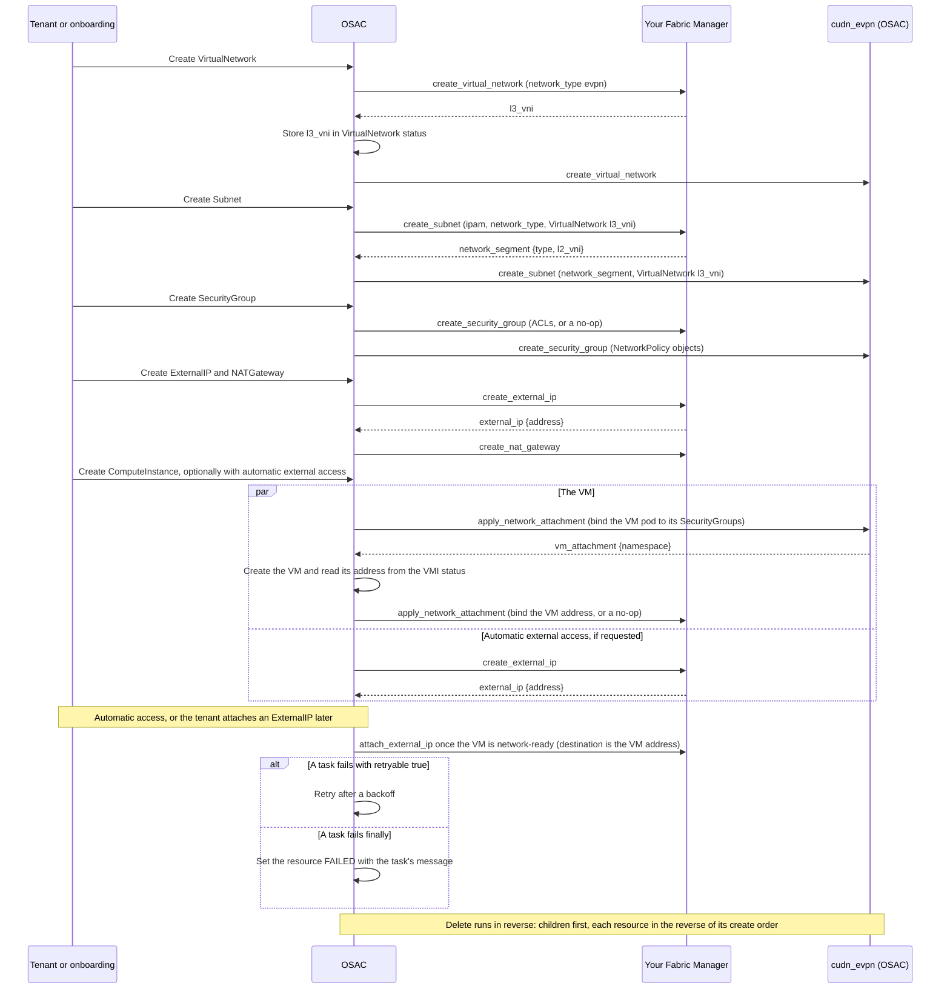

# OSAC Fabric Manager Guide

**Audience:** a provider whose deployment enables VMaaS only, with its own Fabric Manager and OSAC's `cudn_evpn` Kubernetes Manager over the `evpn` network type.

This guide shows how to build, test, deploy, and run an OSAC **Fabric Manager**, the one network manager a provider writes. The examples call your company **Acme**: replace `acme` and `ACME` with your own names, and every Acme fabric API call (marked `PLACEHOLDER`) with your backend's API. The guide has every rule a VMaaS-only Fabric Manager acts on, so you can build the manager from this guide alone.

**How to use this guide.** Read part 1 first: it explains how OSAC uses your manager. Then follow parts 2 to 6 in order: plan, build, test without OSAC, deploy, and verify in an OSAC lab. Part 7 is for running the manager. The appendices hold the complete input of every task and every check OSAC applies to a result.

**Contents**

- [1. How OSAC works](#1-how-osac-works)
  - [Terms](#terms)
  - [The two managers](#the-two-managers)
  - [What happens when a tenant creates a VM](#what-happens-when-a-tenant-creates-a-vm)
  - [How OSAC runs a task](#how-osac-runs-a-task)
  - [What OSAC guarantees](#what-osac-guarantees)
- [2. Plan your manager](#2-plan-your-manager)
  - [What you prepare, and when](#what-you-prepare-and-when)
  - [What your fabric must provide](#what-your-fabric-must-provide)
  - [The task files you write](#the-task-files-you-write)
  - [Names](#names)
  - [Your manager design](#your-manager-design)
- [3. Build your manager](#3-build-your-manager)
  - [Create the collection and role](#create-the-collection-and-role)
  - [Write a task file](#write-a-task-file)
  - [Rules every task follows](#rules-every-task-follows)
  - [Use the Subnet address layout](#use-the-subnet-address-layout)
  - [Implement the tasks in order](#implement-the-tasks-in-order)
- [4. Test your tasks](#4-test-your-tasks)
  - [Run a task with Ansible](#run-a-task-with-ansible)
  - [What to check](#what-to-check)
- [5. Hand over your manager](#5-hand-over-your-manager)
  - [Agree on the shared values and prepare your fabric](#agree-on-the-shared-values-and-prepare-your-fabric)
  - [Build the execution environment image](#build-the-execution-environment-image)
  - [Settings and secrets](#settings-and-secrets)
  - [Registration manifest](#registration-manifest)
- [6. Verify in a lab and go live](#6-verify-in-a-lab-and-go-live)
  - [Verify in a lab](#verify-in-a-lab)
  - [Go-live checklist](#go-live-checklist)
- [7. Operate and change a manager](#7-operate-and-change-a-manager)
  - [Read the status](#read-the-status)
  - [Handle failures and deletes](#handle-failures-and-deletes)
  - [Change a manager](#change-a-manager)
- [Appendix A: Complete task inputs](#appendix-a-complete-task-inputs)
- [Appendix B: OSAC's result checks](#appendix-b-osacs-result-checks)
- [Related documents](#related-documents)

## 1. How OSAC works

This part explains what OSAC does and what your manager does. You write no code here.

### Terms

| Term | Meaning |
|---|---|
| Hub | The management cluster. The OSAC operator, the OSAC CRs, AAP, and the VMs all run there. It is the only cluster your tasks reach. **Hub nodes** are its nodes that run VMs; the OSAC installer connects each of them to your fabric over EVPN ([Agree on the shared values and prepare your fabric](#agree-on-the-shared-values-and-prepare-your-fabric)). |
| Manager | An Ansible role with one task file per task. Yours is in your own collection. |
| Task | One named operation, such as `create_subnet`. OSAC runs it as one AAP job. |
| API ID | The stable ID the fulfillment service gives a resource; never the CR name or `metadata.uid`. API IDs are lowercase UUIDs (36 characters) and are never reused, so you can derive backend names from them. |
| NetworkAttachment | OSAC's internal hub CR for a VM's attachment to its Subnet and SecurityGroups. `cudn_evpn` attaches the VM, and your manager binds the VM's address to its SecurityGroups, or does nothing as a documented no-op ([VM attachment tasks](#vm-attachment-tasks)). |
| Network type | The technology this deployment's NetworkClass uses to isolate VirtualNetworks and Subnets; recorded on each VirtualNetwork's status. This release has only `evpn`. |
| Manager design | The document you publish with your role ([Your manager design](#your-manager-design)). OSAC never reads it. |
| No-op | A task, or part of one, that changes nothing, returns a valid result, and is described as a no-op in your manager design. |

### The two managers

| Type | Written by | Configures | Selected by the Helm value |
|---|---|---|---|
| Fabric Manager | You | The fabric: routing domains, Subnet segments, EVPN extension to the hub nodes, NAT, external addresses, and SecurityGroup ACLs if your fabric enforces them. | `global.networking.fabricManager` |
| Kubernetes Manager | OSAC (`cudn_evpn`) | The hub: the overlay network VMs use as their primary network, VM addresses, SecurityGroup policy objects bound to VMs. | `global.networking.k8sManager` |

`cudn_evpn` ships in OSAC's base image ([Build the execution environment image](#build-the-execution-environment-image)), and the OSAC installer registers it. It builds a Layer2 OVN-Kubernetes ClusterUserDefinedNetwork with `transport: EVPN`, using the Subnet's `l2_vni` and its VirtualNetwork's `l3_vni`.

It hands out VM addresses and enforces VM SecurityGroups with NetworkPolicy;
your fabric may also enforce them. See [SecurityGroup tasks](#securitygroup-tasks).

The CUDN template sets `defaultGatewayIPs: [gateway_ip]`, using the Subnet's
`gateway_ipv4`. OVN-Kubernetes serves this default gateway on every hub node
and routes into the IP-VRF (symmetric IRB). The fabric carries the MAC-VRF
(`l2_vni`) and IP-VRF (`l3_vni`) to the hub nodes and routes the IP-VRF; it
need not serve the VMs' gateway, but may (see Gateway in [What your fabric
must provide](#what-your-fabric-must-provide)). You write no hub or VM
networking.

OSAC validates tenant requests, computes each Subnet's address layout, stores
task inputs, runs jobs in AAP, validates results, and orders your tasks and
`cudn_evpn`'s. `create_virtual_network` returns the VirtualNetwork's `l3_vni`;
OSAC stores it in VirtualNetwork status and passes it to both managers' Subnet
tasks. `create_subnet` returns the Subnet's `l2_vni`, which OSAC passes to
`cudn_evpn`. OSAC retries or cancels jobs and keeps finalizers until cleanup
succeeds.

At create, OSAC records the managers in the CR's `status.networkManagers`
and, for a VirtualNetwork and its children, the network type in
`status.networkType`; every later task of that resource, deletes included,
uses these values. An ExternalIPPool, ExternalIP, ExternalIPAttachment, or
NATGateway records only your Fabric Manager, because only Fabric tasks run on
them; every other resource records both managers, copied from its parent.

**A manager never:** writes OSAC CRs (OSAC writes all status, addresses, and results; your job's service account could write them, so this is a rule you follow, not one OSAC enforces); reads or modifies VMs or the hub's VM networks; calls the Kubernetes Manager; writes static addresses into guests; puts secrets in `osac_job_vars`, `osac_result`, `osac_error`, or task logs; keys backend state by a name, CIDR, IP, MAC, AAP job ID, or Kubernetes UID; or uses `tenant` to authorize anything.

### What happens when a tenant creates a VM

Your tasks run at the points below. Deletes run in reverse.



### How OSAC runs a task

OSAC runs every task through one generic playbook in the networking AAP instance group:

```yaml
- name: Run the selected network manager task
  ansible.builtin.include_role:
    name: "{{ osac_job_vars.manager.ansible_role }}"
    tasks_from: "{{ osac_job_vars.task }}"
```

Before `include_role`, the playbook checks that your role and its task file exist in the image; if not, it fails the job with `osac_error: {message: "role <ansible_role> or task file <task> not found in the execution environment", retryable: true}`, so a fixed image recovers the resource. You add no job templates or playbooks.

Your task gets all its input in one variable, `osac_job_vars` ([Read the input](#read-the-input)). It reports back with `ansible.builtin.set_stats`: its typed result as `osac_result`, or an error as `osac_error` with `retryable` true or false ([Return a result or an error](#return-a-result-or-an-error)). OSAC then acts on the outcome:

| Task kind | Failure | What OSAC does |
|---|---|---|
| create, apply, attach | `retryable: true`, or AAP ended the job before it could report (AAP status `error`, such as an evicted pod, or the 60-minute job timeout) | Retries after 2, 4, 8, 16, 30, 30, … minutes, with no attempt limit. The resource stays PENDING with your message and the next retry time. Exception: during a SecurityGroup rule update, a READY group stays READY (message `Updating`). |
| create, apply, attach | `retryable: false`, a failure without `osac_error`, a malformed `osac_error` (not exactly `{message, retryable}`), or a rejected result | **Final.** The resource is FAILED with your message; the owner deletes it. No retry, also not after a backend repair; only a new input starts a new attempt (a SecurityGroup rule update). |
| delete, detach | Any failure | Retries with the same backoff until it succeeds; the finalizer stays. |

A job that AAP has not started within 30 minutes (for example, no capacity in the instance group) is cancelled and launched again with the same backoff; your task never sees it. A job cancelled by hand in AAP is launched again at once.

### What OSAC guarantees

Your tasks can rely on these rules:

- **Order.** For a VirtualNetwork, Subnet, or SecurityGroup, create (and a
  SecurityGroup rule update) runs your task, then `cudn_evpn`'s; delete runs in
  reverse. For a VM, `cudn_evpn`'s `apply_network_attachment` runs first, then
  OSAC creates the VM, then your apply runs with its address; after the VM is
  gone, your delete runs, then `cudn_evpn`'s. A child is created after its
  parent and deleted before it: Subnet, SecurityGroup, and NATGateway under
  their VirtualNetwork; ExternalIP under its pool; ExternalIPAttachment under
  its ExternalIP.
- A VM's NetworkAttachment belongs to its ComputeInstance and references its
  Subnet: it is created after the Subnet and deleted before it.
- **Concurrency.** OSAC runs at most one job at a time per resource, task, and manager, and at most one Subnet task at a time per VirtualNetwork. Jobs of distinct resources may run in parallel, and so may different tasks on one resource unless the order above applies. Managers take no locks.
- **Cancel on delete.** Deleting a resource cancels any create, apply or
  attach job still running for it, and any pending retry. OSAC ignores the
  result of a cancelled job. As soon as AAP reports that job ended, OSAC runs
  your delete task, even if the cancelled job had already started backend
  work. Your delete must therefore find and remove everything by the
  resource's API ID, including anything the cancelled job created.
- **Retries** start only after the previous job has ended.
- **Timeout.** Every networking job has an AAP timeout of 60 minutes. Keep each task, including its backend waits, well below it.

## 2. Plan your manager

Plan what you prepare and when, what your fabric must do, which task files you write, and the names you use.

### What you prepare, and when

You build and test without OSAC. You hand your manager over before OSAC is installed, and you verify it once OSAC runs:

| When | What you do |
|---|---|
| While you build | Write and test the tasks ([3. Build your manager](#3-build-your-manager), [4. Test your tasks](#4-test-your-tasks)) and your manager design. |
| Before the OSAC install | Agree on the shared values with the Cloud Infrastructure Admin, prepare your fabric, and hand over your image, settings, secrets, and registration manifest ([5. Hand over your manager](#5-hand-over-your-manager)). |
| During the install | The Cloud Infrastructure Admin installs OSAC with your manager, following the [OSAC installation guide](../installation/customer-install-guide.md#44-installing-with-provider-networking). |
| After the install | Verify your manager in a lab, then go live ([6. Verify in a lab and go live](#6-verify-in-a-lab-and-go-live)). |

The shared values are fixed once OSAC is installed ([Agree on the shared values and prepare your fabric](#agree-on-the-shared-values-and-prepare-your-fabric)). Choose them with care, and size the VNI range with headroom.

### What your fabric must provide

A **network type** names the technology this deployment's NetworkClass uses to
isolate VirtualNetworks and Subnets. The NetworkClass records one type for the
deployment, and each VirtualNetwork records it in status; its Subnets inherit
that type. This release has one, `evpn`: an EVPN control plane with a VXLAN
data plane, served on the hub by `cudn_evpn`. Declare it in `network_types` of
your registration ([Registration manifest](#registration-manifest)); without
it, the NetworkClass is FAILED and no networking resource can be created.

For `evpn`, your fabric must provide:

- **VirtualNetwork.** `create_virtual_network` creates the routing domain's
  IP-VRF, allocates its `l3_vni`, extends it to the hub nodes, and returns
  `l3_vni`. OSAC stores that result in the VirtualNetwork status.
- **Subnet.** `create_subnet` receives the VirtualNetwork's `l3_vni`, creates
  the segment's MAC-VRF with its own `l2_vni`, extends it to the hub nodes,
  and returns `network_segment: {type, l2_vni}`.
- **Route targets.** Extend each VRF to the hub nodes by importing and
  exporting its route target `0:<VNI>` over your EVPN peering with them:
  `0:<l3_vni>` for the IP-VRF and `0:<l2_vni>` for the MAC-VRF. `cudn_evpn`
  sets exactly these route targets on the hub, whatever the hub nodes' BGP
  AS; OSAC passes no route target to your tasks. With any other route target,
  the hub and your fabric exchange no routes, and VMs get no connectivity
  while every task succeeds.
- **Gateway.** The CUDN template sets
  `defaultGatewayIPs: [gateway_ip]` from `gateway_ipv4`.
  OVN-Kubernetes serves this gateway on every hub node and routes VM traffic
  into the IP-VRF (symmetric IRB). Your fabric carries the
  MAC-VRF (`l2_vni`) and IP-VRF (`l3_vni`) to the hub nodes and routes the
  IP-VRF. Your fabric need not serve the VMs' gateway. It may also serve
  `gateway_ipv4` on its own devices, for example so that a physical host on
  the Subnet has a gateway. If it does, it must not conflict with the
  OVN-Kubernetes gateway on the same segment: either use the same MAC address
  (recommended), or accept that routed traffic can see two gateway MAC
  addresses. OVN-Kubernetes derives its gateway MAC from the gateway address
  and you cannot configure it: `0a:58` followed by the four bytes of
  `gateway_ipv4` (`0a:58:0a:00:01:01` for `10.0.1.1`). Verify it in your lab.
  State in your manager design which choice you made. The template also sets
  `infrastructureSubnets: [<gateway>/32, <network + 2>/32]`: the gateway and
  the address two above the Subnet's network address are infrastructure
  addresses of OVN-Kubernetes on the overlay range, never handed to VMs.
- **VTEP addresses.** Each VTEP, on a hub node or leaf, has its own underlay
  address.
- **Unique VNIs.** No two resources share a VNI, and no `l2_vni` equals an
  `l3_vni`. Allocate both VNI types atomically from the range kept for OSAC in
  your settings. When your fabric allocates VNIs itself (the Netris Fabric
  Manager does), return the VNI that it allocated; then no OSAC range applies.
  When the range has no free VNI, fail with `retryable: false`
  and a message naming the range. Reuse a VNI only after the Fabric delete
  that held it succeeded, and free it as the last step of that delete, so a
  failed delete never frees it; OSAC handles a freed VNI that a parallel
  create gets at once ([Subnet tasks](#subnet-tasks)).
- **Persistent VNIs.** A VirtualNetwork's `l3_vni` and a Subnet's `l2_vni`
  stay the same for each resource's whole life, across controller restarts and
  backend upgrades. Each task returns the same value on reruns.
- **Data plane.** VXLAN on UDP port 4789. Flood broadcast, unknown-unicast, and multicast traffic by ingress replication (type-3 routes), with no multicast underlay.
- **MTU.** Workloads use MTU 1500 (`cudn_evpn` sets it on its network). The fabric underlay and the hub node NICs carry frames of at least 1550 bytes (jumbo frames recommended).

Example, with VirtualNetwork `l3_vni` `20001`, and Subnet `10.0.1.0/24` with
`l2_vni` `10100`:

```text
create_virtual_network:  IP-VRF   VNI 20001  route target 0:20001
create_subnet:           MAC-VRF  VNI 10100  route target 0:10100
                         carried to hub nodes and routed in IP-VRF 20001
OVN-Kubernetes:           gateway 10.0.1.1/24 on every hub node; routes into
                         IP-VRF 20001 (symmetric IRB)
```

Carry the MAC-VRF and IP-VRF to the hub nodes and advertise the required EVPN
routes. Your lab verification checks that VMs reach their gateway, each other,
and the outside ([Verify in a lab](#verify-in-a-lab)).

### The task files you write

You write 16 task files:

| Tasks | What to do |
|---|---|
| `create_virtual_network`, `delete_virtual_network`, `create_external_ip_pool`, `delete_external_ip_pool`, `create_external_ip`, `delete_external_ip`, `attach_external_ip`, `detach_external_ip`, `create_nat_gateway`, `delete_nat_gateway` | Implement. `create_virtual_network` allocates and returns `l3_vni`. |
| `create_subnet`, `delete_subnet` | Implement the segment and EVPN duties; these are never a no-op (nor are those of `create_virtual_network`). Serve no DHCP for overlay (VM) addresses; physical-range DHCP only as the DHCP rule allows ([Use the Subnet address layout](#use-the-subnet-address-layout)). |
| `create_security_group`, `delete_security_group`, `apply_network_attachment`, `delete_network_attachment` | Enforce SecurityGroups with your fabric's ACLs, or make all four documented no-ops ([SecurityGroup tasks](#securitygroup-tasks)). |

The contract also defines Fabric tasks for BMaaS and CaaS. OSAC never calls them in a VMaaS-only deployment, so you write no files for them.

### Names

Choose the role name and network types once: OSAC reads them only until the NetworkClass is READY ([Change a manager](#change-a-manager)).

| Item | Rule | Example |
|---|---|---|
| Manager name (`name` in the registration) | Lowercase letters, digits, underscores; starts with a letter. | `acme_fabric` |
| Collection | Your own namespace, never `osac.*`: OSAC's collections shadow one of the same name. | `acme.network` |
| Ansible role | One role. | `acme.network.fabric` |
| Environment variables | Start with the registration `name` in upper case. | `ACME_FABRIC_API_URL` |

### Your manager design

Write a short document for your manager. It lists the environment variables your manager reads (and which are secrets), its network types, its no-ops (the SecurityGroup and VM attachment tasks, if your fabric does not enforce SecurityGroups), its implementation limits ([Implementation limits](#implementation-limits)), the hub permissions its tasks need ([Settings and secrets](#settings-and-secrets)), and its installation prerequisites ([Agree on the shared values and prepare your fabric](#agree-on-the-shared-values-and-prepare-your-fabric)). Publish it anywhere; OSAC never reads it.

## 3. Build your manager

Build in this order: the collection, the task file pattern, the rules every task follows, then the tasks, one resource at a time. Test each task as soon as it works ([4. Test your tasks](#4-test-your-tasks)).

### Create the collection and role

Create one Ansible collection with one role that holds the 16 task files ([The task files you write](#the-task-files-you-write)). Each task is the file `roles/<role>/tasks/<task>.yaml` (or `.yml`); OSAC runs only the fixed task names. The role may also hold helper task files (for example `tasks/_report_error.yaml`, included with `ansible.builtin.include_tasks`), `defaults/`, `vars/`, `templates/`, and `files/`; OSAC never calls a helper directly.

```text
acme_collections/ansible_collections/acme/network/
├── README.md
├── galaxy.yml
├── meta/runtime.yml
└── roles/fabric/tasks/                # role acme.network.fabric
    ├── create_virtual_network.yaml
    ├── delete_virtual_network.yaml
    ├── create_subnet.yaml
    ├── delete_subnet.yaml
    ├── create_security_group.yaml
    ├── delete_security_group.yaml
    ├── apply_network_attachment.yaml
    ├── delete_network_attachment.yaml
    ├── create_external_ip_pool.yaml
    ├── delete_external_ip_pool.yaml
    ├── create_external_ip.yaml
    ├── delete_external_ip.yaml
    ├── attach_external_ip.yaml
    ├── detach_external_ip.yaml
    ├── create_nat_gateway.yaml
    └── delete_nat_gateway.yaml
```

`galaxy.yml` (and `meta/runtime.yml` with `requires_ansible: ">=2.19.0"`):

```yaml
namespace: acme
name: network
version: 1.0.0
readme: README.md
authors: [Acme Networking <networking@acme.example>]
description: Acme Fabric Manager for OSAC networking.
license: [Apache-2.0]
dependencies: {}    # leave out collections OSAC's base image already ships
build_ignore: ["*.tar.gz"]
```

Call modules by fully qualified name. OSAC's base image already has OSAC's collections and their dependencies (including `ansible.utils` and `community.general`); add only what your collection needs. Check their versions before you use a newer module or filter (`ansible-galaxy collection list` in the base image). `ansible.utils` network filters need the Python package `netaddr`, which OSAC's base image ships. Do not rely on facts; the generic playbook may not gather them.

### Write a task file

#### Read the input

Your task receives one variable, `osac_job_vars`. A complete `create_subnet` input ([Appendix A](#appendix-a-complete-task-inputs) has every task's):

```yaml
osac_job_vars:
  manager: {name: acme_fabric, type: fabric, ansible_role: acme.network.fabric}
  task: create_subnet
  tenant: 5d6a0f1e-2b3c-4d5e-8f90-a1b2c3d4e5f6     # absent for ExternalIPPool tasks
  resource:                                         # snapshot of the resource the task acts on
    apiVersion: osac.openshift.io/v1alpha1
    kind: Subnet
    id: 8a2b4c6d-1e3f-4a5b-9c7d-2e4f6a8b0c12          # the API ID: your ownership key
    metadata: {name: subnet-8a2b4c6d, namespace: osac-networking, uid: 4f0e1d2c-aaaa-4bbb-8ccc-123456789abc, generation: 1}
    spec: {ipv4Cidr: 10.0.1.0/24}                   # only the fields the task lists
  virtual_network:                                  # parent snapshot
    apiVersion: osac.openshift.io/v1alpha1
    kind: VirtualNetwork
    id: 3f1c9a2e-7b4d-4e8a-9c6f-0d2e4b6a8c10
    metadata: {name: vn-3f1c9a2e, namespace: osac-networking, uid: 0e9d8c7b-6a5f-4e3d-8c2b-1a0f9e8d7c6b, generation: 1}
    spec: {ipv4Cidr: 10.0.0.0/16}
    status: {l3Vni: 20001}
  ipam:                                             # the Subnet address layout
    gateway_ipv4: 10.0.1.1
    overlay_ipv4_cidrs: [10.0.1.0/25, 10.0.1.128/26]
    physical_ipv4_cidrs: [10.0.1.192/26]
    lb_vip_ipv4_cidrs: []
  network_type: evpn                                # added at launch (Subnet tasks)
```

- `resource.id` is the ownership key; `metadata.uid` and `metadata.generation` only identify the CR version the input came from.
- A parent's API ID (`virtual_network.id` here) is enough to find your backend objects for that parent. OSAC passes the whole parent snapshot so that a task never reads OSAC CRs, and so that retries and the delete see the same parent values, taken from the stored input. Beyond the ID, a Subnet task needs only the VirtualNetwork's accepted `l3Vni`.
- A snapshot `spec` holds only the fields its task section lists ([Implement the tasks in order](#implement-the-tasks-in-order)), in camelCase (`spec: {}` when none). Parent snapshots carry only `spec.ipv4Cidr` (a pool: `spec.cidrs`), except that the VirtualNetwork snapshot on a Subnet task also carries its accepted `status.l3Vni`. A key the task does not list is absent.
- Keys and typed outputs use snake_case. IPv4 addresses are dotted decimal without leading zeros or a prefix length; CIDRs have zero host bits. Return values in the same formats.
- **Stored input.** OSAC stores the input once, when it starts the first job of a create, apply, or attach, in the CR's `status.taskInput`: one stored input per CR, shared by both managers. Every retry and the matching delete or detach get that stored input plus `manager` and `task`, and, for VirtualNetwork and Subnet tasks only, `network_type`, which OSAC adds at launch and never stores ([Subnet tasks](#subnet-tasks)); so a delete gets the same input as its create, except `task`. Two exceptions: a SecurityGroup rule update stores a new input ([SecurityGroup tasks](#securitygroup-tasks)), and OSAC adds the VM's address, `network_attachment.interface.ipv4_address`, to a VM attachment's stored input before your first apply (`cudn_evpn` ignores it; [VM attachment tasks](#vm-attachment-tasks)).
- The hub networking namespace (`osac-networking` in the examples) is `resource.metadata.namespace`; always read it from the input.

**Settings and secrets** reach your task as environment variables from the ConfigMap and Secret `network-fulfillment-ig` ([Settings and secrets](#settings-and-secrets)). Read them with `lookup('ansible.builtin.env', ...)` in the task that needs them, and mark every task that handles a secret `no_log: true`. A CA bundle can come through the ConfigMap; when a client needs a file, write it to a job-unique file only when it is set, and remove the file at the end (the pattern below). The CA certificate needs the `keyUsage` extension (`keyCertSign`): Python 3.13 and later reject a CA without it. Write private keys with mode `0600` and delete them after use. Check every setting a task reads, and its format where that is cheap, in the task's first step, so a bad value never reaches your backend. A missing or malformed setting fails the task with `retryable: true` and a message naming the setting: an administrator can fix it, and job pods read settings when they start.

#### Return a result or an error

Every task file follows this pattern. This complete `create_external_ip` reads its settings, calls the backend (the Acme API is a **placeholder**), and returns the typed result or an error:

```yaml
---
# roles/fabric/tasks/create_external_ip.yaml
- name: Reserve an ExternalIP address
  vars:
    acme_api: "{{ lookup('ansible.builtin.env', 'ACME_FABRIC_API_URL') }}"
    acme_token: "{{ lookup('ansible.builtin.env', 'ACME_FABRIC_API_TOKEN') }}"
    acme_ca_bundle: "{{ lookup('ansible.builtin.env', 'ACME_FABRIC_CA_BUNDLE') }}"
    acme_final_statuses: [400, 410, 422]    # PLACEHOLDER: backend HTTP statuses that a retry cannot fix
  block:
    - name: Fail when a setting is missing or malformed    # retryable: an administrator can fix it
      vars:
        acme_checks:                    # each setting this task reads: true when its value is well formed
          ACME_FABRIC_API_URL: "{{ acme_api is match('https://[^ ]+$') }}"
          ACME_FABRIC_API_TOKEN: "{{ acme_token | length > 0 }}"
          ACME_FABRIC_CA_BUNDLE: "{{ acme_ca_bundle | length == 0 or ('-----BEGIN CERTIFICATE-----' in acme_ca_bundle and '-----END CERTIFICATE-----' in acme_ca_bundle) }}"
        acme_bad: "{{ acme_checks | dict2items | rejectattr('value') | map(attribute='key') | list }}"
      when: acme_bad | length > 0
      ansible.builtin.fail:
        msg: "Missing or malformed setting in network-fulfillment-ig: {{ acme_bad | join(', ') }}."

    - name: Create a job-unique file for the CA bundle    # only when the setting is set
      when: acme_ca_bundle | length > 0
      ansible.builtin.tempfile:
        suffix: .pem
      register: acme_ca_file

    - name: Write the CA bundle
      when: acme_ca_bundle | length > 0
      ansible.builtin.copy:
        content: "{{ acme_ca_bundle }}"
        dest: "{{ acme_ca_file.path }}"

    - name: Reserve a free address under the ExternalIP API ID    # PLACEHOLDER: Acme IPAM API
      ansible.builtin.uri:
        url: "{{ acme_api }}/v1/pools/osac-{{ osac_job_vars.external_ip_pool.id }}/reservations/{{ osac_job_vars.resource.id }}"
        method: PUT
        headers: {Authorization: "Bearer {{ acme_token }}"}
        ca_path: "{{ acme_ca_file.path | default(omit) }}"
        timeout: 30
        status_code: [200, 201, 507]    # 200: the same reservation on a retry; 507: pool full
        return_content: true
      register: acme_reservation
      no_log: true

    - name: Stop with a final error when the pool has no free address
      when: acme_reservation.status == 507
      block:
        - name: Mark the error as final
          ansible.builtin.set_fact:
            acme_final_error: >-
              ExternalIPPool {{ osac_job_vars.external_ip_pool.id }} is full.
              Delete unused ExternalIPs or add a pool.
        - name: Fail
          ansible.builtin.fail:
            msg: "{{ acme_final_error }}"

    - name: Return the typed output to OSAC
      ansible.builtin.set_stats:
        aggregate: false
        per_host: false
        data:
          osac_result:
            external_ip:
              address: "{{ acme_reservation.json.address }}"    # PLACEHOLDER response field

  rescue:
    - name: Build an error message without secrets    # read only status, msg, and json.message
      ansible.builtin.set_fact:
        acme_error_message: >-
          {{ acme_final_error | default(
               ('The Acme Fabric API did not answer in time, cannot be reached, or its certificate is not trusted (check ACME_FABRIC_API_URL and ACME_FABRIC_CA_BUNDLE): ' ~ ansible_failed_result.msg)
               if ansible_failed_result.status | default(0) == -1 else
               ('Step "' ~ ansible_failed_task.name ~ '" failed'
                ~ ((' with backend HTTP status ' ~ ansible_failed_result.status) if ansible_failed_result.status is defined else '')
                ~ ': ' ~ (ansible_failed_result.json.message | default(ansible_failed_result.msg) | default('no details', true))),
               true) }}

    - name: Report the error to OSAC
      ansible.builtin.set_stats:
        aggregate: false
        per_host: false
        data:
          osac_error:
            message: "{{ acme_error_message }}"
            retryable: "{{ acme_final_error is undefined and ansible_failed_result.status | default(0) not in acme_final_statuses }}"

    - name: Fail the play
      ansible.builtin.fail:
        msg: "{{ acme_error_message }}"

  always:
    - name: Remove the CA file
      when: acme_ca_file.path is defined
      ansible.builtin.file:
        path: "{{ acme_ca_file.path }}"
        state: absent
```

The Acme IPAM API reserves atomically and returns the existing reservation for the same API ID, so a retry returns the same address and parallel calls on one pool never get the same one ([Parallel jobs](#parallel-jobs)). The other examples in this guide show only the steps inside the `block:` and leave out `ca_path` and `timeout`.

**Keep secrets out of errors.** `no_log: true` hides a task's result from the log, not from `ansible_failed_result`: in the rescue it is the complete result, including `invocation.module_args` with your Authorization header. Never put `ansible_failed_result`, or its `invocation`, into `osac_error`, a `debug`, or a `fail` message. Read only the fields the pattern reads: `status` (the backend HTTP status, `-1` when the backend was unreachable or did not answer within `timeout`), `msg`, and your backend's own error field (here the placeholder `json.message`), and only if your backend never echoes a secret in it.

The pattern raises a **final** error by setting `acme_final_error` before it fails, or when the backend answers with a status in `acme_final_statuses`; it reports every other error as retryable. List there your backend's answers that mean "never possible", for example 400 for a malformed request, 410 for a write to a deleted API ID ([Ownership, idempotency, and updates](#ownership-idempotency-and-updates)), and 422 for an implementation limit; the settings check keeps a bad setting from reaching the backend as one of them. Retrying every other error is the pattern's default, not OSAC's: a failure without `osac_error` is final. Because the pattern retries every unclassified error, a bug is retried forever (at most every 30 minutes); mark every error a retry cannot fix as final.

Result rules:

- A task with a typed output publishes it under `osac_result` with `ansible.builtin.set_stats` before it ends. A task without one publishes nothing; a successful play is its result.
- OSAC rejects a result with a missing required output, an extra key, or a malformed value, or a `create_nat_gateway` result whose dependencies changed during the job ([NATGateway tasks](#natgateway-tasks)); a rejected result is a final failure, and OSAC changes nothing. When the play fails, OSAC ignores any `osac_result`.
- OSAC reads only `osac_result` and `osac_error`, and only from the job it launched, so a result needs no identity fields.
- `osac_error` has exactly `message` and `retryable`. `message` says in plain words what failed and what to fix. Tenants see it; never put secrets in it.
- [Appendix B](#appendix-b-osacs-result-checks) lists every check OSAC applies.

Use `retryable: false` when retrying cannot help: your fabric cannot build the Subnet or hold a SecurityGroup's rules, or the pool or the VNI range is full. Use `retryable: true` for anything that can pass later: backend timeouts, an unreachable backend, API errors, a conflict with a parallel job, or a missing or malformed setting (job pods load settings when they start).

**Hub objects (optional).** A Fabric Manager normally creates none. If yours does, reach the hub with the job pod's in-cluster service account (the `kubernetes.core` modules use it; for a local test, set `K8S_AUTH_KUBECONFIG`), name each object from the API ID, label it `osac.openshift.io/owner-kind: <lowercase kind>` and `osac.openshift.io/owner-id: <API ID>` where Kubernetes allows labels, remove it by these labels in the resource's delete task, and list the hub permissions in your manager design.

### Rules every task follows

#### Ownership, idempotency, and updates

- Key every backend object by `resource.id`. Use names derived from it, and record it on the object, in a field (`external_id` in the examples) or as the object's key (the reservation URL in [Return a result or an error](#return-a-result-or-an-error)).
- A repeated create or apply leaves the same backend state (no duplicate objects, addresses, or policy) and returns the same typed output.
- **Create also updates.** OSAC updates a resource by running its create or apply task again, with the same `resource.id` and a new input; in this release, the only case is a SecurityGroup rule update ([SecurityGroup tasks](#securitygroup-tasks)). So a create or apply makes the backend match its input: it creates what is missing and changes what differs, and never stops just because the object exists. It keeps what it allocated for the API ID (VNIs, addresses), so the typed output stays the same.
- A task can be stopped at any point, for example when a delete cancels it. The next run, or the delete, handles the partial state.
- A delete removes what it finds for the API ID and reports success only when cleanup is complete; wait for an asynchronous backend. It succeeds when the state is already gone, including when nothing was ever created.
- **A delete wins over in-flight writes.** Cancelling a job kills its pod, but not a request your backend already accepted, and OSAC runs your delete at once. A create, apply, or attach of the same API ID may still land after your delete succeeded; it must leave no state. Do it in your backend for every kind of object (pool reservations, ACL bindings, NAT rules, VRFs, segments), in one of two ways: the backend applies the requests of one API ID in order, so a DELETE takes effect after an earlier PUT; or the delete records a **tombstone** for the API ID that turns any later write for it into a no-op. The backend answers such a write with an error (for example 410 Gone), never with a success that has no object, and your task reports it as final (`acme_final_statuses` in [Return a result or an error](#return-a-result-or-an-error)): OSAC ignores a cancelled job's result and never writes a deleted API ID again. API IDs are never reused, so a tombstone never blocks a new resource. Test this before you hand over ([What to check](#what-to-check)).
- A missing hub CR is no reason to delete or reallocate backend state. Tolerate state left by API IDs that no longer exist.
- OSAC runs no delete or detach on a manager whose create, apply, or attach
  never started (it has no `status.jobs` entry). When OSAC rejects a result,
  cleanup runs only for managers whose task started.

The simplest idempotent create is one backend call keyed by the API ID that
creates the object, or updates the existing one to match the request (an
upsert). For `create_virtual_network`, that call also allocates or reads the
VirtualNetwork's stable `l3_vni`:

```yaml
- name: Create or read the VRF of this VirtualNetwork    # PLACEHOLDER: Acme Fabric API
  ansible.builtin.uri:
    url: "{{ acme_api }}/v1/vrfs/osac-vn-{{ osac_job_vars.resource.id }}"
    method: PUT                         # creates the VRF, or updates the existing one to match this body
    body_format: json
    body: {external_id: "{{ osac_job_vars.resource.id }}", tenant_label: "{{ osac_job_vars.tenant }}"}
    headers: {Authorization: "Bearer {{ acme_token }}"}
    status_code: [200, 201]
    return_content: true
  register: acme_vrf
  no_log: true
```

And the idempotent delete in `delete_virtual_network`, with a poll (`until:`) that waits for 404 when your backend deletes asynchronously (the Acme API answers a GET for a deleted API ID with 404, also while it keeps a tombstone; if yours answers 410, accept it in the poll):

```yaml
- name: Delete the VRF of this VirtualNetwork    # PLACEHOLDER: Acme Fabric API, which records a tombstone for the API ID
  ansible.builtin.uri:
    url: "{{ acme_api }}/v1/vrfs/osac-vn-{{ osac_job_vars.resource.id }}"
    method: DELETE
    headers: {Authorization: "Bearer {{ acme_token }}"}
    status_code: [200, 202, 204, 404]   # 404: already gone, or never created
  no_log: true

- name: Wait until the VRF is gone    # PLACEHOLDER: an asynchronous backend
  ansible.builtin.uri:
    url: "{{ acme_api }}/v1/vrfs/osac-vn-{{ osac_job_vars.resource.id }}"
    headers: {Authorization: "Bearer {{ acme_token }}"}
    status_code: [200, 404]
  register: acme_vrf_gone
  until: acme_vrf_gone.status == 404
  retries: 60
  delay: 10
  no_log: true
```

#### Parallel jobs

OSAC runs jobs of different resources in parallel ([What OSAC guarantees](#what-osac-guarantees)), and you take no locks. With VMaaS only, tasks of different resources share at least these backend objects, in creates and deletes alike:

- one pool's free addresses: `create_external_ip` and `delete_external_ip` of different ExternalIPs in one pool;
- one VRF's NAT and DNAT rule set: `attach_external_ip`, `detach_external_ip`, `create_nat_gateway`, and `delete_nat_gateway` on one VirtualNetwork;
- the VNI range: `create_virtual_network`, `create_subnet`, and their deletes in different VirtualNetworks. A VNI that a delete frees may go at once to a parallel create; OSAC handles that ([Subnet tasks](#subnet-tasks)), so you need no quarantine or cyclic allocation;
- one SecurityGroup's ACLs, if you enforce SecurityGroups: `apply_network_attachment` and `delete_network_attachment` of different VMs bound to the group, and the group's rule update (`create_security_group`). Bind each VM address to the group's one policy object, which every `create_security_group` run replaces atomically, so a bind during a rule update still ends with the newest rules;
- anything else your backend shares across VirtualNetworks, for example the EVPN peering configuration with the hub nodes (each `create_virtual_network` and `create_subnet` adds a VRF or VNI to it) ([VirtualNetwork tasks](#virtualnetwork-tasks)).

For each, allocate or write atomically in your backend (as in the pattern), or fail with `retryable: true` on a conflict so OSAC retries with backoff; never read the object, change it, and write it back whole, which can lose a parallel job's change. A backend that can neither allocate atomically nor detect the conflict is not supported in this release.

#### Isolation with overlapping CIDRs

- Separate VirtualNetworks may use identical or overlapping CIDRs, even two of one tenant. Key routing, policy, NAT, address lookup, and cleanup by VirtualNetwork and Subnet API ID, so deleting one resource's state never removes another's. Never rely on a namespace or a separate backend API instance for isolation.
- Subnets of one VirtualNetwork have non-overlapping CIDRs and route to each other. Workloads on one Subnet share its L2 domain.
- No VirtualNetwork CIDR overlaps `global.networking.excludedIpv4Cidrs` or an ExternalIPPool CIDR; give your infrastructure ranges to the Cloud Infrastructure Admin for that list ([Agree on the shared values and prepare your fabric](#agree-on-the-shared-values-and-prepare-your-fabric)).

#### Implementation limits

If your fabric cannot build some Subnet, fail its `create_subnet` with `retryable: false` and a message that names the limit, and list the limit in your manager design. The Subnet stays FAILED, and the tenant deletes it.

`cudn_evpn` has a limit you see on the hub: it builds one hub network per VirtualNetwork, owned by one Subnet, because each OVN-Kubernetes network needs its own IP-VRF VNI: in a tenant's default VirtualNetwork the default Subnet (OSAC admits no other Subnet there until it is READY), elsewhere the first Subnet whose `cudn_evpn` `create_subnet` runs. VM attachments on the other Subnets of that VirtualNetwork fail with a final error that names the limit; OSAC accepts those Subnets and VMs at create. Your tasks run as usual on every Subnet.

### Use the Subnet address layout

OSAC computes each Subnet's layout once, at Subnet create, from the address plan stored with the Subnet, records it in `Subnet.status.ipam`, and passes it to both managers as `osac_job_vars.ipam`; every later task gets the recorded layout. The plan gives the shares `overlay`, `fabric`, and `lbVip` of the Subnet's addresses; with VMaaS only, the default is 0.75/0.25/0. From the network address, OSAC places the ranges in the order overlay, fabric, lbVip, each as the fewest aligned CIDRs in ascending order (a share of 0 gives `[]`):

```yaml
ipam:                                    # Subnet 10.0.1.0/24, plan 0.75/0.25/0
  gateway_ipv4: 10.0.1.1
  overlay_ipv4_cidrs: [10.0.1.0/25, 10.0.1.128/26]
  physical_ipv4_cidrs: [10.0.1.192/26]
  lb_vip_ipv4_cidrs: []
```

| Key | Rule | Who uses it |
|---|---|---|
| `gateway_ipv4` | Network address plus one, in every plan. | OVN-Kubernetes serves it as the VM gateway on every hub node; your fabric routes VM traffic into the IP-VRF and may also serve it on its own devices under the Gateway rule ([What your fabric must provide](#what-your-fabric-must-provide)). |
| `overlay_ipv4_cidrs` | The `overlay` share; never empty with `cudn_evpn`. | `cudn_evpn`, for VM addresses. |
| `physical_ipv4_cidrs` | The `fabric` share. | Your range: your own devices on the Subnet (for example appliances or router ports). |
| `lb_vip_ipv4_cidrs` | The `lbVip` share. | No one: `[]` with the default plan. Accept any list (a set `addressPlan` may fill it), and never use an address from it. |

Rules:

- Read the lists; never compute ranges from the Subnet CIDR or the plan. The plan can change only while no VirtualNetwork exists, and a recorded layout never changes, so no address moves.
- Any list may be `[]`, and every task accepts it. With an empty
  `physical_ipv4_cidrs`, use no Subnet address for a fabric device.
- **DHCP.** Serve no DHCP for overlay (VM) addresses: OVN-Kubernetes assigns them, and a second server on the shared segment could answer a VM. When `physical_ipv4_cidrs` is not empty and BMaaS or CaaS is enabled, you may serve DHCP only from `physical_ipv4_cidrs`, with `gateway_ipv4` as router, and answer only the MACs of physical attachments. With `[]`, serve none. The Netris Fabric Manager serves DHCP over `physical_ipv4_cidrs` once a physical attachment is applied, but it cannot filter by MAC (no DHCP host reservation in its collection), so it answers any MAC in that range, a deviation from this rule. Whether it answers VMs on the same EVPN Subnet is an open lab check.
- VMs get their address, the Subnet's prefix, `gateway_ipv4` as router
  (for example `10.0.1.17/24` via `10.0.1.1`), and the cluster DNS, from
  `cudn_evpn`'s DHCP. OVN-Kubernetes serves the gateway on every hub node.
  Your manager has no DNS task. A resolver for bare-metal hosts is the provider's installation-level concern, not an OSAC setting.
- Allocate only from your own range. Never use the network address or
  broadcast address for a fabric device, and use `gateway_ipv4` only to serve
  the Subnet's gateway under the Gateway rule; every other address for your
  own Subnet devices comes from `physical_ipv4_cidrs`.
- Every CIDR of a layout has at least 16 addresses: OSAC rejects a Subnet whose prefix is too long for the plan (/26 for 0.75/0.25/0).

### Implement the tasks in order

Implement and test the tasks in the order of this table. Each resource needs the ones above it: a Subnet lives in a VirtualNetwork, a VM attaches to a Subnet and its SecurityGroups, and an ExternalIP comes from a pool.

| Task pair | What it gives the tenant | Extra input keys | Typed output | Ready when |
|---|---|---|---|---|
| `create_virtual_network` / `delete_virtual_network` | A private network with its own routing, kept apart from every other network. | `network_type` | `l3_vni`; optional `backend_id` | Your create and `cudn_evpn`'s succeed |
| `create_subnet` / `delete_subnet` | An address range and L2 segment in that network, carried to the hub; OVN-Kubernetes serves the VM gateway there. | `virtual_network`, `ipam`, `network_type` | `network_segment: {type, l2_vni}` | Your create and `cudn_evpn`'s succeed |
| `create_security_group` / `delete_security_group` | Firewall rules for VMs. `cudn_evpn` always enforces them; your fabric may enforce them too. | `virtual_network` | none | Your create and `cudn_evpn`'s succeed |
| `apply_network_attachment` / `delete_network_attachment` | The VM's address bound to its SecurityGroups in your fabric (or a no-op). | `target`, `network_attachment`, `virtual_network`, `subnet`, `ipam` | none | `cudn_evpn`'s apply and yours succeed (the VM is network-ready) |
| `create_external_ip_pool` / `delete_external_ip_pool` | Public addresses that a Cloud Infrastructure Admin hands to OSAC. | none | none | Your create succeeds |
| `create_external_ip` / `delete_external_ip` | One public address reserved for a tenant. | `external_ip_pool` | `external_ip` | Address accepted (ALLOCATED) |
| `attach_external_ip` / `detach_external_ip` | Inbound access to a VM through a public address. | `external_ip`, `destination` | none | Your attach succeeds |
| `create_nat_gateway` / `delete_nat_gateway` | Outbound access to the outside for a whole VirtualNetwork. | `virtual_network`, `external_ip`, `nat_gateway_context` | none | Your create succeeds |

Each section lists when OSAC calls the task, its input, what it must do, its result, and what the paired delete does. Both tasks of a pair get the same stored input (exceptions: Stored input in [Read the input](#read-the-input)); only `task` differs. Unless a section says otherwise, the task has no typed output. The input excerpts show only the task-specific keys, without `apiVersion` and `metadata`; [Appendix A](#appendix-a-complete-task-inputs) has the complete input of every task.

#### VirtualNetwork tasks

| | |
|---|---|
| Called | When a VirtualNetwork is created. Delete: after all its children are gone. |
| Input | `resource`: VirtualNetwork snapshot (`spec.ipv4Cidr`); `network_type`. |
| Must do | Create a routing domain (for example a VRF) keyed by the VirtualNetwork API ID that keeps its traffic apart from every other VirtualNetwork, even with overlapping CIDRs. Allocate its `l3_vni`, give it an IP-VRF, and extend it to the hub nodes ([What your fabric must provide](#what-your-fabric-must-provide)). |
| Result | Required `l3_vni`; optional `backend_id` (string), your network ID shown in `status.backendNetworkId`. OSAC stores `l3_vni` in `VirtualNetwork.status.l3Vni` and passes it to Subnet tasks. |
| Delete | Remove the routing domain, its IP-VRF, and its hub extension, then, as the last step, free its `l3_vni`. |

```yaml
resource: {kind: VirtualNetwork, id: 3f1c9a2e-7b4d-4e8a-9c6f-0d2e4b6a8c10, spec: {ipv4Cidr: 10.0.0.0/16}}
network_type: evpn
```

The task reads one more setting, as a block `var` like the pattern's: `acme_vni_range` (`ACME_FABRIC_VNI_RANGE`). Its settings check adds it to the pattern's `acme_checks`:

```yaml
ACME_FABRIC_VNI_RANGE: >-     # <first>-<last> within 1-16777215
  {{ acme_vni_range is match('[0-9]+-[0-9]+$')
     and 1 <= acme_vni_range.split('-')[0] | int <= acme_vni_range.split('-')[1] | int <= 16777215 }}
```

After the idempotent VRF create, give the VRF its `l3_vni` (the backend allocates from your range atomically and keeps the same VNI for the VRF) and return the result:

```yaml
- name: Give the VRF its IP-VRF from the OSAC VNI range and extend it to the hub    # PLACEHOLDER
  ansible.builtin.uri:
    url: "{{ acme_api }}/v1/vrfs/osac-vn-{{ osac_job_vars.resource.id }}/evpn"
    method: PUT
    body_format: json
    body:
      vni_range: "{{ acme_vni_range }}"
      route_target_admin: 0                 # route target 0:<VNI>
    headers: {Authorization: "Bearer {{ acme_token }}"}
    status_code: [200, 201, 507]        # 200: a rerun keeps the same VNI; 507: no free VNI
  register: acme_evpn
  no_log: true

- name: Stop with a final error when the VNI range has no free VNI
  when: acme_evpn.status == 507
  block:
    - name: Mark the error as final
      ansible.builtin.set_fact:
        acme_final_error: >-
          The VNI range kept for OSAC ({{ acme_vni_range }})
          has no free VNI. Delete unused Subnets or VirtualNetworks, or contact the provider.
    - name: Fail
      ansible.builtin.fail:
        msg: "{{ acme_final_error }}"

- name: Return the backend network ID and IP-VRF VNI
  ansible.builtin.set_stats:
    aggregate: false
    per_host: false
    data:
      osac_result:
        backend_id: "{{ acme_vrf.json.uuid | string }}"
        l3_vni: "{{ acme_evpn.json.vni | int }}"
```

`backend_id` must be a YAML string: native templating renders a numeric ID as
an integer, and OSAC rejects a `backend_id` that is not a string. `l3_vni`
must be an integer.

#### Subnet tasks

| | |
|---|---|
| Called | When a Subnet is created; its VirtualNetwork is already Ready. Delete: after every VM attachment on the Subnet is deleted and after `cudn_evpn`'s `delete_subnet`. |
| Input | `resource`: Subnet snapshot (`spec.ipv4Cidr`); `virtual_network` including `status.l3Vni`; `ipam`; `network_type` (complete example in [Read the input](#read-the-input)). |
| Must do | Create the Subnet's L2 segment in the VirtualNetwork's routing domain, with routes to its sibling Subnets. Give it a MAC-VRF with its `l2_vni` and extend it to the hub nodes. OVN-Kubernetes serves `gateway_ipv4` as the VM gateway; you may serve it too under the Gateway rule ([What your fabric must provide](#what-your-fabric-must-provide)). Serve no DHCP for overlay (VM) addresses; physical-range DHCP only as the DHCP rule allows ([Use the Subnet address layout](#use-the-subnet-address-layout)). Accept `[]` for every range. If your fabric cannot build the Subnet, fail with `retryable: false`. |
| Result | `network_segment` (below). |
| Delete | Remove the segment and its hub extension, then, as the last step, free its `l2_vni`. |

**The network segment.** These rules cover the `network_type` input and the
`network_segment` result of `create_subnet`. The `virtual_network` input
includes `status.l3Vni`, the accepted result of
`create_virtual_network`.

**Input.** OSAC adds `network_type: evpn` at launch to `create_virtual_network`, `create_subnet`, and their deletes, from the resource's `status.networkType`. With `cudn_evpn` it is always present, and it never changes, so every retry and delete gets it.

**Result.** `create_subnet` always returns the segment. The Subnet owns its
`l2_vni`; the parent VirtualNetwork supplies its `l3_vni`. `"{{ x | int }}"`
renders as an integer, which OSAC needs. This holds on ansible-core 2.19 and
later (OSAC's base image has 2.19 or later), where templates keep native types:

```yaml
- name: Return the network segment
  ansible.builtin.set_stats:
    aggregate: false
    per_host: false
    data:
      osac_result:
        network_segment:
          type: "{{ osac_job_vars.network_type }}"
          l2_vni: "{{ acme_segment.json.vni | int }}"     # the Subnet's MAC-VRF
```

OSAC accepts the segment only when:
- its keys are exactly `type` and `l2_vni`, and `type` equals the input
  `network_type`;
- `l2_vni` is an integer from 1 to 16777215 (a string such as `"10100"` is
  rejected);
- `l2_vni` is unique across every VNI held by a resource whose Fabric delete
  has not succeeded, including VirtualNetwork `l3_vni` values;
- on a rerun, `l2_vni` equals the value OSAC already accepted.

Otherwise OSAC rejects the result, a final failure; the tenant sees only the
rule broken (for example "VNI already in use"). If a conflicting VNI belongs
to a resource whose Fabric delete has started but not succeeded, OSAC waits
for that delete, then checks again. A VNI freed by `delete_subnet` can go at
once to a parallel create. OSAC writes the accepted segment to
`Subnet.status.networkSegment` and passes it to `cudn_evpn` along with the
parent VirtualNetwork's `l3_vni`.

The EVPN peering with the hub nodes exists from installation. The task reads
the VirtualNetwork's VRF, uses its accepted `l3_vni`, adds the segment and its
MAC-VRF, and returns `network_segment` as shown above. It reads
`acme_vni_range` and checks it as `create_virtual_network` does:

```yaml
- name: Read the VRF of the VirtualNetwork    # PLACEHOLDER
  ansible.builtin.uri:
    url: "{{ acme_api }}/v1/vrfs/osac-vn-{{ osac_job_vars.virtual_network.id }}"
    headers: {Authorization: "Bearer {{ acme_token }}"}
    return_content: true
  register: acme_vrf
  no_log: true

- name: Fail retryably when the backend VRF has no VNI yet
  when: (acme_vrf.json.vni | default(none)) is none
  ansible.builtin.fail:
    msg: >-
      The backend VRF for VirtualNetwork {{ osac_job_vars.virtual_network.id }}
      has no VNI yet.

- name: Stop with a final error when the backend VRF VNI differs from OSAC's accepted value
  when: (acme_vrf.json.vni | int) != (osac_job_vars.virtual_network.status.l3Vni | int)
  block:
    - name: Mark the error as final    # the VRF was replaced; a retry cannot fix it
      ansible.builtin.set_fact:
        acme_final_error: >-
          The backend VRF for VirtualNetwork {{ osac_job_vars.virtual_network.id }}
          has VNI {{ acme_vrf.json.vni }}, not its accepted l3_vni.
    - name: Fail
      ansible.builtin.fail:
        msg: "{{ acme_final_error }}"

- name: Create or read the segment and extend it to the hub over EVPN    # PLACEHOLDER
  ansible.builtin.uri:
    url: "{{ acme_api }}/v1/segments/osac-{{ osac_job_vars.resource.id }}"
    method: PUT                         # the same segment and l2_vni on a rerun
    body_format: json
    body:
      external_id: "{{ osac_job_vars.resource.id }}"
      vrf: "osac-vn-{{ osac_job_vars.virtual_network.id }}"    # routed in the IP-VRF with the l3_vni
      vni_range: "{{ acme_vni_range }}"
      route_target_admin: 0                 # route target 0:<VNI>
      replication: ingress
    headers: {Authorization: "Bearer {{ acme_token }}"}
    status_code: [200, 201, 507]        # 507: no free VNI
    return_content: true
  register: acme_segment
  no_log: true

- name: Stop with a final error when the VNI range has no free VNI
  when: acme_segment.status == 507
  block:
    - name: Mark the error as final
      ansible.builtin.set_fact:
        acme_final_error: >-
          The VNI range kept for OSAC ({{ acme_vni_range }})
          has no free VNI. Delete unused Subnets or VirtualNetworks, or contact the provider.
    - name: Fail
      ansible.builtin.fail:
        msg: "{{ acme_final_error }}"
```

#### SecurityGroup tasks

`cudn_evpn` always enforces every SecurityGroup on the hub with NetworkPolicy. Your fabric may enforce the same groups with ACLs, because some VM-to-VM traffic crosses the switches; traffic must then pass both. The rules are stateful (replies pass), so a fabric with only stateless switch ACLs cannot enforce them exactly. If your fabric does not enforce SecurityGroups, or has only stateless ACLs, make these tasks and the VM attachment tasks documented no-ops.

A NetworkPolicy cannot match ICMP, so `cudn_evpn` does not declare the registration capability `security_group_icmp`, and it fails an `icmp` rule as a final safety net. OSAC accepts `PROTOCOL_ICMP` only when every manager of the NetworkClass declares `security_group_icmp`: with `cudn_evpn` it never does, whatever your registration says. The fulfillment API then rejects the create or update with `InvalidArgument`: `<ingress|egress> rule at index <n>: protocol icmp is not supported by this deployment's network managers; use protocol all, which includes ICMP`. The CLI and the UI do not offer ICMP. A tenant uses `all`, which includes ICMP, so your task does not get an `icmp` rule in that case.

Declare `security_group_icmp` only if your `create_security_group` handles `icmp` rules, or if it is a documented no-op, like Netris's, so ICMP stays usable for deployments without VMs. A manager that cannot enforce ICMP exactly leaves the capability out.

| | |
|---|---|
| Called | When a SecurityGroup is created, including each tenant's default SecurityGroup, after its VirtualNetwork is Ready and before `cudn_evpn`'s. Again on each rule update (below). Delete: after no NetworkAttachment selects the group, and after `cudn_evpn`'s delete. |
| Input | `resource`: SecurityGroup snapshot (`spec.ingressRules`, `spec.egressRules`); `virtual_network`. |
| Must do | Create one policy object (for example an ACL set) keyed by the SecurityGroup API ID that enforces exactly the group's rules on every VM address later bound to it. Creating it changes no traffic. A rerun with other rules replaces the rules atomically: on failure, the object keeps its previous rules. When your fabric cannot enforce a rule exactly, or cannot hold the group's rule set (capacity, for example ACL entries), fail with `retryable: false` and a message that names the limit; never allow more. Or a documented no-op. |
| Rules | Each rule in `ingressRules` and `egressRules` has `protocol`: `tcp`, `udp`, `icmp` (every ICMP type; only when your registration declares `security_group_icmp`), or `all`. `sourceCidr` (ingress) or `destinationCidr` (egress) holds the remote addresses, a canonical IPv4 CIDR. `portFrom` and `portTo` are the destination port range: present exactly for `tcp` and `udp`, both set, from 1 to 65535, with `portFrom` ≤ `portTo` (one port: equal values); absent for `icmp` and `all`. A direction with no rules is `[]` and allows no new connections. The API rejects every other rule, so your task never gets one. A rule allows new connections that match it; unmatched new traffic is denied, and replies on an established connection pass. The rules of all groups on one address combine as a union per direction. IPv4 only. ARP for any endpoint of the Subnet and for `gateway_ipv4` always passes, and so does DHCP from `cudn_evpn`. |
| Mapping | OSAC converts each API rule to the task input: `protocol` `PROTOCOL_TCP`, `PROTOCOL_UDP`, `PROTOCOL_ICMP`, `PROTOCOL_ALL` → `tcp`, `udp`, `icmp`, `all`; `ipv4_cidr` → `sourceCidr` in `ingressRules`, `destinationCidr` in `egressRules`; `port_from`, `port_to` → `portFrom`, `portTo`. |
| Rule update | A tenant can replace a group's complete rules, also the default SecurityGroup's; OSAC accepts the update only while the group is READY with no update in progress, or FAILED, so no job of the group is running. OSAC stores the new input and runs your `create_security_group` with it as the next attempt, then `cudn_evpn`'s, also after a final failure; later retries and the delete get the newest input. No attachment task runs: every bound VM address follows the object. Meanwhile a READY group stays READY (message `Updating`) and a FAILED group is PENDING; a final failure makes it FAILED, your object keeps the rules of its last successful run, and the tenant fixes them with another update. |
| Delete | Remove the policy object. |

```yaml
resource:
  kind: SecurityGroup
  id: 7b6a5c4d-3e2f-4a1b-9c8d-7e6f5a4b3c2d
  spec:
    ingressRules:
      - {protocol: tcp, portFrom: 22, portTo: 22, sourceCidr: 0.0.0.0/0}
      - {protocol: all, sourceCidr: 10.0.1.0/24}
    egressRules:
      - {protocol: all, destinationCidr: 0.0.0.0/0}
virtual_network: {kind: VirtualNetwork, id: 3f1c9a2e-7b4d-4e8a-9c6f-0d2e4b6a8c10, spec: {ipv4Cidr: 10.0.0.0/16}}
```

A documented no-op is a task file that changes nothing and succeeds:

```yaml
---
# roles/fabric/tasks/create_security_group.yaml: a documented no-op (this fabric does not enforce SecurityGroups)
- name: Do nothing; cudn_evpn enforces SecurityGroups on the hub
  ansible.builtin.debug:
    msg: "No fabric policy for SecurityGroup {{ osac_job_vars.resource.id }}"
```

#### VM attachment tasks

| | |
|---|---|
| Called | For each VM, after `cudn_evpn`'s `apply_network_attachment` succeeded and the VM got its address. The VM is network-ready, and its ExternalIPs can be attached, only after your apply succeeds. Delete: after the VM is gone, before `cudn_evpn`'s delete. |
| Input | `resource`: NetworkAttachment snapshot (`spec.target`, `spec.subnet`; its `id` is the VM's API ID, unique because a VM has exactly one NetworkAttachment); `target: {kind: ComputeInstance, id}`; `network_attachment: {subnet, interface: {type: overlay, ipv4_address}, security_group_ids}`, where `security_group_ids` holds at least one SecurityGroup API ID, each once; `virtual_network` and `subnet`: parent snapshots (`spec.ipv4Cidr`); `ipam`: the Subnet's layout ([Use the Subnet address layout](#use-the-subnet-address-layout)). No `network_type`. OSAC adds `interface.ipv4_address`, the address VMaaS read from the VM's status, to the stored input before your first apply; the VM keeps it across restarts and live migration, so it never changes, and your delete gets it too. |
| Must do | Bind `interface.ipv4_address` to the policy objects of `security_group_ids`, keyed by `resource.id` (for example as ACL membership). The VM then allows the union of the groups' rules and follows each group's current rules. Every selected group's policy object exists, because the group was READY when the VM was created; bind also while the group is updating, or FAILED after a rule update. Change nothing else: `cudn_evpn` attached the VM. Or a documented no-op, allowed in every deployment because `cudn_evpn` always enforces VM SecurityGroups. |
| Delete | Unbind the address from its SecurityGroups. |

```yaml
resource: {kind: NetworkAttachment, id: 9c8b7a6d-5e4f-4a3b-8c2d-1e0f9a8b7c6d, spec: {target: {kind: ComputeInstance, id: 9c8b7a6d-5e4f-4a3b-8c2d-1e0f9a8b7c6d}, subnet: 8a2b4c6d-1e3f-4a5b-9c7d-2e4f6a8b0c12}}
target: {kind: ComputeInstance, id: 9c8b7a6d-5e4f-4a3b-8c2d-1e0f9a8b7c6d}
network_attachment:
  subnet: 8a2b4c6d-1e3f-4a5b-9c7d-2e4f6a8b0c12
  interface: {type: overlay, ipv4_address: 10.0.1.17}
  security_group_ids: [7b6a5c4d-3e2f-4a1b-9c8d-7e6f5a4b3c2d]
virtual_network: {kind: VirtualNetwork, id: 3f1c9a2e-7b4d-4e8a-9c6f-0d2e4b6a8c10, spec: {ipv4Cidr: 10.0.0.0/16}}
subnet: {kind: Subnet, id: 8a2b4c6d-1e3f-4a5b-9c7d-2e4f6a8b0c12, spec: {ipv4Cidr: 10.0.1.0/24}}
ipam: {gateway_ipv4: 10.0.1.1, overlay_ipv4_cidrs: [10.0.1.0/25, 10.0.1.128/26], physical_ipv4_cidrs: [10.0.1.192/26], lb_vip_ipv4_cidrs: []}
```

#### ExternalIPPool tasks

| | |
|---|---|
| Called | When a Cloud Infrastructure Admin creates the pool, after OSAC is installed. Delete: after no ExternalIP uses it. |
| Input | `resource`: ExternalIPPool snapshot (`spec.cidrs`, exactly one IPv4 CIDR), for example `{kind: ExternalIPPool, id: 4c3b2a19-0f8e-4d7c-b6a5-948372615f0e, spec: {cidrs: [198.51.100.0/24]}}`. No `tenant`. |
| Must do | Make every eligible address of the CIDR available for allocation, and route it to the fabric from wherever you expose external addresses. Eligible means every address except the network and broadcast addresses; in a /31 or /32, every address. Fail with `retryable: false` when the backend can never serve every eligible address; the Cloud Infrastructure Admin deletes the FAILED pool. Use `retryable: true` for a transient error. |
| Delete | Remove the pool from the backend. |

#### ExternalIP tasks

| | |
|---|---|
| Called | When an ExternalIP is created. Delete: after no ExternalIPAttachment or NATGateway uses it. |
| Input | `resource`: ExternalIP snapshot (`spec.pool`: the pool's API ID, informational); `external_ip_pool`: the pool's snapshot (`spec.cidrs`). |
| Must do | Reserve one free address of the pool under the ExternalIP's API ID, atomically, so parallel calls on one pool never return the same address. A retry returns the same address. When the pool has no free address, fail with `retryable: false` and a message that says the pool is full, for example `ExternalIPPool <id> is full`. |
| Result | `external_ip: {address: 198.51.100.19}`. OSAC accepts it only when the address is canonical and an eligible address of the pool CIDR, then writes it to `ExternalIP.status.address`. |
| Delete | Release the reservation. Success means the address is free. |

```yaml
resource: {kind: ExternalIP, id: e1a2b3c4-d5e6-4f7a-8b9c-0d1e2f3a4b5c, spec: {pool: 4c3b2a19-0f8e-4d7c-b6a5-948372615f0e}}
external_ip_pool: {kind: ExternalIPPool, id: 4c3b2a19-0f8e-4d7c-b6a5-948372615f0e, spec: {cidrs: [198.51.100.0/24]}}
```

The pattern is the complete task file.

#### ExternalIPAttachment tasks

| | |
|---|---|
| Called | When an ExternalIPAttachment is created, after the ExternalIP is ALLOCATED and the VM is ready: running, network-ready (your apply succeeded), with its address, and not being deleted. Detach: before the ExternalIP or the VM is deleted. |
| Input | `resource`: ExternalIPAttachment snapshot (`spec: {}`); `external_ip: {id, address}`; `destination`. |
| Must do | Create one-to-one inbound destination NAT (DNAT) from `external_ip.address` to `destination.address` in `destination.routing_domain`, for all protocols and ports. The DNAT also applies to traffic that reaches `external_ip.address` from any VirtualNetwork through its NATGateway, including from the same VirtualNetwork (**hairpin**), with replies on the same path. The DNAT is inbound only, with its replies: replies to DNAT connections return through the translation even when the VirtualNetwork has no NATGateway, and new outbound connections of the VM use the NATGateway address, never `external_ip.address`. Keep the client's source address on inbound traffic (destination NAT only), so the VM's SecurityGroup ingress rules see the real client. For hairpin traffic, the VM sees the client VirtualNetwork's NATGateway address. |
| Delete | Remove the translation. |

```yaml
resource: {kind: ExternalIPAttachment, id: f5e6d7c8-b9a0-4b1c-9d2e-3f4a5b6c7d8e, spec: {}}
external_ip: {id: e1a2b3c4-d5e6-4f7a-8b9c-0d1e2f3a4b5c, address: 198.51.100.19}
destination:
  address: 10.0.1.17                     # the VM address, in overlay_ipv4_cidrs
  routing_domain:
    type: tenant_virtual_network         # always
    virtual_network_id: 3f1c9a2e-7b4d-4e8a-9c6f-0d2e4b6a8c10
    subnet_id: 8a2b4c6d-1e3f-4a5b-9c7d-2e4f6a8b0c12
```

Key the translation by the ExternalIPAttachment API ID, and always use the routing domain in lookups: the destination address is unique only inside it. **Hairpin example:** with the NATGateway below (ExternalIP `198.51.100.20`) and this attachment (`198.51.100.19` → `10.0.1.17`), a VM in the same VirtualNetwork that connects to `198.51.100.19` leaves through `198.51.100.20`, reaches `10.0.1.17`, and gets its replies on the same path.

#### NATGateway tasks

| | |
|---|---|
| Called | When a NATGateway is created (one per VirtualNetwork; on a tenant's default VirtualNetwork, only by tenant onboarding, with the ExternalIP `default-nat`), after its ExternalIP is ALLOCATED. Delete: before its ExternalIP is deleted. |
| Input | `resource`: NATGateway snapshot (`spec: {}`); `virtual_network`; `external_ip: {id, address}`; `nat_gateway_context`, which OSAC supplies and you can ignore (below). |
| Must do | Translate the source address of outbound traffic from the whole VirtualNetwork CIDR to `external_ip.address` (SNAT), so later Subnets need no change; this covers new outbound connections of a VM with an ExternalIPAttachment too. Allow no new inbound connections. |
| Delete | Remove the translation. |
| Result | None. OSAC accepts a successful `create_nat_gateway` only while the NATGateway, its VirtualNetwork, and its ExternalIP still match the stored input, and the VirtualNetwork is Ready and the ExternalIP allocated; OSAC re-reads them from the API server. Otherwise the result is rejected: a final failure, and OSAC changes nothing, so what the task created stays until the delete task removes it. |

Before it launches the job, OSAC checks that the NATGateway, the VirtualNetwork, and the ExternalIP belong to one tenant and share the networking namespace, and that the ExternalIP address and the VirtualNetwork CIDR are canonical IPv4. A mismatch fails the NATGateway with no job and no task input. A dependency that is not Ready yet only delays the job.

`nat_gateway_context` is a snapshot of the two dependencies that OSAC stores with the input, so the delete gets the same values. It holds, for each of `external_ip` and `virtual_network`: `name`, `namespace`, `fulfillment_id`, `kubernetes_uid`, `tenant_id`, `phase` (`Ready`), and for the ExternalIP `address` and `state` (`Allocated`), for the VirtualNetwork `ipv4_cidr`. A manager that keeps its backend state by Kubernetes UID can use it without querying Kubernetes. Your tasks need not read it, and the Netris manager ignores it.

```yaml
resource: {kind: NATGateway, id: 2d3e4f50-6172-4839-a4b5-c6d7e8f90a1b, spec: {}}
virtual_network: {kind: VirtualNetwork, id: 3f1c9a2e-7b4d-4e8a-9c6f-0d2e4b6a8c10, spec: {ipv4Cidr: 10.0.0.0/16}}
external_ip: {id: 0a1b2c3d-4e5f-4a6b-8c7d-9e0f1a2b3c4d, address: 198.51.100.20}
nat_gateway_context: {external_ip: {...}, virtual_network: {...}}   # complete object in Appendix A
```

## 4. Test your tasks

Test every task before OSAC is installed, in a lab with the real APIs your environment uses (for example Arista CloudVision or Netris). Run each task with `ansible-playbook`: you need no AAP and no OSAC. Give each task a complete input, check its output, and check the configuration it made in your network orchestrator.

### Run a task with Ansible

Run any task file outside AAP with the same `include_role` call. Save `test-task.yml`:

```yaml
- name: Run one network manager task like the OSAC generic playbook
  hosts: localhost
  connection: local
  gather_facts: false
  tasks:
    - name: Run the selected network manager task
      ansible.builtin.include_role:
        name: "{{ osac_job_vars.manager.ansible_role }}"
        tasks_from: "{{ osac_job_vars.task }}"
```

Save each input of [Appendix A](#appendix-a-complete-task-inputs) under the file name in its first line, for example `fixtures/create_virtual_network.yaml` and `fixtures/create_subnet.yaml`. A delete or detach gets the same input with only `task` changed, and `-e` cannot change one key inside `osac_job_vars`, so make the delete and detach fixtures from the create, apply, and attach fixtures:

```sh
for f in fixtures/create_*.yaml fixtures/apply_*.yaml fixtures/attach_*.yaml; do
  sed -E 's/^  task: (create|apply)_/  task: delete_/; s/^  task: attach_/  task: detach_/' "$f" \
    > "$(echo "$f" | sed -E 's#/(create|apply)_#/delete_#; s#/attach_#/detach_#')"
done
```

Run the fixtures in your image in the order OSAC runs them: a parent before its child, for example `create_virtual_network` before `create_subnet`, and `delete_subnet` before `delete_virtual_network` (`acme-test.env` holds the single-line settings and secrets; `ANSIBLE_SHOW_CUSTOM_STATS` prints what `set_stats` published):

```sh
for task in create_virtual_network create_subnet; do
  podman run --rm -v "$PWD:/work:Z" -w /work -e ANSIBLE_SHOW_CUSTOM_STATS=true \
    --env-file acme-test.env -e ACME_FABRIC_CA_BUNDLE="$(cat ca.pem)" \
    registry.acme.example/osac/osac-aap-acme:<base tag>-1 \
    ansible-playbook test-task.yml -e @fixtures/$task.yaml
done
```

Leave out `-e ACME_FABRIC_CA_BUNDLE=...` when your API needs no extra CA. Before your image exists, run the same loop with a local `ansible` package (ansible-core 2.19 or later; the package includes `ansible.utils`, `community.general`, and `ansible.posix`):

```sh
set -a; . ./acme-test.env; set +a; export ACME_FABRIC_CA_BUNDLE="$(cat ca.pem)"
ANSIBLE_COLLECTIONS_PATH="$PWD/acme_collections" ANSIBLE_SHOW_CUSTOM_STATS=true \
  ansible-playbook test-task.yml -e @fixtures/create_virtual_network.yaml
```

To check results in a script, also set `ANSIBLE_STDOUT_CALLBACK=ansible.posix.json`: the JSON output holds what `set_stats` published under `global_custom_stats` (`osac_result` or `osac_error`). Before you run `attach_external_ip` and `create_nat_gateway`, set `external_ip.address` in their fixtures to the address your `create_external_ip` returned for that ExternalIP, and only then make the detach and delete fixtures. After you delete a resource, give its fixtures new API IDs (lowercase UUIDs, for example from `uuidgen | tr A-Z a-z`) before you create it again, and update every fixture that refers to it (for example `virtual_network.id`, `external_ip_pool.id`, `external_ip.id`, `security_group_ids`): OSAC never reuses an API ID, and with a tombstone a create with a deleted ID fails with a final error.

### What to check

- Each create, apply, and attach returns exactly its typed output ([Appendix B](#appendix-b-osacs-result-checks)), and your network orchestrator shows the expected configuration.
- A rerun with the same input changes nothing and returns the same result. A rerun with a new input updates the configuration (for example `create_security_group` with other rules leaves exactly the new rules).
- Each delete and detach removes everything for the API ID, and also succeeds when run twice or for an API ID that was never created.
- A create stopped halfway (Ctrl-C) is cleaned up by its delete.
- A missing or malformed setting, an unreachable API, and a transient backend error fail with `retryable: true` and a message that says what to fix. An answer a retry cannot fix fails with `retryable: false`: for example a full pool (`create_external_ip` on a /31 pool with a third API ID), a full VNI range, or a SecurityGroup rule set your fabric cannot hold.
- No value of a secret appears in any result, error, or output, also with `-vvv`.
- A delete wins over a late create: start a create, stop it after your backend accepted the request, run the delete, then let the create's request land. Nothing remains for the API ID; with a tombstone, a later create with that ID also fails with a final error ([Ownership, idempotency, and updates](#ownership-idempotency-and-updates)).
- `create_virtual_network` returns the same integer `l3_vni` on a rerun;
  `create_subnet` receives it and returns the same integer `l2_vni` on a rerun.
  Both VNIs are unique across resources.
- Tasks run at the same time get different values: two `create_external_ip` on one pool get different addresses, and two `create_subnet` in different VirtualNetworks get different VNIs.

## 5. Hand over your manager

The Cloud Infrastructure Admin installs OSAC with your manager by following the [OSAC installation guide](../installation/customer-install-guide.md#44-installing-with-provider-networking). Before that install, agree on the shared values, prepare your fabric, and give the admin four things: your image, your settings, your secrets, and your registration manifest.

### Agree on the shared values and prepare your fabric

Agree with the Cloud Infrastructure Admin on:

- **The EVPN connection of the hub nodes**, the values of the installer's EVPN host networking ([installation guide, Section 2.6](../installation/customer-install-guide.md#26-evpn-host-networking-for-vmaas)): the VTEP CIDR and each hub node's VTEP address inside it; the hub nodes' BGP AS (one default, optionally one per node); for each node uplink, the node interface, its address, and your leaf's BGP address and AS; and the loopback ranges of your leaves, which the hub nodes accept as /32 VTEP routes.
- **The OSAC networking values**: the VNI range for OSAC (none for Netris, which allocates VNIs), the ExternalIPPool CIDRs, and your infrastructure ranges.

The admin lists the VTEP CIDR, the uplink ranges, and your infrastructure ranges in OSAC's excluded ranges (`excludedIpv4Cidrs`), so no VirtualNetwork or ExternalIPPool overlaps them. The VTEP CIDR and the VNI range are fixed once OSAC is installed; changing them means reinstalling. Hub nodes can be added and removed later.

OVN-Kubernetes serves `gateway_ipv4` on every hub node and routes into the
IP-VRF. Your fabric carries the MAC-VRF and IP-VRF to the hub nodes and routes
the IP-VRF. It does not answer ARP for the VM gateway, unless it serves
`gateway_ipv4` itself as described in Gateway above. Each hub-node and leaf
VTEP has its own underlay address.

Prepare your fabric before the install, because tasks do not install infrastructure:

- **Peering with the hub nodes.** The OSAC installer configures the hub side: each node's uplink and VTEP addresses, and a BGP session from each uplink to your leaf, with the EVPN address family. It then waits until every session is established. On your side, configure for every hub node: the switch port and the leaf end of each uplink; a BGP neighbor for each uplink with the node's AS and the EVPN address family; acceptance of the node's VTEP address (a /32 inside the VTEP CIDR); advertisement of your leaf VTEP loopbacks as /32 routes inside the agreed loopback ranges; and route targets `0:<VNI>` ([What your fabric must provide](#what-your-fabric-must-provide)). The underlay and the node NICs carry frames of at least 1550 bytes. You can configure this before OpenShift is installed: the sessions stay down and retry until the hub side exists. It is not a task of your manager; configure it again as hub nodes are added or removed.
- **External routing.** The upstream path that brings ExternalIPPool CIDRs to your fabric edge is installation work. `create_external_ip_pool` routes each pool CIDR into the fabric.
- **Connected deployment.** OSAC networking supports connected deployments only, not air-gapped ones: the hub, AAP job pods, and your fabric API reach each other.

### Build the execution environment image

OSAC runs every job in one execution environment (EE) image built on **OSAC's base image**, the `osac-aap` image of the OSAC release, with your collection in `/usr/share/ansible/collections`.

1. Build the collection archive (`acme-network-1.0.0.tar.gz`):

   ```sh
   cd acme_collections/ansible_collections/acme/network && ansible-galaxy collection build
   ```

2. Find the base image of the OSAC release you deploy, the chart value `aap.bootstrap.image` (its tag can differ from the release number):

   ```sh
   helm show values oci://ghcr.io/osac-project/charts/osac --version <OSAC release> \
     | yq '.aap.bootstrap.image'
   ```

3. In a build directory outside the collection directory, put the archive, a `requirements.txt` for Python packages (create an empty one if you need none), and a `Containerfile`:

   ```dockerfile
   FROM ghcr.io/osac-project/osac-aap:<base tag>
   USER root
   COPY acme-network-1.0.0.tar.gz requirements.txt /tmp/
   RUN ansible-galaxy collection install --no-deps \
         -p /usr/share/ansible/collections /tmp/acme-network-1.0.0.tar.gz \
    && <image Python> -m pip install --no-cache-dir -r /tmp/requirements.txt \
    && rm /tmp/acme-network-1.0.0.tar.gz /tmp/requirements.txt
   USER 1000
   ```

   Install as root, then run as user 1000. For `<image Python>`, use the interpreter that the `python version` line of `podman run --rm ghcr.io/osac-project/osac-aap:<base tag> ansible --version` names, for example `/usr/bin/python3.12`. `--no-deps` keeps the collections OSAC ships unchanged; never replace or upgrade one. List in `requirements.txt` only packages the image lacks; never upgrade a Python package the image ships. The base image already holds `cudn_evpn`.

4. Build, check, and push:

   ```sh
   podman build -t registry.acme.example/osac/osac-aap-acme:<base tag>-1 .
   podman run --rm registry.acme.example/osac/osac-aap-acme:<base tag>-1 \
     ansible-galaxy collection list acme.network
   podman push registry.acme.example/osac/osac-aap-acme:<base tag>-1
   ```

5. Make sure the hub can pull it; job pods pull it on every job. If your registry needs credentials, give them to the Cloud Infrastructure Admin, who adds them to the cluster pull secret.

6. Give the image reference to the Cloud Infrastructure Admin, who sets it at install (`aap.configAsCode.eeImage`). AAP runs OSAC's generic playbook in it for every OSAC instance group. `ANSIBLE_COLLECTIONS_PATH` always includes `/usr/share/ansible/collections`, after the collections next to OSAC's playbooks, so `include_role` finds your role and OSAC's collections win a name clash. Jobs need no Galaxy server or network access.

Rebuild the image for every OSAC release.

### Settings and secrets

Your tasks read their settings and secrets as environment variables ([Read the input](#read-the-input)). Give the Cloud Infrastructure Admin each key and its value: settings (endpoints, CA bundles, the shared values) go into the ConfigMap `network-fulfillment-ig`, and tokens and private keys into the Secret `network-fulfillment-ig`. The installer writes both; the installation guide shows how. Acme's keys:

| Key | Kind | Value | Example |
|---|---|---|---|
| `ACME_FABRIC_API_URL` | Setting | The Acme Fabric API endpoint. | `https://fabric-api.acme.example` |
| `ACME_FABRIC_CA_BUNDLE` | Setting, optional | The CA that signed the API certificate (PEM, with the `keyCertSign` key usage). Leave it out when the certificate needs no extra CA. | `-----BEGIN CERTIFICATE-----…` |
| `ACME_FABRIC_API_TOKEN` | Secret | The API token. | From your secret store |
| `ACME_FABRIC_VNI_RANGE` | Setting | The VNI range kept for OSAC, with headroom (shared value). | `"10000-29999"` |

Every role in OSAC's networking jobs can read these values. Job pods read the values when they start, so a change applies to the next job. Networking jobs run as OSAC's job service account, which has `cluster-admin` on the hub; list in your manager design the hub permissions your tasks need.

### Registration manifest

Your manager registers with one ConfigMap in the OSAC operator's namespace, the namespace of the OSAC Helm release. You ship the manifest without a namespace; a Cloud Infrastructure Admin applies it in that namespace (`oc apply -n <OSAC namespace> -f acme-registration.yaml`) once that namespace exists, before or after the install. Until then, the NetworkClass is FAILED with a message that no registration has that name; OSAC resolves it again as soon as the registration exists. The installer creates only `cudn_evpn`'s registration.

```yaml
# acme-registration.yaml
apiVersion: v1
kind: ConfigMap
metadata:
  name: network-manager-acme-fabric      # any name
  labels:
    osac.openshift.io/network-fabric-manager: "true"
immutable: true
data:
  name: acme_fabric
  ansible_role: acme.network.fabric
  network_types: evpn
  capabilities: security_group_icmp
  description: Acme Fabric Manager (VXLAN EVPN fabric)
```

| Field | Rule |
|---|---|
| Label | `osac.openshift.io/network-fabric-manager: "true"`. |
| `immutable: true` | Required. To change a registration, delete it and create a new one. |
| `data.name` | Your manager name; the admin sets it as OSAC's Fabric Manager (`global.networking.fabricManager`). Lowercase letters, digits, underscores; starts with a letter. |
| `data.ansible_role` | `<namespace>.<collection>.<role>`, never `osac.*`. |
| `data.network_types` | Comma-separated, no spaces. Only `evpn` in this release. |
| `data.capabilities` | Optional. Comma-separated, no spaces. Fabric Managers: `eastWestEthernet`, `security_group_icmp`; any other token fails the NetworkClass. `security_group_icmp`: your `create_security_group` handles `icmp` rules (a documented no-op counts). Acme declares it because its policy object enforces `icmp`; with `cudn_evpn` in the same NetworkClass the derived result is still false. Leave the key out otherwise. |
| `data.description` | Optional free text. |

A key with an empty value counts as absent; any other `data` key, such as the typo `networkTypes`, fails the NetworkClass. Resolution checks only the format of `ansible_role`, so first run a task in your image with that exact name ([4. Test your tasks](#4-test-your-tasks)). A role or task file missing from the image fails every task with `retryable: true` until the image has it.

## 6. Verify in a lab and go live

Once OSAC is installed with your manager in a lab that runs this OSAC release, verify end to end, through OSAC's API, that OSAC works with your manager and your fabric. Then check every item of the go-live checklist.

### Verify in a lab

Use a lab with only VMaaS enabled, provider networking enabled, and the NetworkClass READY with your manager and `cudn_evpn` ([installation guide, Section 4.4.6](../installation/customer-install-guide.md#446-checking-the-networkclass)). The [networking guide](../developer/networking-guide.md) shows how a tenant creates each resource. Check, in order:

1. **VirtualNetwork and Subnet.** A new VirtualNetwork and a Subnet in it become READY. Your fabric shows the VRF with its `l3_vni` and the segment with its `l2_vni`, both with route targets `0:<VNI>`, carried to every hub node.
2. **VMs on one Subnet.** Two VMs on the Subnet become ready, with addresses in the Subnet's overlay range. They reach their gateway and each other.
3. **A second Subnet.** `cudn_evpn` runs VMs only on the Subnet that owns the VirtualNetwork's hub network (the first Subnet created; in a tenant's default VirtualNetwork, the default Subnet). A VM attachment on another Subnet fails as final and names this implementation limit, so a deployment without bare-metal hosts cannot test routing between Subnets with VMs. Check instead that a second Subnet in the VirtualNetwork becomes READY, and that your fabric routes its `l2_vni` in the IP-VRF with the `l3_vni`, with route targets `0:<VNI>`.
4. **Egress.** A VM reaches an outside address through the VirtualNetwork's NATGateway, and resolves names through the cluster DNS that `cudn_evpn`'s DHCP gives it.
5. **Ingress.** An ExternalIP from an ExternalIPPool, attached to a VM, accepts SSH from outside the tenant networks, and the VM sees the client's address. A VM in the same VirtualNetwork reaches that ExternalIP too (hairpin).
6. **SecurityGroups.** A rule allows traffic, its absence denies it, and a rule update takes effect on running VMs. If your fabric enforces SecurityGroups, also test traffic that crosses your switches.
7. **Failures.** With your backend unreachable, a create stays PENDING with your message and the next retry time, and becomes READY once the backend is back. A full ExternalIPPool fails `create_external_ip` as final.
8. **Deletes.** Deleting every resource, in any order the API accepts, leaves nothing in your backend for their API IDs.

After a fix, build a new image and have the Cloud Infrastructure Admin roll it out (`aap.configAsCode.eeImage`) before you verify again. Record the release, your collection version, your image digest, and the results with your manager design.

### Go-live checklist

- [ ] Manager design published ([Your manager design](#your-manager-design)).
- [ ] The 16 task files exist; `create_virtual_network` and `create_subnet`
      always do their IP-VRF and MAC-VRF EVPN duties; `create_subnet` serves no
      DHCP for overlay addresses (physical-range DHCP only as allowed).
- [ ] Every task that calls the backend uses `block`/`rescue`, publishes `osac_error` on failure, built only from `status`, `msg`, and the backend's error field (never `ansible_failed_result` or its `invocation`), and only its defined typed outputs on success; every setting a task reads is checked first, and a missing or malformed one is retryable and named; backend answers a retry cannot fix are final; `backend_id` is a string.
- [ ] Backend objects keyed by API ID; idempotent creates and deletes; a create rerun with a new input updates the object; a delete succeeds when nothing was created, and wins over a cancelled job's late writes (per-ID order, or a tombstone whose write answer is a final error).
- [ ] No locks; allocation or a write on a backend object shared by distinct resources (one pool's free addresses, one VRF's NAT and DNAT rule set, the VNI range, one SecurityGroup's ACLs, the EVPN peering configuration) is atomic, or a conflict fails with `retryable: true`; every task ends well within 60 minutes.
- [ ] Fabric duties met ([What your fabric must provide](#what-your-fabric-must-provide)):
      VRFs on the hub, stable unique VNIs from an OSAC range with headroom,
      freed last (or the VNIs your fabric allocates itself); OVN-Kubernetes
      serves the VM gateway, and a gateway on your fabric uses the same MAC or
      the risk is stated in your manager design.
- [ ] Every task accepts `[]` lists; `gateway_ipv4` stays reserved for the
      gateways, and fabric devices use your own range.
- [ ] SecurityGroups: stateful ACLs that enforce exactly the rules (or fail final, also on capacity), bound per VM address, or documented no-ops.
- [ ] DNAT is inbound only, keeps the client's source address, and works with hairpin; a full pool or VNI range is a final failure.
- [ ] No secrets in input, results, or logs.
- [ ] Shared values agreed and your fabric prepared before the install; image, settings, secrets, and registration manifest handed over; OSAC installed with your manager.
- [ ] The lab verification ([Verify in a lab](#verify-in-a-lab)) passed with this OSAC release, and its results are recorded with your manager design.

## 7. Operate and change a manager

### Read the status

- Each hub CR has one `Ready` condition, mapped to the API `state` and `message`: `Progressing` is PENDING (the running task and AAP job ID; after a retryable failure, your message and the next retry time); `Succeeded` is READY; `Updating` (a SecurityGroup rule update) is READY with the message `Updating`, then the running task; `Failed` is FAILED with your message, the AAP failure text, or why OSAC rejected the result. After a delete is accepted, the resource is DELETING. With provider networking disabled, every networking resource is READY with the reason `ProvisioningDisabled`, and OSAC runs no networking job.
- The CR keeps its stored input in `status.taskInput` and its jobs in `status.jobs`, one entry per task and manager:

  ```yaml
  status:
    jobs:
      - {task: create_subnet, manager: fabric, attempt: 2, state: Succeeded, jobID: "1234", message: ""}
      - {task: create_subnet, manager: kubernetes, attempt: 1, state: Running, jobID: "1240", message: ""}
  ```

  `state` is `Running`, `Retrying`, `Succeeded`, `Failed` (final), or `Cancelled` (for a delete; not a failure). In AAP, the job has the label `osac-<task>-<manager>-<API ID>-<attempt>`.
- A VirtualNetwork shows its accepted `l3_vni` in
  `status.l3Vni`. A Subnet shows its accepted segment in
  `status.networkSegment` (`{type, l2Vni}`).

### Handle failures and deletes

- **Final failures** are never retried, also not after you repair the backend. The owner deletes the resource, and your delete cleans up what the failed create left; a FAILED SecurityGroup can also be fixed with a rule update.
- **Stuck deletes** retry until they succeed, and the finalizer stays, so a failing delete blocks its parent's delete. Repair the backend; the admission policy rejects removing an OSAC finalizer by hand.
- **Hub CRs.** Change them only through the fulfillment API. An admission policy that the installer creates rejects, from any identity other than OSAC's controllers and OSAC's AAP jobs, creating, updating (also `status` and finalizers), or deleting a networking CR or NetworkAttachment in the OSAC namespace, with "OSAC manages this resource; change it through the fulfillment API". Hub objects your manager creates are not affected. A lost CR (for example after an etcd restore) is not supported.

### Change a manager

- **New OSAC release.** Rebuild your image on the release's base image, have the Cloud Infrastructure Admin roll it out, and repeat the lab verification ([Verify in a lab](#verify-in-a-lab)). The [installation guide](../installation/customer-install-guide.md#table-42-settings-fixed-at-installation) says which upgrades OSAC supports in place.
- **New collection version.** Build a new image, have the Cloud Infrastructure Admin roll it out, and repeat the lab verification. New code handles state that older versions created for the same API IDs. Keep the role name and the registration unchanged: a new role name or new network types need a new NetworkClass, which means deleting every networking resource first ([installation guide](../installation/customer-install-guide.md#448-replacing-the-networkclass)).

## Appendix A: Complete task inputs

The complete `osac_job_vars` of each create, apply, and attach of one tenant's VM. The paired delete or detach gets the same input with only `task` changed. `metadata` only identifies the CR version; every value here is an example. The `metadata.name` values are illustrative; OSAC names hub CRs itself, and your tasks never use the name. The blocks form one run: the pool is one a Cloud Infrastructure Admin created (API name `pool-public-1`), and its two ExternalIPs serve the ExternalIPAttachment and the NATGateway, because an ExternalIP has at most one consumer. The `external_ip.address` values are what `create_external_ip` returned in this run; use the addresses yours returns ([4. Test your tasks](#4-test-your-tasks)). Save each block under the file name in its first line ([4. Test your tasks](#4-test-your-tasks)).

```yaml
# fixtures/create_virtual_network.yaml
osac_job_vars:
  manager: {name: acme_fabric, type: fabric, ansible_role: acme.network.fabric}
  task: create_virtual_network
  tenant: 5d6a0f1e-2b3c-4d5e-8f90-a1b2c3d4e5f6
  resource:
    apiVersion: osac.openshift.io/v1alpha1
    kind: VirtualNetwork
    id: 3f1c9a2e-7b4d-4e8a-9c6f-0d2e4b6a8c10
    metadata: {name: vn-3f1c9a2e, namespace: osac-networking, uid: 0e9d8c7b-6a5f-4e3d-8c2b-1a0f9e8d7c6b, generation: 1}
    spec: {ipv4Cidr: 10.0.0.0/16}
  network_type: evpn
```

```yaml
# fixtures/create_subnet.yaml
osac_job_vars:
  manager: {name: acme_fabric, type: fabric, ansible_role: acme.network.fabric}
  task: create_subnet
  tenant: 5d6a0f1e-2b3c-4d5e-8f90-a1b2c3d4e5f6
  resource:
    apiVersion: osac.openshift.io/v1alpha1
    kind: Subnet
    id: 8a2b4c6d-1e3f-4a5b-9c7d-2e4f6a8b0c12
    metadata: {name: subnet-8a2b4c6d, namespace: osac-networking, uid: 4f0e1d2c-aaaa-4bbb-8ccc-123456789abc, generation: 1}
    spec: {ipv4Cidr: 10.0.1.0/24}
  virtual_network:
    apiVersion: osac.openshift.io/v1alpha1
    kind: VirtualNetwork
    id: 3f1c9a2e-7b4d-4e8a-9c6f-0d2e4b6a8c10
    metadata: {name: vn-3f1c9a2e, namespace: osac-networking, uid: 0e9d8c7b-6a5f-4e3d-8c2b-1a0f9e8d7c6b, generation: 1}
    spec: {ipv4Cidr: 10.0.0.0/16}
    status: {l3Vni: 20001}
  ipam:
    gateway_ipv4: 10.0.1.1
    overlay_ipv4_cidrs: [10.0.1.0/25, 10.0.1.128/26]
    physical_ipv4_cidrs: [10.0.1.192/26]
    lb_vip_ipv4_cidrs: []
  network_type: evpn
```

```yaml
# fixtures/create_security_group.yaml
osac_job_vars:
  manager: {name: acme_fabric, type: fabric, ansible_role: acme.network.fabric}
  task: create_security_group
  tenant: 5d6a0f1e-2b3c-4d5e-8f90-a1b2c3d4e5f6
  resource:
    apiVersion: osac.openshift.io/v1alpha1
    kind: SecurityGroup
    id: 7b6a5c4d-3e2f-4a1b-9c8d-7e6f5a4b3c2d
    metadata: {name: sg-7b6a5c4d, namespace: osac-networking, uid: 3c2b1a09-8f7e-4d6c-b5a4-938271605f4e, generation: 1}
    spec:
      ingressRules:
        - {protocol: tcp, portFrom: 22, portTo: 22, sourceCidr: 0.0.0.0/0}
        - {protocol: icmp, sourceCidr: 0.0.0.0/0}
        - {protocol: all, sourceCidr: 10.0.1.0/24}
      egressRules:
        - {protocol: all, destinationCidr: 0.0.0.0/0}
  virtual_network:
    apiVersion: osac.openshift.io/v1alpha1
    kind: VirtualNetwork
    id: 3f1c9a2e-7b4d-4e8a-9c6f-0d2e4b6a8c10
    metadata: {name: vn-3f1c9a2e, namespace: osac-networking, uid: 0e9d8c7b-6a5f-4e3d-8c2b-1a0f9e8d7c6b, generation: 1}
    spec: {ipv4Cidr: 10.0.0.0/16}
```

```yaml
# fixtures/apply_network_attachment.yaml (the VM's address is in the stored input before your first apply)
osac_job_vars:
  manager: {name: acme_fabric, type: fabric, ansible_role: acme.network.fabric}
  task: apply_network_attachment
  tenant: 5d6a0f1e-2b3c-4d5e-8f90-a1b2c3d4e5f6
  resource:
    apiVersion: osac.openshift.io/v1alpha1
    kind: NetworkAttachment
    id: 9c8b7a6d-5e4f-4a3b-8c2d-1e0f9a8b7c6d          # the VM's API ID
    metadata: {name: na-9c8b7a6d, namespace: osac-networking, uid: 5e4d3c2b-1a09-4f8e-a7d6-c5b4a3928170, generation: 1}
    spec:
      target: {kind: ComputeInstance, id: 9c8b7a6d-5e4f-4a3b-8c2d-1e0f9a8b7c6d}
      subnet: 8a2b4c6d-1e3f-4a5b-9c7d-2e4f6a8b0c12
  target: {kind: ComputeInstance, id: 9c8b7a6d-5e4f-4a3b-8c2d-1e0f9a8b7c6d}
  network_attachment:
    subnet: 8a2b4c6d-1e3f-4a5b-9c7d-2e4f6a8b0c12
    interface: {type: overlay, ipv4_address: 10.0.1.17}
    security_group_ids: [7b6a5c4d-3e2f-4a1b-9c8d-7e6f5a4b3c2d]
  virtual_network:
    apiVersion: osac.openshift.io/v1alpha1
    kind: VirtualNetwork
    id: 3f1c9a2e-7b4d-4e8a-9c6f-0d2e4b6a8c10
    metadata: {name: vn-3f1c9a2e, namespace: osac-networking, uid: 0e9d8c7b-6a5f-4e3d-8c2b-1a0f9e8d7c6b, generation: 1}
    spec: {ipv4Cidr: 10.0.0.0/16}
  subnet:
    apiVersion: osac.openshift.io/v1alpha1
    kind: Subnet
    id: 8a2b4c6d-1e3f-4a5b-9c7d-2e4f6a8b0c12
    metadata: {name: subnet-8a2b4c6d, namespace: osac-networking, uid: 4f0e1d2c-aaaa-4bbb-8ccc-123456789abc, generation: 1}
    spec: {ipv4Cidr: 10.0.1.0/24}
  ipam:
    gateway_ipv4: 10.0.1.1
    overlay_ipv4_cidrs: [10.0.1.0/25, 10.0.1.128/26]
    physical_ipv4_cidrs: [10.0.1.192/26]
    lb_vip_ipv4_cidrs: []
```

```yaml
# fixtures/create_external_ip_pool.yaml (no tenant)
osac_job_vars:
  manager: {name: acme_fabric, type: fabric, ansible_role: acme.network.fabric}
  task: create_external_ip_pool
  resource:
    apiVersion: osac.openshift.io/v1alpha1
    kind: ExternalIPPool
    id: 4c3b2a19-0f8e-4d7c-b6a5-948372615f0e
    metadata: {name: pool-4c3b2a19, namespace: osac-networking, uid: 1a2b3c4d-5e6f-4a7b-8c9d-0e1f2a3b4c5d, generation: 1}
    spec: {cidrs: [198.51.100.0/24]}
```

```yaml
# fixtures/create_external_ip.yaml (returns 198.51.100.19 in this run; the ExternalIPAttachment uses it)
osac_job_vars:
  manager: {name: acme_fabric, type: fabric, ansible_role: acme.network.fabric}
  task: create_external_ip
  tenant: 5d6a0f1e-2b3c-4d5e-8f90-a1b2c3d4e5f6
  resource:
    apiVersion: osac.openshift.io/v1alpha1
    kind: ExternalIP
    id: e1a2b3c4-d5e6-4f7a-8b9c-0d1e2f3a4b5c
    metadata: {name: eip-e1a2b3c4, namespace: osac-networking, uid: 6b5a4c3d-2e1f-4a0b-9c8d-7e6f5a4b3c2e, generation: 1}
    spec: {pool: 4c3b2a19-0f8e-4d7c-b6a5-948372615f0e}                    # informational; use external_ip_pool
  external_ip_pool:
    apiVersion: osac.openshift.io/v1alpha1
    kind: ExternalIPPool
    id: 4c3b2a19-0f8e-4d7c-b6a5-948372615f0e
    metadata: {name: pool-4c3b2a19, namespace: osac-networking, uid: 1a2b3c4d-5e6f-4a7b-8c9d-0e1f2a3b4c5d, generation: 1}
    spec: {cidrs: [198.51.100.0/24]}
```

```yaml
# fixtures/create_external_ip_nat.yaml (a second ExternalIP; returns 198.51.100.20 in this run; the NATGateway uses it)
osac_job_vars:
  manager: {name: acme_fabric, type: fabric, ansible_role: acme.network.fabric}
  task: create_external_ip
  tenant: 5d6a0f1e-2b3c-4d5e-8f90-a1b2c3d4e5f6
  resource:
    apiVersion: osac.openshift.io/v1alpha1
    kind: ExternalIP
    id: 0a1b2c3d-4e5f-4a6b-8c7d-9e0f1a2b3c4d
    metadata: {name: eip-0a1b2c3d, namespace: osac-networking, uid: 9e8d7c6b-5a4f-4e3d-8c2b-1a0f9e8d7c6c, generation: 1}
    spec: {pool: 4c3b2a19-0f8e-4d7c-b6a5-948372615f0e}
  external_ip_pool:
    apiVersion: osac.openshift.io/v1alpha1
    kind: ExternalIPPool
    id: 4c3b2a19-0f8e-4d7c-b6a5-948372615f0e
    metadata: {name: pool-4c3b2a19, namespace: osac-networking, uid: 1a2b3c4d-5e6f-4a7b-8c9d-0e1f2a3b4c5d, generation: 1}
    spec: {cidrs: [198.51.100.0/24]}
```

```yaml
# fixtures/attach_external_ip.yaml
osac_job_vars:
  manager: {name: acme_fabric, type: fabric, ansible_role: acme.network.fabric}
  task: attach_external_ip
  tenant: 5d6a0f1e-2b3c-4d5e-8f90-a1b2c3d4e5f6
  resource:
    apiVersion: osac.openshift.io/v1alpha1
    kind: ExternalIPAttachment
    id: f5e6d7c8-b9a0-4b1c-9d2e-3f4a5b6c7d8e
    metadata: {name: eipa-f5e6d7c8, namespace: osac-networking, uid: 7c6b5a49-3d2e-4f1a-8b9c-0d1e2f3a4b6d, generation: 1}
    spec: {}
  external_ip: {id: e1a2b3c4-d5e6-4f7a-8b9c-0d1e2f3a4b5c, address: 198.51.100.19}
  destination:
    address: 10.0.1.17
    routing_domain:
      type: tenant_virtual_network
      virtual_network_id: 3f1c9a2e-7b4d-4e8a-9c6f-0d2e4b6a8c10
      subnet_id: 8a2b4c6d-1e3f-4a5b-9c7d-2e4f6a8b0c12
```

```yaml
# fixtures/create_nat_gateway.yaml
osac_job_vars:
  manager: {name: acme_fabric, type: fabric, ansible_role: acme.network.fabric}
  task: create_nat_gateway
  tenant: 5d6a0f1e-2b3c-4d5e-8f90-a1b2c3d4e5f6
  resource:
    apiVersion: osac.openshift.io/v1alpha1
    kind: NATGateway
    id: 2d3e4f50-6172-4839-a4b5-c6d7e8f90a1b
    metadata: {name: natgw-2d3e4f50, namespace: osac-networking, uid: 8d7c6b5a-4e3f-4a2b-9c0d-1e2f3a4b5c7e, generation: 1}
    spec: {}
  virtual_network:
    apiVersion: osac.openshift.io/v1alpha1
    kind: VirtualNetwork
    id: 3f1c9a2e-7b4d-4e8a-9c6f-0d2e4b6a8c10
    metadata: {name: vn-3f1c9a2e, namespace: osac-networking, uid: 0e9d8c7b-6a5f-4e3d-8c2b-1a0f9e8d7c6b, generation: 1}
    spec: {ipv4Cidr: 10.0.0.0/16}
  external_ip: {id: 0a1b2c3d-4e5f-4a6b-8c7d-9e0f1a2b3c4d, address: 198.51.100.20}
  nat_gateway_context:
    external_ip:
      name: eip-0a1b2c3d
      namespace: osac-networking
      fulfillment_id: 0a1b2c3d-4e5f-4a6b-8c7d-9e0f1a2b3c4d
      kubernetes_uid: 9e8d7c6b-5a4f-4e3d-8c2b-1a0f9e8d7c6c
      tenant_id: 5d6a0f1e-2b3c-4d5e-8f90-a1b2c3d4e5f6
      address: 198.51.100.20
      state: Allocated
      phase: Ready
    virtual_network:
      name: vn-3f1c9a2e
      namespace: osac-networking
      fulfillment_id: 3f1c9a2e-7b4d-4e8a-9c6f-0d2e4b6a8c10
      kubernetes_uid: 0e9d8c7b-6a5f-4e3d-8c2b-1a0f9e8d7c6b
      tenant_id: 5d6a0f1e-2b3c-4d5e-8f90-a1b2c3d4e5f6
      ipv4_cidr: 10.0.0.0/16
      phase: Ready
```

## Appendix B: OSAC's result checks

OSAC applies these checks to every job of your manager.

- OSAC reads only the `osac_result` and `osac_error` keys of the `set_stats` data of the job it launched.
- **Success** (the play succeeds): `osac_result` holds exactly the task's typed outputs below; a task without one publishes no `osac_result`. A missing required output, an extra key, or a value that fails its check below is a **rejected result**: a final failure, and OSAC changes nothing.
- **Failure** (the play fails): OSAC ignores any `osac_result`. `osac_error` is exactly `{message, retryable}`: `message` a non-empty string, `retryable` a boolean. [How OSAC runs a task](#how-osac-runs-a-task) has what OSAC does for each failure.

| Task | Typed output | OSAC accepts it only when |
|---|---|---|
| `create_virtual_network` | Required `l3_vni`; optional `backend_id` | `l3_vni` is required (`network_type` is always present) and is a JSON integer from 1 to 16777215 (a string is rejected). No other VirtualNetwork has it as `l3_vni` and no Subnet has it as `l2_vni` ("VNI already in use" is a final failure; while a resource whose Fabric delete has started holds it, OSAC retries instead). It is unchanged on a rerun. OSAC stores it in `VirtualNetwork.status.l3Vni`. `backend_id` is a YAML string, also for a numeric ID (apply the `string` filter, [VirtualNetwork tasks](#virtualnetwork-tasks)); OSAC shows it in `status.backendNetworkId`. |
| `create_subnet` | `network_segment: {type, l2_vni}` (required: `network_type` is always present) | Its keys are exactly `type` and `l2_vni` (an `l3_vni` inside `network_segment` is rejected: the VirtualNetwork owns it); `type` equals the input `network_type`; `l2_vni` is a JSON integer from 1 to 16777215, equal to no other Subnet's `l2_vni` and to no VirtualNetwork's `l3_vni` ("VNI already in use"; retried while a resource whose Fabric delete has started holds it), and unchanged on a rerun. OSAC stores it in `Subnet.status.networkSegment` and passes it, with the VirtualNetwork's `l3_vni`, to `cudn_evpn`. |
| `create_external_ip` | `external_ip: {address}` (required) | `address` is a canonical IPv4 address and an eligible address of the pool CIDR: not its network or broadcast address, except in a /31 or /32. |
| Every other task | none | No `osac_result` is published. For `create_nat_gateway`, OSAC also checks that its dependencies still match the stored input ([NATGateway tasks](#natgateway-tasks)); a mismatch rejects the successful result as a final failure. |

## Related documents

- [OSAC installation guide](../installation/customer-install-guide.md#44-installing-with-provider-networking)
- [EVPN host networking for VMaaS](../installation/customer-install-guide.md#26-evpn-host-networking-for-vmaas), the hub side of the EVPN connection
- [Setting up networking with OSAC](../developer/networking-guide.md), the tenant's view
