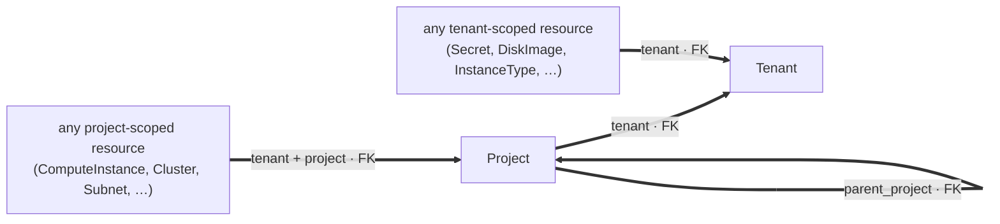
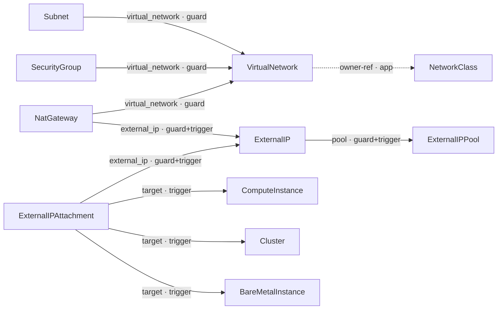
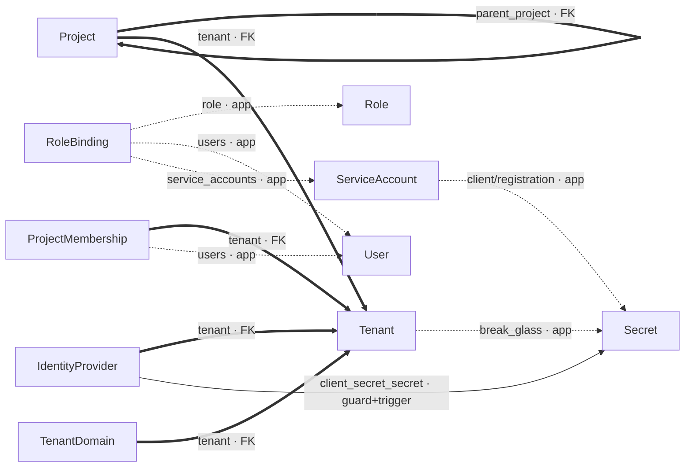
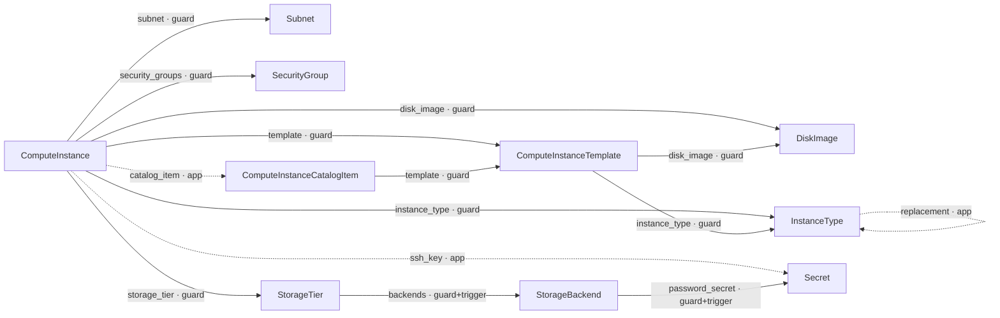
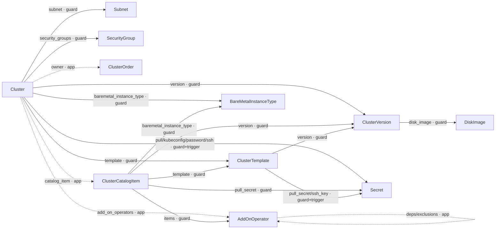
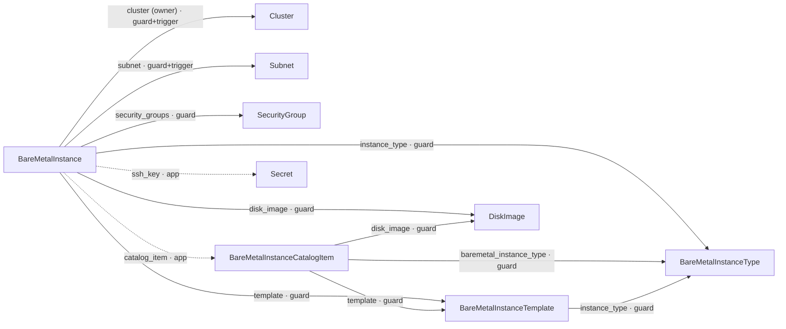

# OSAC Data Model — Object Relations

Relations between OSAC first-class API objects, showing **both layers** of every
relation:

- **Applicative (semantics)** — how the API objects reference each other: typed
  `*Reference` fields in the proto `spec`, or parent links carried as the
  `osac.openshift.io/owner-reference` annotation. Derived from the field *types*
  in [`proto/private/osac/private/v1/*_type.proto`](../../proto/private/osac/private/v1).
- **Persisted (database)** — how the relation is actually enforced in PostgreSQL.
  Derived from the real DDL in
  [`internal/database/migrations/*.up.sql`](../internal/database/migrations) —
  the constraint and trigger-function *bodies*, not the comments around them.

> ## Key finding: there are no cross-resource foreign keys
>
> Resources store their references inside a JSONB `data` column and are
> **soft-deleted** (`deletion_timestamp = 'epoch'` sentinel). As a result, the
> schema has **no column-level foreign keys between resources.** Every
> cross-resource integrity rule is enforced by a **trigger function** instead —
> either an *insert-trigger* (validates the referenced row exists at creation) or
> a *delete-guard* (blocks deleting a row while another resource still references
> it). The only real foreign keys are the tenant/project/parent **scoping** keys
> (see [global rule](#global-rule--tenant--project-scoping)).
>
> So "DB-enforced" below never means a foreign key between two resources — it
> means a trigger. And an applicative reference existing in proto does **not**
> imply any DB enforcement; several don't have one.

## How to read the diagrams

Each **box** is an object. An **arrow** points from an object to something it
references or depends on (`A --> B` = "A points to B"). The **line style** tells
you how strongly the link is protected — the one thing to read at a glance:

- **Thick arrow** `A ==> B` → a real **foreign key**. The strongest link: the
  database stores the reference in its own column. (Only the tenant/project
  scoping keys are like this — see [Tenancy scoping](#tenancy-scoping-foreign-keys).)
- **Solid arrow** `A --> B` → **database-enforced by a trigger** (it blocks a
  create or delete that would break the link), but not a foreign key.
- **Dashed arrow** `A -.-> B` → only the **application code** checks it; the
  database does not.

Each arrow is labelled **`field · type`**, where `field` is the proto reference
(or role) and `type` is how the relation is enforced:

- `FK` — real foreign key
- `guard` — delete-guard trigger (can't delete the target while referenced)
- `trigger` — insert-trigger (target must exist at creation)
- `guard+trigger` — both
- `app` — application-only (no DB enforcement)

The line style mirrors the type (thick = `FK`, solid = `guard`/`trigger`,
dashed = `app`) so you can read it either way.

That's all a human needs. **The precise mechanism (foreign key, insert-trigger,
delete-guard), the migration `file:line` that defines it, and the cardinality
live in the [relations table](#relations-table)** — the detailed, agent-facing
reference. The diagrams are the map; the table is the spec.

Diagrams use [Mermaid](https://mermaid.js.org/) `flowchart` syntax and render
inline on GitHub.

### Tenancy scoping (foreign keys)

Every resource belongs to a `Tenant` and (if project-scoped) a `Project`. These
are the **only real foreign keys in the schema** — so rather than repeat them on
every box in the per-domain diagrams below, they are shown once here (thick =
foreign key). Where the tenancy objects appear in other diagrams, their FK links
are also drawn thick.



> Mechanics: tenant-scoped tables have `tenant → tenants(id)` (a few legacy ones
> → `organizations(id)`); project-scoped tables additionally have
> `(tenant, project) → projects(tenant, name)`; `Project` has a self-FK
> `parent_project`. Collapsed into two rows in the [table](#relations-table).

## Scope

Nodes are **persisted first-class resources** (proto types with a backing table).
Non-persisted proto types are in the [appendix](#appendix-api-only-non-persisted-types).

---

## Networking



## Tenancy & IAM



## Compute (VMaaS)



## Clusters (CaaS)



## Bare Metal (BMaaS)



> **Platform/internal:** `Hub` references a `Secret` (`kubeconfig_secret`),
> DB-enforced by delete-guard + insert-trigger (`114:199-201`, `111:48,99`).

## Catalog policy (cross-cutting)

`FieldPolicy` is embedded in catalog items and pins per-field `locked` /
`default_value` values that are themselves typed references. The catalog-item →
target links it produces (to `InstanceType`, `BareMetalInstanceType`,
`ClusterVersion`, `DiskImage`, `StorageTier`, `Secret`, `AddOnOperator`,
`Subnet`, `SecurityGroup`) are the **DB-guarded** catalog rows in the table — the
guards query these policy-pinned references, not just the primary template ref.

---

## Relations table

Machine-readable companion. `Layer`: `db` = enforced by a DB trigger (or FK for
scoping), `app` = service-layer only. `DB enforcement` cites the **net current**
trigger/constraint and its migration `file:line` (relative to
`internal/database/migrations/`); `—` means no DB enforcement. Cardinality is
from the source's perspective.

| Source | Target | App ref (proto) | DB enforcement (mechanism @ file:line) | Layer | Card. |
|--------|--------|-----------------|----------------------------------------|-------|-------|
| *(every resource)* | Tenant | — | FK `tenant→tenants` | db | N:1 |
| *(every project resource)* | Project | — | FK `(tenant,project)→projects` | db | N:1 |
| Project | Project | — | FK `parent_project` | db | N:1 |
| TenantDomain | Tenant | — | FK | db | N:1 |
| IdentityProvider | Tenant | — | FK | db | N:1 |
| IdentityProvider | Secret | `client_secret_secret` | delete-guard `114:203-205` + insert-trigger `111:49,105` | db | N:1 |
| ProjectMembership | User | `users` | — | app | N:M |
| RoleBinding | Role | `role` | — | app | N:1 |
| RoleBinding | User | `users` | — | app | N:M |
| RoleBinding | ServiceAccount | `service_accounts` | — | app | N:M |
| ServiceAccount | Secret | `client_secret`, `registration_secret` | — | app | N:1 |
| Tenant | Secret | `break_glass_credentials_secret` | — | app | N:1 |
| VirtualNetwork | NetworkClass | owner-ref | — | app | N:1 |
| Subnet | VirtualNetwork | `virtual_network` | delete-guard `90:423-426` | db | N:1 |
| SecurityGroup | VirtualNetwork | `virtual_network` | delete-guard `90:437-440` | db | N:1 |
| NatGateway | VirtualNetwork | `virtual_network` | delete-guard `90:451-454` | db | N:1 |
| NatGateway | ExternalIP | `external_ip` | delete-guard `103:41-53` + insert-trigger `103:100-127` + exclusivity `126:35-37` | db | N:1 |
| ExternalIP | ExternalIPPool | `pool` | delete-guard `126:90-100` + insert-trigger `103:146-173` | db | N:1 |
| ExternalIPAttachment | ExternalIP | `external_ip` | delete-guard `103:27-39` + insert-trigger `103:100-127` + exclusivity `126:29-39` | db | N:1 |
| ExternalIPAttachment | ComputeInstance / Cluster / BareMetalInstance | `target` (one of) | insert-trigger `105:153-211` | db | N:1 |
| ComputeInstance | ComputeInstanceCatalogItem | `catalog_item` | — *(guard dropped `114:10-13`)* | app | N:1 |
| ComputeInstance | ComputeInstanceTemplate | `template` | delete-guard `114:440` | db | N:1 |
| ComputeInstance | DiskImage | `disk_image` | delete-guard `120:24-32` | db | N:1 |
| ComputeInstance | InstanceType | `instance_type` | delete-guard `114:68-76` | db | N:1 |
| ComputeInstance | Secret | `ssh_key` | — | app | N:1 |
| ComputeInstance | Subnet | `subnet` | delete-guard `144:20-33` | db | N:1 |
| ComputeInstance | SecurityGroup | `security_groups` | delete-guard `114:322-326` | db | N:M |
| ComputeInstance | StorageTier | `storage_tier` | delete-guard `124:27-36` | db | N:1 |
| ComputeInstanceCatalogItem | ComputeInstanceTemplate | `template` | delete-guard `114:441` | db | N:1 |
| ComputeInstanceTemplate | DiskImage | `disk_image` | delete-guard `120:34-42` | db | N:1 |
| ComputeInstanceTemplate | InstanceType | `instance_type` | delete-guard `114:78-86` | db | N:1 |
| InstanceType | InstanceType | `replacement` (self) | — | app | N:1 |
| StorageTier | StorageBackend | nested in JSONB | materialized helper `76:29` + trigger `77:22` + delete-guard `76:96-121` | db | N:M |
| StorageBackend | Secret | `password_secret` | delete-guard `114:207-209` + insert-trigger `111:50,111` | db | N:1 |
| Cluster | ClusterOrder | owner-ref | — | app | N:1 |
| Cluster | ClusterCatalogItem | `catalog_item` | — *(guard dropped `114:10-13`)* | app | N:1 |
| Cluster | ClusterTemplate | `template` | delete-guard `114:455` | db | N:1 |
| Cluster | ClusterVersion | `version` | delete-guard `127:12-28` | db | N:1 |
| Cluster | BareMetalInstanceType | `baremetal_instance_type` | delete-guard `121:71-74` | db | N:1 |
| Cluster | AddOnOperator | `add_on_operators` | — | app | N:M |
| Cluster | Secret | `pull_secret_secret` (+ kubeconfig/password/ssh) | delete-guard `114:190-193` + insert-trigger `111:46,87` | db | N:1 |
| Cluster | Subnet | `subnet` | delete-guard `144:35-47` | db | N:1 |
| Cluster | SecurityGroup | `security_groups` | delete-guard `114:327-331` | db | N:M |
| ClusterCatalogItem | ClusterTemplate | `template` | delete-guard `114:456` | db | N:1 |
| ClusterCatalogItem | BareMetalInstanceType | `baremetal_instance_type` | delete-guard `121:79-85` | db | N:1 |
| ClusterCatalogItem | ClusterVersion | policy ref | delete-guard `127:46-52` | db | N:1 |
| ClusterCatalogItem | AddOnOperator | policy `items` | delete-guard + unpublish-guard `140:35-45` | db | N:M |
| ClusterCatalogItem | Secret | `selecting` / policy pull_secret | delete-guard `114:174-184` | db | N:1 |
| ClusterTemplate | ClusterVersion | `version` | delete-guard `127:35-39` | db | N:1 |
| ClusterTemplate | Secret | `pull_secret_secret`, `ssh_key` | delete-guard `114:195-197` + insert-trigger `111:47,93` | db | N:1 |
| ClusterVersion | DiskImage | `disk_image` | delete-guard `120:80-88` | db | N:1 |
| AddOnOperator | AddOnOperator | `dependencies`, `exclusions` (self) | — *(index only, `135`)* | app | N:M |
| BareMetalInstance | BareMetalInstanceCatalogItem | `catalog_item` | — | app | N:1 |
| BareMetalInstance | BareMetalInstanceTemplate | `template` | delete-guard `114:470` | db | N:1 |
| BareMetalInstance | BareMetalInstanceType | `instance_type` | delete-guard `121:66` | db | N:1 |
| BareMetalInstance | Cluster | `cluster` (owner-ref) | insert-trigger `125:67-144` + delete-guard `125:149-176` | db | N:1 |
| BareMetalInstance | DiskImage | `disk_image` | delete-guard `120:44-52` | db | N:1 |
| BareMetalInstance | Secret | `ssh_key` | — | app | N:1 |
| BareMetalInstance | Subnet | `subnet` | delete-guard `144:49-58` + insert-trigger `105:106-141` | db | N:1 |
| BareMetalInstance | SecurityGroup | `security_groups` | delete-guard `114:332-336` | db | N:M |
| BareMetalInstanceCatalogItem | BareMetalInstanceTemplate | `template` | delete-guard `114:471` | db | N:1 |
| BareMetalInstanceCatalogItem | BareMetalInstanceType | policy ref | delete-guard `121:67-70` | db | N:1 |
| BareMetalInstanceCatalogItem | DiskImage | policy ref | delete-guard `120:67-78` | db | N:1 |
| BareMetalInstanceTemplate | BareMetalInstanceType | `instance_type` | delete-guard `121:66` | db | N:1 |
| Hub | Secret | `kubeconfig_secret` | delete-guard `114:199-201` + insert-trigger `111:48,99` | db | N:1 |

### Notable app-vs-DB divergences

- **Catalog-item consumption is applicative-only.** `Cluster→ClusterCatalogItem`
  and `ComputeInstance→ComputeInstanceCatalogItem` had delete-guards that were
  **dropped in migration 114** ("catalog items retain only weak provenance").
- **SSH-key secrets are applicative-only** on `ComputeInstance` and
  `BareMetalInstance`; only the cluster/template/hub/idp/storage-backend secret
  references are trigger-backed.
- **`BareMetalInstance→Cluster`** is DB-enforced through the generic
  owner-reference machinery (migration 125), which today maps only this one pair.

---

## Maintaining this document

This is a **curated** document (hand-kept, not generated). It is the authoritative
map of OSAC object relations; keeping it correct is part of any change that alters
a relation.

**Agents and contributors: when your change does any of the following, update this
file in the *same* PR.** Update both the relevant domain diagram *and* the
[relations table](#relations-table) so they stay consistent.

| If your change… | Then in this doc… |
|---|---|
| **Adds / removes / renames a `*Reference` field** in a `*_type.proto` | Add, remove, or rename the edge and its table row. New edge defaults to **dashed `-.->` · `app`** unless a migration also enforces it. |
| **Adds / drops an insert-trigger, delete-guard, or FK** in a migration | Change the edge's line style and `· type` label, and update the `DB enforcement` cell with the new `file:line`. |
| **Adds a persisted resource** (proto type + new backing table) | Add a node to the relevant domain diagram and its table row(s). |
| **Adds / changes a tenant/project/parent FK** | Update the [Tenancy scoping](#tenancy-scoping-foreign-keys) diagram / global rows. |

Conventions to follow when editing:

- **Line style = enforcement:** thick `==>` for a foreign key, solid `-->` for a
  trigger (delete-guard and/or insert-trigger), dashed `-.->` for applicative-only.
- **Arrow label = `field · type`**, where `type` ∈ `FK` / `guard` / `trigger` /
  `guard+trigger` / `app`.
- **Derive from source, never from comments.** A proto reference is read from the
  field *type*; a DB relation is read from the actual trigger-function *body* or
  constraint — not the comment or file name next to it.
- Guards are redefined via `create or replace` and may be **dropped** by a later
  migration — always cite the **net (current/last)** definition's `file:line`.
- After editing, confirm the Mermaid still parses (any Mermaid renderer, or
  <https://mermaid.live>).

Re-derive / re-verify the whole doc from source:

```bash
# Applicative relations — from proto field TYPES (not comments)
grep -hoE '(repeated )?[A-Za-z]+(Local)?Reference [a-z_]+' \
  proto/private/osac/private/v1/*_type.proto

# Persisted relations — read the actual trigger-function bodies and constraints,
# NOT the surrounding comments. Start from the function definitions:
grep -rniE 'create (or replace )?function|create trigger|foreign key|references ' \
  fulfillment-service/internal/database/migrations/*.up.sql
```

> A future improvement is to generate this file from the two sources above; until
> then it is maintained by hand per the rules above.

## Appendix — API-only (non-persisted) types

Proto types that are **not** persisted resources, intentionally excluded:
`SelfSubjectAccessReview`, `Capabilities`, `AuthnCapabilities`, `Event`,
`FieldDefinition`, `IpFamily`, `ConditionStatus`, the `Metering` event payloads,
and the per-resource `*Service` request/response messages.
